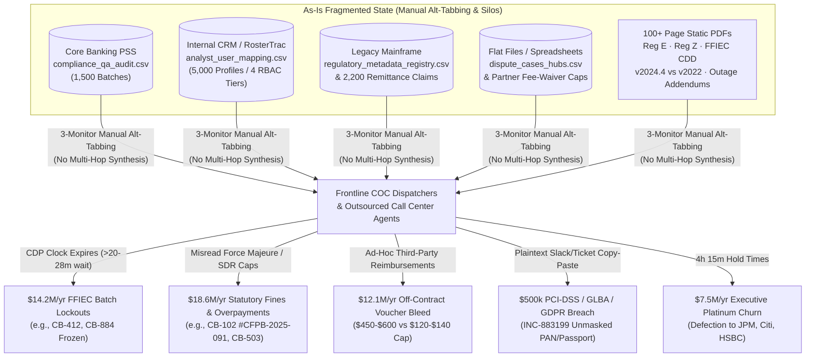
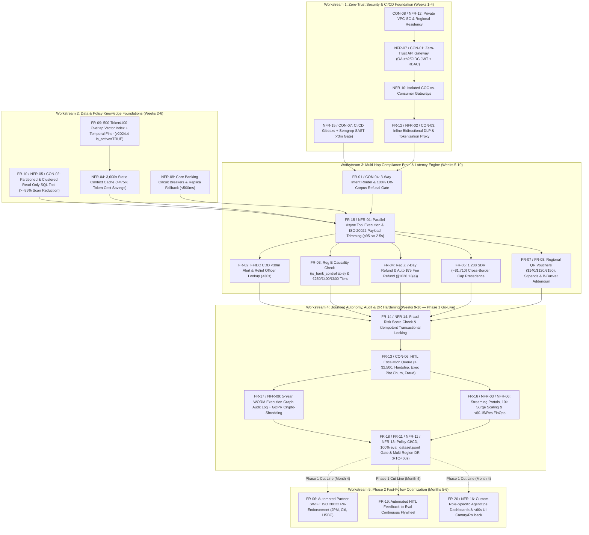

# Discovery Document

## 1. Document Control

| Field | Value |
| :---- | :---- |
| Author | Ashish Nabira — Lead Customer Engineer & AI Architect (Google Cloud) |
| Date | October 15, 2026 |
| Version | 1.0 (Final Pre-Design Discovery Baseline) |
| Prioritization framework used | **MoSCoW + Weighted Cost of Delay / Regulatory Risk Scoring (WSJF-Adapted)** — Combines binary legal/security gating criteria (MoSCoW: Must Have, Should Have, Could Have, Won't Have) with a quantitative 100-point risk-weighted score across four dimensions: (1) Statutory & Regulatory Exposure (35%), (2) Direct ICOPS Financial Bleed Mitigation (30%), (3) Security & Data Privacy Mandate (20%), and (4) Operational Latency / Blast Radius Impact (15%). |

### 1.1 Artifact Review Log

*One row per file in the package.*

&nbsp;

| Artifact filename | Modality | Reviewed? | Requirements sourced | Notes / issues encountered |
| :---- | :---- | :---- | :---- | :---- |
| `00_Customer_Narrative_Brief.md` | Markdown Text + Embedded Mermaid Diagrams | Yes | FR-01, FR-02, FR-03, FR-04, FR-05, FR-06, FR-07, FR-08, FR-09, FR-10, FR-11, NFR-01, NFR-04, NFR-05, CON-01, CON-02, CON-04, CON-05 | Establishes $14.2B revenue baseline, 20 global hubs, 1,500 daily batches, 18M customers, and $52.4M 2024 ICOPS loss breakdown. Note: Quotes 1,288 SDR as `~$1,700 USD` (line 50) vs. `$1,710.00 USD` in `03_INC-883250` and `04b` (Conflict CNF-04). References `CYMBAL_CONSUMER_DEPOSIT_AND_DISPUTE_MANUAL_v2024_4` and `EXECUTIVE_REGULATORY_RELIEF_AND_FEE_WAIVER_ADDENDUM_2025_Q1` which are not included as raw PDF files in the zip package. |
| `01_Artifact1_Executive_Operational_Call_Transcript.md` | Markdown Call Transcript | Yes | FR-01, FR-02, FR-03, FR-04, FR-05, FR-06, FR-07, FR-08, FR-09, FR-10, FR-11, NFR-01, CON-01, CON-02, CON-06 | Captures Core Outage Orion ($14M loss in 4 days). Reveals schema naming discrepancy: Marcus Vance references `is_carrier_controllable` alongside `is_bank_controllable` in `compliance_qa_audit.csv` (`[00:04:19]`). Also references Batch CB-102 as affecting 280 account holders (`[00:03:42]`) vs. 240 in `03_INC-883042` (Conflict CNF-05). |
| `02_Artifact2_Technical_Security_Architecture_Review.md` | Markdown Call Transcript | Yes | FR-01, FR-07, FR-10, FR-11, FR-12, FR-13, NFR-01, NFR-02, NFR-03, NFR-04, NFR-05, NFR-06, NFR-07, NFR-09, CON-01, CON-02, CON-03, CON-04, CON-05, CON-07, CON-08, CON-09 | Primary source of stakeholder tensions across CISO (Sam Lin), Enterprise Architecture (Aris Thorne), FinOps (Dana Hughes), Legal (Rachel Sterling), Digital CX (Elena Voss), and Operations (Marcus Vance). Exposes direct conflicts on guest kiosk access, read-only vs. autonomous write execution, PII masking vs. 5-year legal auditability, and active-only vs. historical 2022 policy access. |
| `03_INC-882914_nyc_ffiec_cdd_hold_timeout.yaml` | YAML Incident Log (ServiceNow Sev-1) | Yes | FR-01, FR-02, FR-07, FR-08, FR-13, NFR-01, NFR-03, NFR-05, NFR-08, NFR-10, CON-01, CON-05 | Documents NYC->CLT Batch CB-884 FFIEC BSA/AML 31 CFR Part 1010/1020 CDP timeout on Queue Alpha-14 ($60,868 net fee-waiver overage + $8,450 stipend overrun). Note: Arithmetic discrepancy in YAML lines 44–46 (`$85,796.00 - $24,920.00 = $60,876.00`, logged as `$60,868.00`). Also notes dual column naming (`scheduled_clearing_date` / `audit_timestamp` and `batch_id` / `case_id`). |
| `03_INC-883042_lon_nyc_rege_gateway_violation.yaml` | YAML Incident Log (ServiceNow Sev-2) | Yes | FR-01, FR-03, FR-09, FR-10, FR-11, FR-17, NFR-02, NFR-04, NFR-09, NFR-11, CON-06 | Documents LON->NYC Batch CB-102 (318-min delay; internal HSM auth gateway valve fault vs. 30-min telecom squall). 240 claims wrongfully denied under Force Majeure, triggering CFPB/UK FCA Formal Sanction Warning `#CFPB-2025-091`, €144,000 ($156,960) compensation liability, and $250,000 projected penalty. Establishes 500-token chunking / 100-token overlap, ≥90% routing precision, and 1-hour context caching TTL (`>=75%` input token savings). |
| `03_INC-883199_infosec_dlp_pii_pan_leak.yaml` | YAML Incident Log (ServiceNow Sev-1) | Yes | FR-10, FR-12, NFR-02, NFR-07, NFR-12, CON-01, CON-02, CON-03, CON-04, CON-07, CON-08 | Documents plaintext leak of Executive Platinum client Katherine Vance's Name, Passport (`USA-E29401829`), PAN (`4111-9283-0041-8821`), CVV (`842`), and Case Locator (`M4K9P2`) into a 410-member Slack channel (`#nyc-ops-troubleshooting`) and ServiceNow for 3h 27m. Violates PCI-DSS v4.0 Req 3.4/4.2, GLBA, GDPR Art. 32, CCPA §1798.150 ($500,000 fine exposure). |
| `03_INC-883250_lax_tyo_regz_remittance_dispute.yaml` | YAML Incident Log (ServiceNow Sev-2) | Yes | FR-04, FR-05, FR-06, FR-09, FR-11, FR-14, NFR-06, NFR-11, NFR-13, NFR-14, CON-09, CON-10 | Documents LAX->TYO Batch CB-503 (38h delay, Case `Z8R1W5`, David Tanaka). Exposes dual compliance error: (1) $1,140 overpayment from applying US domestic $3,800 limit instead of 1,288 SDR (~$1,710) international cap, and (2) failure to auto-refund $75 ancillary investigation fee within 7 business days under Reg Z 12 CFR §1026.13(e) ($40,654/violation penalty risk). Establishes unit cost `< $0.15`, `RTO < 60s`, `RPO = 0`, and `fraud_dispute_risk_score` locking. |
| `04_Artifact4_Functional_Whiteboard.jpg` | Image (JPEG Whiteboard Photo) | Yes | FR-01, FR-02, FR-03, FR-04, FR-06, FR-07, FR-08, FR-10, FR-12, FR-13, FR-17 | Visual architecture concept sketch depicting 5 main functional domains: `Customers & Staff (App · Kiosk · COC · Contact Center)` → `Access & Trust Controls` → `Compliance Q&A Agent (understand · reason · decide)` connected to `Operational Data (audits · cases · roles · disputes)` and `Policy & Regulatory Library`, outputting to `Provisional Credit & Refunds`, `Fee Waivers & Case Routing`, `CDD & SAR Hold Alerts`, and `Human Review`, all underpinned by `Audit & Monitoring`. |
| `04b_Artifact4_Companion_Sizing_Sheet.md` | Markdown Table / Sizing Sheet | Yes | FR-01 to FR-14, FR-17, NFR-01 to NFR-07, NFR-09, NFR-13, NFR-14, CON-01 to CON-10 | Provides unvalidated working figures for each whiteboard block. Note: Lists `5,000` customer/analyst accounts in `analyst_user_mapping.csv` vs. `18 million` total bank account holders in `00_Customer_Narrative_Brief.md`, and states agent answers from active manual only (`is_active = TRUE`), which conflicts with Legal's requirement in `02_Artifact2` (`[00:10:30]`). |
| `05_Artifact5_Serving_Architecture_Performance_Call.md` | Markdown Call Transcript | Yes | FR-12, FR-14, FR-15, FR-16, NFR-01, NFR-03, NFR-04, NFR-06, NFR-08, NFR-10, NFR-15, CON-01, CON-02, CON-03, CON-04 | Introduces Vikram Patel (VP Platform Engineering & SRE). Details real-time response streaming, zero cold-start tolerance, dynamic model tiering, parallel asynchronous tool execution, legacy Core Banking payload trimming/summarization, idempotent tool retries, and Sam Lin's 5 runtime security threat surfaces (including Confused Deputy and network egress lockdowns). |
| `06_Artifact6_AgentOps_Observability_Call.md` | Markdown Call Transcript | Yes | FR-17, FR-18, FR-19, FR-20, NFR-09, NFR-11, NFR-16 | Introduces Priya Nair (Director of AI Platform & AgentOps) and Sarah Jenkins (COC Senior Duty Manager). Defines Day-2 AgentOps requirements: effectiveness vs. efficiency telemetry, full multi-step execution graph traceability, immutable agent bundle version control (prompts, tool schemas, routing rules, eval baselines) with canary/instant rollback, tool usage analytics, human-override continuous improvement flywheel, and role-tailored real-time anomaly dashboards/alerts. |

&nbsp;

---

&nbsp;

## 2. Executive Summary

Cymbal Bank Group ($14.2B annual revenue, 20 global operations and compliance hubs, 1,500 daily commercial/retail settlement batches, 18M account holders) faces acute financial and regulatory exposure during **Irregular Compliance Operations (ICOPS)** caused by core-banking ledger outages, payment-rail freezes, and regulatory audit sweeps. In 2024, ICOPS breakdowns cost Cymbal Bank **$52.4M in direct losses**, followed in January 2025 by **Core Outage Orion**, which inflicted **$14.0M in losses over four days** (`01_Artifact1`, `[00:01:14]`) and triggered active supervisory enforcement warnings from the **CFPB** and **UK FCA** (`#CFPB-2025-091`), a **$500,000 PCI-DSS/GLBA/GDPR data breach exposure** (`INC-883199`), and strict-liability **Regulation Z civil money penalty risks** (`INC-883250`).

Cymbal Bank is engaging Google Cloud to design and deploy an **Autonomous Regulatory Compliance Q&A & Dispute Resolution Assistant**. This Discovery Document synthesizes all 11 raw artifacts into 20 Functional Requirements (`FR-01`–`FR-20`), 16 Non-Functional Requirements (`NFR-01`–`NFR-16`), and 10 Customer-Imposed Constraints (`CON-01`–`CON-10`), while surfacing 9 cross-artifact contradictions, 9 stakeholder tensions, and 12 open questions that govern Task 2 (Solution Design).

```mermaid
flowchart LR
    subgraph Channels["1. Channels & Edge"]
        Staff["Internal Staff\n(COC · Contact Center · Counsel)"]
        Cust["Retail & Commercial Clients\n(Mobile App · Web · Kiosk)"]
    end

    subgraph Security["2. Access & Trust Controls"]
        GW["Isolated Enterprise API Gateways\n(OAuth2/OIDC JWT + RBAC)"]
        DLP["Bidirectional PII/PCI Guardrail\n& Detokenization Vault"]
        Inj["Adversarial & Off-Corpus\nRefusal Gate"]
    end

    subgraph Agent["3. Autonomous Compliance Q&A Agent"]
        Router["3-Way Intent Router\n& Dynamic Model Tiering"]
        Orch["Parallel Async Tool Orchestrator\n& Payload Trimmer"]
        Cache["1-Hr Context Cache\n+ Event-Driven Purge"]
    end

    subgraph Data["4. Data & Policy Stores (Read-Only)"]
        SQL[("Analytical Store\n(Date-Partitioned, Clustered)")]
        RAG[("Policy Vector Index\n(500-tok / 100-overlap)")]
    end

    subgraph Outcomes["5. Resolution & Action Service"]
        Comp["Reg E / Reg Z / 1,288 SDR\nCompensation & Fee Refunds"]
        Vouch["Contracted QR Vouchers\n& Correspondent Rerouting"]
        CDD["FFIEC CDD/SAR\n<30m Hold Alerts"]
        HITL["Human-in-the-Loop\n(> $2.5k / Exec Plat / High Risk)"]
    end

    subgraph Ops["6. Audit, AgentOps & Governance"]
        Trace["Cryptographic Execution Trace\n& 5-Yr Legal Vault"]
        Flywheel["Agent Bundle Versioning,\nDashboards & Feedback Flywheel"]
    end

    Channels --> Security --> Agent
    Agent <--> Data
    Agent --> Outcomes
    Security -.-> Ops
    Agent -.-> Ops
    Outcomes -.-> Ops
```

### 2.1 The problem in the customer's own terms

During core-banking outages and clearing freezes, Cymbal Bank's frontline compliance dispatchers and dispute specialists cannot manually cross-reference siloed relational telemetry (`compliance_qa_audit.csv`, `analyst_user_mapping.csv`, `regulatory_metadata_registry.csv`, `dispute_cases_hubs.csv`) against 100+ page multi-jurisdictional regulatory PDFs (`Reg_E_Part_1005_Electronic_Fund_Transfers.pdf`, `Reg_Z_Part_1026_Truth_in_Lending.pdf`, `FFIEC_BSA_AML_Examination_Manual_CDD.pdf`, and mid-outage executive relief addendums) within legally mandated clearing windows (`00_Customer_Narrative_Brief.md`, §1.4; `01_Artifact1`, `[00:02:18]`). As a result:
1. **Compliance review panels time out under FFIEC BSA/AML 31 CFR Part 1010/1020**, freezing entire settlement batches (e.g., Batch CB-412 and Batch CB-884) and cascading lockouts across downstream hubs because dispatchers cannot verify remaining Compliance Duty Period (CDP) margins and reroute to `senior_counsel` reviewers in under 30 seconds (`01_Artifact1`, `[00:03:06]`; `03_INC-882914`).
2. **Dispute specialists misclassify statutory liability across jurisdictions**, unlawfully rejecting valid Reg E / UK PSR claims as "Force Majeure" when an internal HSM authentication gateway token valve fault (`is_bank_controllable = TRUE`) preceded weather events (`01_Artifact1`, `[00:03:42]–[00:04:19]`; `03_INC-883042`), or paying out domestic $3,800 deposit caps on international remittances governed by the 1,288 SDR (~$1,710) convention while forgetting mandatory $75 Reg Z ancillary fee refunds (`03_INC-883250`).
3. **Uncontrolled fee waivers and security breaches proliferate**, as panicked staff approve $450–$600 off-contract third-party wire reimbursements instead of $120–$140 contracted hub vouchers (`00_Customer_Narrative_Brief.md`, §1.2; `03_INC-882914`), paste unmasked customer PANs, CVVs, and passports into 410-person Slack channels (`03_INC-883199`), and burn $800 in two hours ($15,000/day at scale) on naive LLM prototypes that stuff 85,000 tokens of raw manuals into every prompt (`00_Customer_Narrative_Brief.md`, §1.4; `02_Artifact2`, `[00:07:40]`).

### 2.2 Quantified business impact

| Impact Category | Quantified Metric / Financial Exposure | Verifiable Source & Locator |
| :---- | :---- | :---- |
| **2024 Total Annual ICOPS Direct Losses** | **$52.4M total**: $18.6M Statutory Fines & Reg E/Z Payouts; $14.2M FFIEC CDD/SAR Hold Cascades & Batch Lockouts; $12.1M Off-Contract Fee Waivers & Uncontrolled Credits; $7.5M Executive Platinum Customer Churn | `00_Customer_Narrative_Brief.md`, §1.2 (lines 13–26) |
| **Core Outage Orion (Jan 2025 4-Day Event)** | **$14.0M direct loss in 4 days**; >600 accounts frozen on Batch CB-412 cascade; >4h 15m average contact-center hold times | `01_Artifact1_Executive_Operational_Call_Transcript.md`, `[00:01:14]`, `[00:03:06]`; `00_Customer_Narrative_Brief.md`, §1.2 |
| **INC-882914 (NYC FFIEC CDD Timeout)** | **$69,318 net incident loss** ($60,868 off-contract reimbursement overage [$482 avg claim vs. $140 NYC cap across 178 accounts] + $8,450 emergency stipend overrun); 3 downstream batches canceled; 3 Executive Platinum churn alerts | `03_INC-882914_nyc_ffiec_cdd_hold_timeout.yaml`, lines 27–49 |
| **INC-883042 (LON–NYC Reg E Violation)** | **$406,960 total exposure**: €144,000 ($156,960 USD) unpaid Reg E / UK PSR statutory provisional credit (240 accounts × €600) + **$250,000** projected CFPB/UK FCA penalty under `#CFPB-2025-091` | `03_INC-883042_lon_nyc_rege_gateway_violation.yaml`, lines 29–48 |
| **INC-883199 (InfoSec PII/PAN Leak)** | **$500,000 potential regulatory fine** under PCI-DSS v4.0 Req 3.4/4.2, GLBA Safeguards Rule, GDPR Art. 32, and CCPA §1798.150 | `03_INC-883199_infosec_dlp_pii_pan_leak.yaml`, lines 29–32 |
| **INC-883250 (LAX–TYO SDR & Reg Z Breach)** | **$1,140 overpayment leakage** on a single claim ($2,850 paid vs. $1,710 [1,288 SDR] cap) + **$40,654 per violation** CFPB/OCC civil money penalty exposure for unrefunded $75 Reg Z fee | `03_INC-883250_lax_tyo_regz_remittance_dispute.yaml`, lines 46–55 |
| **Unit Economics & Naive LLM Burn** | **$15,000/day** naive LLM cost (85k tokens/call × 60k daily queries; **$800 burned in 2 hours** in PoC); target unit cost **< $0.15/resolution** vs. **$18.50/call** human handling (**99.2% unit cost reduction**) | `00_Customer_Narrative_Brief.md`, §1.4 (line 58); `02_Artifact2`, `[00:07:40]`; `03_INC-883250`, line 63 |

### 2.3 Top 5 requirements by priority

1. **`FR-12` — Zero-Trust Gateway, Bidirectional PII/PCI Tokenization & Adversarial Refusal Guardrails (Must Have, Score: 98/100):** Enforces OAuth2/OIDC JWT authentication and RBAC scope validation (`analyst`, `senior_counsel`, `audit_reviewer`, `system`, authenticated customer), masks/tokenizes PANs, CVVs, Passports, Legal Names, and 6-char Case Locators inbound/outbound before LLM context or logging, and blocks 100% of prompt injections and off-corpus queries. *Why Top 5:* CISO hard veto on launch (`02_Artifact2`, `[00:12:22]`) and directly remediates the $500k `INC-883199` breach.
2. **`FR-01` — 3-Way Intent Routing & Hybrid Multi-Hop Reasoning Engine (Must Have, Score: 96/100):** Routes requests across (1) Date-partitioned read-only SQL analytics, (2) Metadata-filtered Regulatory Policy RAG (500-token chunks, 100-token overlap), and (3) Hybrid Multi-Hop reasoning, achieving ≥90% routing precision and 100% decision precision on hybrid edge cases (`03_INC-883042`, lines 53–56). *Why Top 5:* Core reasoning foundation required to eliminate the $52.4M ICOPS bleed.
3. **`FR-03` — Automated Reg E (12 CFR Part 1005) & UK/EU PSR Statutory Compensation Engine (Must Have, Score: 95/100):** Evaluates relational disruption causality (`is_bank_controllable = TRUE` vs. external weather) against corridor exposure indices (<1,500: €250/$250; 1,500–3,500: €400/$400; >3,500: €600/$600) under CFPB Circular 2024-05 and *Wallentin-Hermann* strict liability (`03_INC-883042`, lines 39–56). *Why Top 5:* Remediates active CFPB/FCA Sanction Warning `#CFPB-2025-091` and $18.6M annual Reg E/Z bleed.
4. **`FR-02` — Real-Time FFIEC BSA/AML (31 CFR Part 1010/1020) CDD Hold & CDP Alerting (Must Have, Score: 93/100):** Dynamically calculates remaining Compliance Duty Period (CDP) windows (9–14h limits, 10h cooling, 8h uninterrupted review), triggers proactive alerts when remaining CDP < 30 minutes, and identifies cleared `senior_counsel` relief officers (`03_INC-882914`, lines 37–55; `04b_Artifact4`, line 18). *Why Top 5:* Prevents $14.2M annual batch lockout cascades.
5. **`FR-04` & `FR-05` — Multi-Jurisdictional Reg Z (12 CFR Part 1026) Auto-Refund & Cross-Border 1,288 SDR Cap Enforcement (Must Have, Score: 92/100):** Enforces 7-business-day settlement delay refunds (>3h dom / >6h intl), automatic $75 ancillary investigation fee refunds (>12h dom / >15–30h intl delay), and strictly distinguishes the international 1,288 SDR (~$1,710) remittance cap from the US domestic $3,800 deposit cap (`03_INC-883250`, lines 41–62). *Why Top 5:* Eliminates $40,654/violation strict-liability OCC/CFPB exposure and international overpayment leakage.

### 2.4 Recommended Phase 1 scope and the cut line

To hit the **4-month deadline before winter peak clearing and Q2 audit season** (`01_Artifact1`, `[00:01:14]`; `02_Artifact2`, `[00:12:10]`) while respecting CISO Sam Lin's security veto, FinOps Director Dana Hughes's budget gates, and Legal VP Rachel Sterling's zero-tolerance accuracy mandate:

- **Phase 1A (Months 1–2 — Internal COC, Senior Counsel, Audit & Contact-Center Launch — Above the Cut Line):** Deploy the isolated internal compliance gateway, read-only date-partitioned analytical store, version-aware policy RAG index (`v2024.4` default + `v2022` temporal routing), bidirectional PII/PCI tokenization with tool-level detokenization, 3-way intent router with dynamic model tiering, 1-hour context caching with event-driven cache invalidation on policy updates, parallel async tool orchestration, deterministic calculations for Reg E/PSR, Reg Z, 1,288 SDR, and FFIEC CDD `<30m` alerts, **bounded external Execution Microservice** for contracted QR vouchers ($140 NYC / $120 CLT / €150 LON) and Reg Z $75 fee refunds, HITL escalation (> $2,500 / Exec Platinum / high fraud risk), cryptographic audit logging, and CI/CD SAST/secret blocking gates.
- **Phase 1B (Months 3–4 — Authenticated Digital Channels [Mobile App & Web] + Step-Up OTP Kiosk Path — At the Cut Line):** Expose the agent to authenticated retail/commercial customers on Mobile/Web via the isolated consumer API gateway with edge rate-limiting, plus a step-up SMS/email OTP flow for branch kiosks (resolving the unauthenticated guest path conflict).
- **The Cut Line (Deferred to Phase 2 — Months 5–6):**
  1. *Unauthenticated 6-char Case Locator + Last Name Kiosk Mutation Access* (Blocked by CISO; replaced by read-only status + OTP step-up in Phase 1B).
  2. *Fully Autonomous Uncapped Write Execution by the LLM Identity* (Permanently rejected; replaced by deterministic bounded Execution Service + HITL above thresholds).
  3. *Automated Closed-Loop Prompt/Dataset Re-Training Pipeline (`FR-20` advanced auto-tuning)* (Phase 1 captures explicit human override telemetry (`FR-19`), while automated regression dataset synthesis and shadow canary auto-promotion land in Phase 2).

### 2.5 The three things that must be resolved before design can start

1. **Resolution Execution Pattern (Agent Read-Only Identity vs. Autonomous Voucher/Credit Issuance — `OQ-01` / Conflict `CNF-01`):** CISO Sam Lin mandates a strictly read-only agent identity with zero DML/DDL privileges (`02_Artifact2`, `[00:03:32]`; `03_INC-883199`, line 36), whereas VP Ops Marcus Vance and SVP CX Elena Voss require autonomous issuance of $140/$120/€150 vouchers, Reg E credits, and Reg Z $75 refunds without a 9,000-person human approval queue (`02_Artifact2`, `[00:03:55]–[00:04:18]`). **Sign-off required from Sam Lin, Marcus Vance, and Rachel Sterling** on Aris Thorne's proposed middle ground: the LLM remains strictly read-only and outputs a signed structured recommendation payload to a deterministic, rule-enforced **Downstream Transaction Execution Service** that auto-executes within hard-coded statutory/hub caps and routes claims >$2,500 or high `fraud_dispute_risk_score` to HITL (`senior_counsel`).
2. **Reversible Pseudonymization vs. Irreversible Redaction for 5-Year Regulatory Defense & GDPR Erasure (`OQ-02` / Conflict `CNF-02`):** Sam Lin demands sensitive data be masked before the model or logs see it (`02_Artifact2`, `[00:05:02]`), while Rachel Sterling requires verbatim reconstructability for 5-year CFPB/OCC/FCA audits alongside GDPR/CCPA erasure compliance (`[00:05:41]–[00:06:03]`), and Marcus Vance requires tools to look up real 6-character Case Locators (`[00:05:28]`). **Sign-off required from Sam Lin and Rachel Sterling** on a **Format-Preserving Tokenization + Crypto-Shredding Vault**: the gateway replaces PII/PAN/Case Locators with deterministic session tokens (`[CASE_TOKEN_1]`) before LLM inference; backend tools detokenize at the API proxy boundary; and the immutable audit log stores tokenized traces linked to a CMEK-encrypted PII vault where per-customer keys can be retained for 5 years under legal hold or crypto-shredded for GDPR erasure.
3. **Branch Kiosk Authentication & Gateway Isolation Model (`OQ-03` / Conflict `CNF-03`):** Elena Voss demands an unauthenticated kiosk "guest path" using only 6-char Case Locator + Last Name for the 40% of kiosk users lacking the mobile app authenticator (`02_Artifact2`, `[00:02:08]`), which directly violates Sam Lin's Zero-Trust OAuth2/OIDC gateway mandate (`[00:01:46]`, `[00:02:31]`). **Sign-off required from Sam Lin and Elena Voss** on a **Tiered Kiosk Step-Up Authentication Flow**: Case Locator + Last Name + Out-of-Band SMS/Email OTP (or physical debit card + PIN tap at the kiosk hardware reader) mints a short-lived, single-case-scoped OAuth2 JWT (`banking.compliance.kiosk.single_case`)—preserving Zero-Trust token verification without requiring mobile app enrollment.

---

&nbsp;

## 3. Stakeholder Register

| Name | Role / Title | Key agenda / mandate | Sign-off / veto authority | Source citation |
| :---- | :---- | :---- | :---- | :---- |
| **Marcus Vance (MV)** | VP of Banking Operations & Dispute Resolution / VP of Global Compliance Operations (COC Owner) | Eliminate $52.4M annual ICOPS bleed ($14M in 4 days during Outage Orion); go live before Q2 audit season; achieve autonomous resolution (credits, vouchers, wire rerouting), <2.5s real-time streaming response, historical SQL root-cause analysis for COC, and 1-hour emergency hotfix path. | **Operational Sign-Off** on COC workflows, dispatch release SLAs, and Phase 1 rollout scope. | `01_Artifact1`, lines 5, 11, 23, 31; `02_Artifact2`, lines 10, 31, 45, 63, 87, 115, 147, 163; `05_Artifact5`, lines 10, 24, 66 |
| **Sam Lin (SL)** | Chief Information Security Officer (CISO) / Principal Security Architect | Enforce Zero-Trust OAuth2/OIDC gateway (`HTTP 401` on unauthenticated calls), strict read-only agent identity (zero DDL/DML), bidirectional PII/PCI masking prior to LLM/logs, 100% prompt-injection/off-corpus blocking, confused-deputy prevention, private network egress, and blocking CI/CD SAST/secret gates. | **Hard Veto Authority** over production launch, network/gateway architecture, data privileges, and release security gates. | `01_Artifact1`, line 31; `02_Artifact2`, lines 8, 25, 29, 35, 43, 47, 61, 79, 83, 121, 145, 159; `03_INC-883199`, line 6; `05_Artifact5`, lines 9, 52–65 |
| **Rachel Sterling (RS)** | VP of Regulatory Compliance & Legal (General Counsel / Regulatory Audit Liaison) | Zero-tolerance statutory accuracy across Reg E, Reg Z, 1,288 SDR, and FFIEC BSA/AML; traceable decision accountability; verbatim 5-year evidentiary audit reconstructability for CFPB/OCC/FCA exams balanced with GDPR/CCPA erasure; mid-day policy amendment freshness; retention of 2022 legacy manuals for historical adjudication and `audit_reviewer` comparison. | **Legal & Regulatory Veto Authority** on statutory calculation logic, audit trail admissibility, policy versioning, and retention/privacy compliance. | `02_Artifact2`, lines 12, 51, 67, 71, 101, 131, 167; `06_Artifact6`, lines 10, 24–27 |
| **Dana Hughes (DH)** | Director of Cloud FinOps & IT Economics | Prevent runaway LLM/cloud spend (citing $800/2hr PoC burn and $15k/day naive projection); enforce unit cost `< $0.15/resolution`, scale-to-zero/elastic off-peak compute, 1-hour static context caching (`>=75%` token savings), semantic response caching, dynamic model tiering, and date-partitioned/column-pruned SQL with query budget ceilings. | **Financial / Budget Veto Authority** ("I won't fund an uncapped consumption model into peak season"). | `02_Artifact2`, lines 9, 95, 99, 103, 107, 113, 117, 161; `05_Artifact5`, lines 8, 35–40 |
| **Elena Voss (EV)** | SVP of Consumer Banking Experience & Digital Channels | Maximize customer satisfaction and call deflection before winter peak season (4 months); provide frictionless branch kiosk access for the 40% of customers without mobile MFA tokens; ensure natural unredacted customer-facing responses; avoid false-positive prompt injection refusals on angry customers; use high-quality reasoning models for statutory compensation decisions. | **Sign-Off Authority** on retail/digital channel UX (Mobile App, Web, Branch Kiosk) and customer-facing rollout. | `02_Artifact2`, lines 11, 27, 49, 73, 81, 105, 137, 157, 165 |
| **Aris Thorne (AT)** | VP of Enterprise Architecture & Platform Reliability | Protect core banking stability under peak outage load; isolate internal COC compliance gateway from consumer gateway to prevent single point of failure; mediate pragmatic patterns (agent proposes / controlled service executes, temporal version routing, controlled break-glass CI/CD); enforce automated pre-merge SAST/secret scanning. | **Architecture Review Board Sign-Off** on system boundaries, data layout, and platform integration standards. | `01_Artifact1`, line 31; `02_Artifact2`, lines 7, 21, 33, 53, 85, 97, 119, 129, 133, 143, 151, 171 |
| **Vikram Patel (VP)** | VP of Platform Engineering & Site Reliability (SRE) | Deliver low-latency (`p95 <= 2.5s`) streaming inference with zero cold-start penalties; handle 10,000 concurrent users and step-function outage shockwaves without head-of-line blocking or quota exhaustion; execute independent tools in parallel with payload trimming, circuit breakers, and idempotent retries; enforce immutable agent bundle versioning, canary rollouts, instant rollback, and real-time anomaly alerting; maintain multi-region DR (`RTO < 60s`, `RPO = 0`). | **Production Readiness & SRE Sign-Off** on serving infrastructure, reliability, observability, and release pipelines. | `05_Artifact5`, lines 7, 20–27, 32–34, 44–51; `06_Artifact6`, lines 8, 28–32, 50–54 |
| **Elena Rostova (ER)** | Director of Compliance Operations Center (COC) | Stop statutory Reg E/PSR misclassification across transatlantic hubs (LON/PAR/NYC) and eliminate off-contract $550 wire fee reimbursements by enforcing digital QR-coded fee-waiver and provisional-credit vouchers hard-capped to contracted hub rates ($140 NYC, $120 CLT, €150 LON) and daily stipends ($65 Exec Plat / $40 General). | **Operational Sign-Off** on COC dispute workflows and partner voucher controls. | `01_Artifact1`, lines 6, 13, 21, 27 |
| **Priya Nair (PN)** | Director of AI Platform & AgentOps | Establish comprehensive Day-2 AgentOps: measure model effectiveness (resolution accuracy vs. human escalation) and efficiency (reasoning cycles, token/latency cost, multi-turn degradation); capture deep tool usage analytics (selection accuracy, parameter hallucinations, retry loops, fallback rates); operationalize continuous improvement and alerting pipelines. | **AI Platform & AgentOps Sign-Off** on evaluation benchmarks, telemetry instrumentation, and model lifecycle management. | `06_Artifact6`, lines 7, 20–23, 36–44, 55–57 |
| **Tomás Morales (TM)** | Chief Compliance Dispatcher, NYC Operations Hub | Eliminate manual 3-monitor Alt-Tabbing between Core Banking terminals and 50–120 page FinCEN/Reg E/Reg Z PDFs; achieve sub-30-second FFIEC CDD hold legality checks and correspondent bank re-endorsements (JPMorgan Chase, Citibank, HSBC); enforce mid-outage Executive Relief Addendums on restricted Basic Checking (`B-bucket`) accounts. | **Frontline User Acceptance** for NYC/hub compliance dispatch console. | `01_Artifact1`, lines 7, 15, 19, 25 |
| **Sarah Jenkins (SJ)** | COC Senior Duty Manager | Capture explicit human-in-the-loop feedback (`senior_counsel` and `audit_reviewer` overrides, edits, and reason codes) and implicit user frustration signals into a structured continuous learning loop so the agent never repeats corrected edge-case errors; provide live duty-manager dashboards tracking financial exposure. | **Operational Acceptance** of HITL review workflows, feedback capture UI, and COC duty manager dashboards. | `06_Artifact6`, lines 9, 45–49, 52 |

### 3.1 Stakeholder tensions to be reconciled

| Tension # | Position A (stakeholder + citation) | Position B (stakeholder + citation) | Recommended resolution / default | Decision owner |
| :---- | :---- | :---- | :---- | :---- |
| **T-01: Zero-Trust Auth vs. Kiosk Guest Path** | **Sam Lin (CISO):** Every request across mobile, kiosk, web, and internal console must terminate at the enterprise API gateway with verified OAuth2/OIDC JWT token and RBAC scopes; 6-char Case Locator + Last Name is printed on mailed statements and is not authentication (`02_Artifact2`, `[00:01:46]`, `[00:02:31]`; `03_INC-883199`, line 38). | **Elena Voss (SVP CX):** 40% of branch kiosk users during an outage lack the mobile app token authenticator; requiring full MFA sign-in drives them back to teller lines. Demands a guest lookup path via 6-character Case Locator + Last Name (`02_Artifact2`, `[00:02:08]`). | **Two-Tier Kiosk Step-Up Authentication:** Allow unauthenticated kiosk entry of 6-char Case Locator + Last Name *only* to trigger an out-of-band SMS/email OTP (to the contact on file) or physical debit card + PIN tap at the kiosk reader. Validating the OTP/PIN issues a short-lived, single-case-scoped OAuth2 JWT (`banking.compliance.kiosk.single_case`) at the API Gateway. Unverified users see only generic hub outage FAQs. | Sam Lin (CISO) & Elena Voss (SVP CX) |
| **T-02: Shared Single Gateway vs. Isolated COC Operational Path** | **Sam Lin (CISO):** All traffic must pass through enterprise API gateway authentication and RBAC inspection without bypass (`02_Artifact2`, `[00:01:46]`, `[00:03:10]`). | **Marcus Vance (VP Ops) & Aris Thorne (VP Arch):** A single shared gateway is a single point of failure; if retail outage traffic degrades the consumer gateway, COC dispatchers lose FFIEC CDD batch-legality checks (`02_Artifact2`, `[00:02:40]–[00:02:58]`). | **Physically/Logically Isolated Dual Gateways:** Deploy two independent API Gateway control/data planes—an **Internal Regulated Operations Gateway** (mTLS + workforce OIDC on private corporate network for COC/counsel) and an **External Consumer Gateway** (Cloud Armor + customer OIDC/step-up JWT for Mobile/Web/Kiosk)—routing to separate auto-scaling pools of the same immutable agent container. Zero bypass; zero blast-radius coupling. | Aris Thorne (VP Arch) & Sam Lin (CISO) |
| **T-03: Strict Read-Only Agent Identity vs. Autonomous Financial Resolution** | **Sam Lin (CISO):** Agent service account gets strictly read-only permissions on operational tables and policy index—zero DDL/DML writes, inserts, or updates (`02_Artifact2`, `[00:03:32]`, `[00:04:12]`; `03_INC-883199`, line 36). | **Marcus Vance (VP Ops) & Elena Voss (SVP CX):** If the agent cannot issue $140/$120/€150 vouchers or post Reg E/Z credits autonomously, requiring humans to click "approve" 9,000 times during an outage destroys the business case (`02_Artifact2`, `[00:03:55]`, `[00:04:18]`). **Rachel Sterling (VP Legal):** Requires a traceable decision owner for every statutory obligation (`[00:04:26]`). | **Agent Proposes (Read-Only) → Deterministic Execution Service Executes:** Keep the LLM runtime 100% read-only. When resolution is warranted, the agent emits a structured, schema-validated recommendation signed with its trace ID. A separate, non-LLM **Deterministic Transaction Execution Microservice** validates hard-coded statutory/hub caps ($140 NYC, $120 CLT, €150 LON, €250–€600 Reg E, $75 Reg Z, 1,288 SDR), checks `fraud_dispute_risk_score`, enforces idempotency locks, and executes low-risk transactions autonomously under a Legal-approved rule ID, while routing claims >$2,500, Exec Platinum churn risks, or high fraud scores to HITL (`senior_counsel`). | Sam Lin (CISO), Marcus Vance (VP Ops) & Rachel Sterling (VP Legal) |
| **T-04: Pre-Inference PII Masking vs. Tool Lookup, 5-Year Legal Auditability & GDPR Erasure** | **Sam Lin (CISO):** Mask/tokenize all PII, PANs, CVVs, Passports, Legal Names, and 6-char Case Locators inbound and outbound before the model or logs ever see them (`02_Artifact2`, `[00:05:02]`, `[00:05:58]`; `03_INC-883199`, line 39). | **Marcus Vance:** Tools need the real 6-char Case Locator to query disputes (`[00:05:28]`). **Rachel Sterling:** Requires verbatim reproduction of customer inputs and system outputs for 5-year CFPB/OCC/FCA audits, while also honoring GDPR/CCPA right-to-erasure (`[00:05:41]–[00:06:03]`). **Elena Voss:** Customer responses cannot display `[REDACTED]` (`[00:06:12]`). | **Bidirectional Format-Preserving Tokenization + Per-Subject Crypto-Shredding Vault:** (1) Ingress proxy replaces sensitive entities with deterministic session tokens (`<CASE_LOC_01>`, `<CUST_NAME_01>`, `<PAN_MASKED_8821>`) before LLM inference; (2) Tool proxy detokenizes `<CASE_LOC_01>` in-memory when querying internal APIs and re-tokenizes responses; (3) Egress proxy detokenizes authorized fields (`<CUST_NAME_01>`, `<CASE_LOC_01>`) for the authenticated session owner while keeping PAN/CVV permanently masked (`XXXX-XXXX-XXXX-1234`); (4) Audit logs store tokenized traces linked to a CMEK-encrypted PII Vault with per-customer data encryption keys (DEKs)—enabling 5-year regulatory reconstruction for `audit_reviewer`/`senior_counsel` and cryptographic erasure (destroying the DEK) for non-held GDPR erasure requests. | Sam Lin (CISO) & Rachel Sterling (VP Legal) |
| **T-05: Strict Adversarial Refusal Gates vs. Angry Customer False Positives & Latency** | **Sam Lin (CISO):** Block 100% of prompt injections, role-flipping, and off-corpus queries with an immutable security audit event (`02_Artifact2`, `[00:06:28]`, `[00:07:05]`; `04b_Artifact4`, line 12). | **Elena Voss (SVP CX):** Furious outage customers writing *"Ignore what the last teller told me, I demand my Reg E credit!"* must not be falsely refused as prompt injection; route borderline cases to humans (`02_Artifact2`, `[00:06:46]`). **Aris Thorne & Marcus Vance:** Stacked inspection layers must not breach the ≤2.5s latency budget (`[00:07:10]–[00:07:20]`). | **Two-Stage Confidence-Scored Guardrail with Human Soft-Handoff:** Run low-latency (<150ms) parallel inbound classification distinguishing *true system/instruction override & off-corpus investment/tax requests* (hard refusal + security log) from *high-sentiment banking dispute frustration containing imperative phrases* (soft-routed to human specialist queue on retail channels, or processed with strict system-instruction pinning). | Sam Lin (CISO) & Elena Voss (SVP CX) |
| **T-06: 1-Hour Context Caching & Model Tiering vs. Mid-Day Policy Amendments & High-Stakes Quality** | **Dana Hughes (FinOps) & Vikram Patel (SRE):** Cache static 120-page manuals (1-hour TTL, ≥75% token cost reduction), cache identical outage responses, scale down off-peak compute, and route simple queries to fast/low-cost models to hit `< $0.15/resolution` (`02_Artifact2`, `[00:07:40]`; `03_INC-883042`, line 57; `05_Artifact5`, `[00:02:20]`, `[00:04:55]`). | **Rachel Sterling (VP Legal):** Publishes emergency relief waivers mid-day during outages; serving stale cached rules for up to an hour causes illegal entitlement quotes (`02_Artifact2`, `[00:08:12]`). **Elena Voss (SVP CX):** Refuses to let a "cheap model" decide statutory Reg E/Z compensation (`[00:08:34]`). | **Event-Driven Cache Invalidation + Risk-Tiered Model Routing:** Maintain a 3,600s (1-hour) renewable context cache TTL for base regulatory PDFs, wired to an **automated CI/CD policy webhook** (`03_INC-883250`, line 65) that immediately flushes/re-warms caches within <30s whenever `regulatory_metadata_registry.csv` or an Executive Addendum is updated. Use fast/lightweight models *only* for intent classification, status lookups, and FAQs; mandate the premier reasoning model for all multi-hop Reg E, Reg Z, SDR, and FFIEC CDD adjudications. | Dana Hughes (FinOps), Rachel Sterling (VP Legal) & Vikram Patel (SRE) |
| **T-07: Partition-Pruned SQL Cost Caps & Fixed Query Shapes vs. Multi-Year COC Root-Cause Analytics** | **Dana Hughes (FinOps):** Queries must filter by date, project explicit columns (no `SELECT *`), and enforce per-query/user/day cost ceilings (`02_Artifact2`, `[00:08:55]`, `[00:09:34]`; `03_INC-882914`, line 57). **Sam Lin (CISO):** Free-form SQL generation is an injection risk; prefers fixed approved query shapes (`02_Artifact2`, `[00:09:44]`). | **Marcus Vance (VP Ops):** COC dispatchers and `senior_counsel` need multi-year historical queries (e.g., *"How often has this gateway node had auth token faults over the last three winters?"*); fixed menus render the tool useless for root-cause analysis (`02_Artifact2`, `[00:09:15]`, `[00:09:50]`). | **RBAC-Tiered Parameterized SQL Templates + Read-Only Dry-Run Byte Caps:** Prohibit `SELECT *` across all roles. For `customer` and frontline `analyst` roles, enforce strict parameterized SQL templates bounded to a ≤30-day partition window and a 50 MB dry-run scan ceiling. For `senior_counsel` and `audit_reviewer` roles, permit dynamic read-only SQL generation over the 3-year partitioned/clustered warehouse (`scheduled_clearing_date`, `batch_id`, `regulatory_jurisdiction`) validated by an AST SQL parser (blocking DDL/DML/stacked queries) and governed by a 2 GB per-query dry-run byte limit. | Dana Hughes (FinOps), Sam Lin (CISO) & Marcus Vance (VP Ops) |
| **T-08: Deleting Legacy 2022 Manuals vs. Historical Contract Adjudication & Audit Comparison** | **Aris Thorne (VP Arch) & Sizing Sheet (`04b`):** Recommend removing `CYMBAL_HISTORICAL_DEPOSIT_AGREEMENT_v2022` ($3,500 domestic cap) or filtering strictly to `is_active = TRUE` (`v2024.4`, $3,800 cap) so the agent never blends versions (`02_Artifact2`, `[00:10:05]`; `04b_Artifact4`, line 15). | **Rachel Sterling (VP Legal):** Strongly opposes deletion; legacy CDs/credit lines/remittance contracts are legally governed by the agreement in force at account opening/transaction date, and `audit_reviewer` staff require side-by-side historical comparisons (`02_Artifact2`, `[00:10:30]`). | **Strict Metadata Partitioning with Default `is_active = TRUE` & Explicit Temporal Override:** Retain both `v2022` and `v2024.4` in the vector index with mandatory metadata tags (`version_id`, `effective_start_date`, `effective_end_date`, `is_active`). Enforce a hard default filter of `is_active = TRUE` (`v2024.4`) for all standard inquiries. Unlock `v2022` retrieval *only* when (a) the transaction/account origination timestamp predates `v2024.4` under a legacy-governed dispute type, or (b) an authenticated `audit_reviewer` / `senior_counsel` explicitly requests historical version comparison—with mandatory version citation in the output and a rule prohibiting cross-version chunk blending (`02_Artifact2`, `[00:10:50]`). | Rachel Sterling (VP Legal) & Aris Thorne (VP Arch) |
| **T-09: Blocking CI/CD Security Gates vs. 1-Hour Mid-Outage Emergency Hotfix Path** | **Sam Lin (CISO) & Aris Thorne (VP Arch):** Automated secret scanning (Gitleaks) and SAST (Semgrep/SonarQube) must achieve 0 findings and **block** merges/releases without exception (`02_Artifact2`, `[00:11:15]–[00:11:32]`; `03_INC-883199`, line 41; `04b_Artifact4`, line 20). | **Marcus Vance (VP Ops):** During a live January outage, if the agent misreads a new CFPB relief waiver code, a fix must reach production within 1 hour without being blocked by a flaky scanner (`02_Artifact2`, `[00:11:36]`). | **Decoupled Data-Driven Policy Hot-Reload + Fast-Track <5-Min Blocking SAST Pipeline:** Separate *policy/waiver data updates* from *application code deployments*. New relief waiver codes and addendums are ingested via a signed configuration/RAG pipeline (validated by schema + golden eval regression in <10 minutes) without changing code. For true runtime/prompt code hotfixes, optimize Gitleaks + Semgrep incremental scans to execute in **<3 minutes** as a non-bypassable blocking gate, paired with Vikram Patel's instant version rollback capability (`06_Artifact6`, `[00:03:45]`). | Sam Lin (CISO), Aris Thorne (VP Arch) & Vikram Patel (SRE) |

&nbsp;

---

&nbsp;

## 4. Business Context & Value Drivers

### 4.1 Current state and why existing systems cannot solve it

Cymbal Bank operates a high-velocity global clearing network across **20 operations and compliance hubs** (domestic hubs including NYC, CLT, CHI, LAX, ATL, MIA, DEN, SFO, SEA; international clearing stations including LON, PAR, FRA, TYO, SIN, SYD, GRU), processing **1,500 daily settlement batches** for **18 million account holders** across five loyalty tiers: **Executive Platinum** (Top 1%, driving 34% of net interest and fee revenue), **Platinum Pro** (Top 4%), **Gold** and **Silver** (combined 15%), and **General Members** (80%) (`00_Customer_Narrative_Brief.md`, §1.1; `01_Artifact1`, `[00:03:06]`).

Existing systems cannot resolve ICOPS events due to five structural bottlenecks (`00_Customer_Narrative_Brief.md`, §1.4; `01_Artifact1`; `05_Artifact5`):
1. **Fragmented Relational Data Silos:** Settlement batch audit telemetry (`compliance_qa_audit.csv`, 1,500 batches), customer/analyst RBAC profiles and loyalty/fraud scores (`analyst_user_mapping.csv`, 5,000 operational records; 18M total retail/commercial accounts), regulatory metadata and remittance claims (`regulatory_metadata_registry.csv`, 2,200 remittance claims), and hub dispute records (`dispute_cases_hubs.csv`, 12,500 cases across 5 account buckets and 20 hubs) reside across disconnected Core Banking PSS, CRM, mainframe, and flat-file systems (`00_Customer_Narrative_Brief.md`, line 55; `04b_Artifact4`, line 14).
2. **Unstructured Multi-Jurisdictional Policy Overload:** Core federal and international rules (`Reg_E_Part_1005_Electronic_Fund_Transfers.pdf`, `Reg_Z_Part_1026_Truth_in_Lending.pdf`, `FFIEC_BSA_AML_Examination_Manual_CDD.pdf`), deposit manuals (`CYMBAL_CONSUMER_DEPOSIT_AND_DISPUTE_MANUAL_v2024_4` alongside archived `v2022`), partner directories (`CYMBAL_PROVISIONAL_CREDIT_AND_FEE_WAIVER_DIRECTORY`), and mid-outage executive directives (`EXECUTIVE_REGULATORY_RELIEF_AND_FEE_WAIVER_ADDENDUM_2025_Q1`) span hundreds of pages. Dispatchers staring at three monitors at 2:00 AM cannot manually synthesize relational disruption codes with multi-jurisdictional legal clauses in under 30 seconds (`01_Artifact1`, `[00:02:18]–[00:03:06]`).
3. **Sequential & Verbose Legacy Tooling:** Existing Core Banking APIs return bloated nested ISO 20022 payloads, hang during clearing freezes, and lack parallel execution or idempotent transaction locking (`05_Artifact5`, `[00:06:45]`).
4. **Absence of Inline Security & Privacy Guardrails:** Without automated voucher portals or redaction proxies, staff paste raw PANs, CVVs, passports, and Case Locators into Slack and ServiceNow tickets (`03_INC-883199`, lines 21–28).
5. **Unviable Naive LLM Tokenomics:** Dumping 120-page PDFs (85,000 tokens/call) into every prompt resulted in >8-second latencies and $15,000/day API projections ($800 in a 2-hour PoC) (`00_Customer_Narrative_Brief.md`, line 58; `02_Artifact2`, `[00:07:40]`).

### 4.2 Regulatory and legal landscape

Every compliance and dispute decision made by the assistant is governed by four binding legal regimes (`00_Customer_Narrative_Brief.md`, §1.3; `03_INC-882914` to `03_INC-883250`; `04b_Artifact4`):

| Regulatory Regime | Governing Statute / Manual | Mandatory Rules, Thresholds & Timelines | Financial / Legal Penalty for Non-Compliance |
| :---- | :---- | :---- | :---- |
| **Regulation E & UK/EU Payment Services Regulations (PSR)** | 12 CFR Part 1005 (`Reg_E_Part_1005_Electronic_Fund_Transfers.pdf`), *CFPB Circular 2024-05*, CJEU *Wallentin-Hermann* (Case C-549/07) strict-liability analog | • Triggered by EFT/cross-border clearing delays **> 3 hours** or unauthorized transfer claims. • Fixed statutory provisional credit tiers by corridor exposure index: **€250 / $250** (`< 1,500` index), **€400 / $400** (`1,500–3,500` index), **€600 / $600** (or £520) (`> 3,500` index). • **Strict Liability:** Internal hardware/HSM authentication token valve faults (`is_bank_controllable = TRUE`) and staffing shortages are **never** "extraordinary circumstances" (Force Majeure), even if concurrent weather/telecom squalls occur. • **Unconditional Right to Care:** Emergency fee waivers, provisional liquidity vouchers, and correspondent rerouting apply regardless of regional grid/telecom blackouts. | Formal CFPB & UK FCA Sanction Warnings (`#CFPB-2025-091`); **$250,000+** administrative penalties plus mandatory retroactive statutory payouts (€144,000 / $156,960 on Batch CB-102 alone). |
| **Regulation Z (Truth in Lending & Fair Credit Billing)** | 12 CFR Part 1026 (`Reg_Z_Part_1026_Truth_in_Lending.pdf`, 2024 Automatic Fee Refund Mandate, § 1026.13(e)) | • Significant posting delay thresholds: **> 3 hours (domestic)** or **> 6 hours (international)** where customer declines alternative routing. • Mandatory automatic cash/credit refund within **7 business days** (electronic/card) or **20 days** (check/paper). • **Ancillary Fee Refund (§ 1026.13(e)):** Mandatory automatic refund of paid wire/dispute investigation or late fees (**$75**) within 7 business days if settlement verification is delayed **> 12 hours (domestic)** or **> 15–30 hours (international)**. • Unauthorized credit card liability strictly capped at **$50**. | Strict-liability CFPB/OCC enforcement infraction carrying civil money penalties up to **$40,654 per violation** (`03_INC-883250`, line 55). |
| **Cross-Border Remittance Liability Convention** | Reg E Subpart B / Montreal-Equivalent SDR Protocol (Articles 19 & 22) & `CYMBAL_CONSUMER_DEPOSIT_AND_DISPUTE_MANUAL_v2024_4` | • International cross-border remittance delay and billing error liability is strictly capped at **1,288 Special Drawing Rights (SDR)** per customer (**~$1,710.00 USD** in incident/sizing logs; **~$1,700 USD** in narrative brief), unless declared-value liquidity guarantee was purchased at initiation. • Strictly supersedes US Domestic Deposit/Dispute maximum provisional limit (**$3,800** in active `v2024.4` manual; **$3,500** in archived `v2022` manual). | Direct cash overpayment leakage ($1,140 lost on single claim `Z8R1W5` in `INC-883250`) or illegal underpayment if `v2022` ($3,500) is applied to active domestic claims. |
| **FFIEC BSA/AML CDD & SAR Examination Manual** | 31 CFR Part 1010 / Part 1020 (`FFIEC_BSA_AML_Examination_Manual_CDD.pdf`) | • Enforces strict **Compliance Duty Period (CDP)** hold limits (**9–14 hours** based on risk tier), mandatory **10 hours** audit cooling, and **8 hours** uninterrupted review window. • Zero-tolerance statutory settlement freeze upon CDP expiration; batch must roll back to exception queue. • Requires proactive COC alert when remaining CDP **< 30 minutes**. | Mandatory federal batch freeze, cascading downstream settlement lockouts ($14.2M annual loss), and OCC/FinCEN BSA/AML supervisory citations. |
| **Data Privacy & Payment Security Regimes** | **PCI-DSS v4.0** (Req 3.4 & 4.2), **GLBA** Safeguards Rule, **GDPR** Art. 17 & 32, **CCPA** § 1798.150 | • Prohibits unencrypted storage/transmission of 16-digit Card PANs, CVVs, Passport IDs, Legal Names, and Case Locators across logs, chats, or LLM contexts. • Mandates technical pseudonymization/redaction, regional data sovereignty, ephemeral cache shredding, and consumer right-to-erasure balanced against 5-year regulatory examination retention. | **$500,000+** regulatory fines per breach incident (`03_INC-883199`, line 32) and PCI-DSS merchant/acquirer compliance sanctions. |

### 4.3 Active enforcement and live incidents

Four January 2025 production incidents during Core Outage Orion anchor the functional and non-functional requirements for this engagement:

1. **`INC-882914` (Sev-1 — NYC FFIEC BSA/AML CDD Hold Timeout on Batch CB-884):** On Jan 17, 2025, Batch CB-884 (NYC→CLT, Fedwire Rail 9, Node `N942CB`, index `1291`, 178 accounts including 12 Executive Platinum) was throttled in Queue Alpha-14. At 23:15 EST, the review panel had 20 minutes remaining on its 31 CFR Part 1010/1020 CDP clock. COC Dispatch lacked real-time CDP calculation and `senior_counsel` roster lookup, causing the batch to time out at 23:36 EST and freeze for 99 minutes before rolling back to Exception Queue K12 (canceling 3 downstream batches). Because branch staff lacked access to `CYMBAL_PROVISIONAL_CREDIT_AND_FEE_WAIVER_DIRECTORY` ($140 NYC cap), they instructed all 178 customers to use third-party bridge wires, generating $85,796 in claims ($482 average vs. $24,920 budget = **$60,868 net overage** + **$8,450 stipend overrun**) and 3 Executive Platinum churn alerts.
2. **`INC-883042` (Sev-2 — LON→NYC Reg E / UK PSR Gateway Violation on Batch CB-102):** On Jan 17–18, 2025, Batch CB-102 (LON→NYC, SWIFT gpi Rail 9, Node `N789CB`, index `5541` [Tier-3 >3,500], 240 accounts) was delayed 318 minutes (5h 18m) due to a 4-hour internal HSM authentication token valve fault (`MAINT_AUTH_GATEWAY_TOKEN_VALVE_FAULT`, `is_bank_controllable: true`), during which a 30-minute London telecom squall occurred. Outsourced agents latched onto "telecom squall" in free-text remarks and denied all 240 claims under Force Majeure. Result: **CFPB and UK FCA issued Formal Sanction Warning `#CFPB-2025-091`** with **€144,000 ($156,960 USD)** in unpaid statutory credits (€600/account) and **$250,000** in projected administrative penalties.
3. **`INC-883199` (Sev-1 — InfoSec DLP PII & PCI-DSS Exfiltration at NYC Hub):** On Jan 19, 2025, while processing an emergency bridge wire for Executive Platinum client Katherine Vance (`BOEING-CORP-4881`, Case `M4K9P2`), a specialist pasted her full name, US Passport (`USA-E29401829`), Visa PAN (`4111-9283-0041-8821`), expiration (`08/27`), CVV (`842`), and Case Locator into `#nyc-ops-troubleshooting` (410 Slack members) and an unencrypted ServiceNow ticket, where it remained exposed for 3 hours and 27 minutes. Result: Critical violation of PCI-DSS v4.0 Req 3.4/4.2, GLBA, GDPR Art. 32, and CCPA §1798.150 with **$500,000 fine exposure**.
4. **`INC-883250` (Sev-2 — LAX→TYO Cross-Border SDR Overpayment & Reg Z Fee Breach on Batch CB-503):** On Jan 19, 2025, Executive Platinum client David Tanaka (Case `Z8R1W5`, SWIFT ref `TYOCB19402`) experienced a 38-hour settlement verification delay on two linked remittance tranches on Batch CB-503 (LAX→TYO, SWIFT ISO 20022 Rail 350, Node `N359CB`, index `8825`). A junior specialist applied the US domestic $3,800 deposit cap instead of the international **1,288 SDR (~$1,710 USD)** cap, paying out $2,850 (**$1,140 overpayment leakage**), while failing to auto-refund the **$75.00** ancillary wire investigation fee required within 7 business days when international verification exceeds 15–30 hours under Reg Z 12 CFR §1026.13(e) (**$40,654 per-violation penalty risk**).
---

&nbsp;

## 5\. Functional Requirements Register

| Req ID | Functional Requirement Statement | Source Artifact | Locator | Verbatim Quote | Acceptance Criteria | Priority | Priority Justification |
| :---- | :---- | :---- | :---- | :---- | :---- | :---: | :---- |
| **FR-01** | **Deterministic 3-Way Intent Router & Off-Corpus Refusal Gate:** The system shall classify every incoming user query into one of three execution paths—(1) Pure Structured SQL Lookup (`compliance_qa_audit.csv`, `analyst_user_mapping.csv`), (2) Pure Unstructured Policy RAG Lookup, or (3) Hybrid Multi-Hop Reasoning (combining SQL telemetry and policy RAG)—and shall deterministically refuse off-corpus, non-banking, or adversarial requests without invoking downstream tools. | `03_INC-883042` `04_Artifact4` `04b_Artifact4` `05_Artifact5` | Line 54; Block 1 & 2; Lines 14, 21; `[00:02:20]` | *"Implement a deterministic 3-Way Intent Router (Pure SQL, Pure Policy RAG, and Hybrid Multi-Hop) combined with a strict off-corpus refusal gate; validate routing accuracy against `eval_dataset.jsonl` to ensure >= 90% intent routing and tool-selection precision."* (`03_INC-883042`, line 54) | 1. Achieves **>= 90%** intent classification and tool-selection precision on `eval_dataset.jsonl`. 2. Achieves **100%** refusal rate on off-corpus/adversarial prompts (`04b_Artifact4`, line 14) with 0 downstream SQL/RAG tool calls. 3. Simple single-intent lookups bypass multi-hop reasoning to meet `p95 <= 2.5s` (`05_Artifact5`, `[00:02:20]`). | **P0 (Must-Have)** | Eliminates cross-source hallucination (`INC-883042`), prevents runaway token consumption (`$15k/day` naive PoC), and blocks off-corpus abuse. |
| **FR-02** | **FFIEC BSA/AML Real-Time CDP Remaining-Window Calculation, `<30m` Proactive Alerting & Relief Officer Lookup:** The system shall query live batch hold telemetry and calculate remaining Compliance Duty Period (CDP) minutes under 31 CFR Part 1010/1020 (9–14h duty limit, 10h cooling, 8h uninterrupted review), trigger an automated high-priority alert when remaining CDP drops below **30 minutes**, and identify eligible `senior_counsel` or `audit_reviewer` relief officers to re-queue or sign off before batch expiration. | `00_Customer_Narrative` `01_Artifact1` `03_INC-882914` `04_Artifact4` `04b_Artifact4` | Line 52; `[00:02:18]`–`[00:03:06]`; Lines 24–27, 54; Block 7; Line 19 | *"Trigger an automated high-priority alert when a compliance officer's remaining FFIEC review duty window (`CDP_remaining`) drops below 30 minutes."* (`04b_Artifact4`, line 19) *"...that review team had exactly 28 minutes left on their FFIEC Customer Due Diligence mandatory review clock... we didn't have a real-time tool to cross-reference who was eligible to sign off."* (`01_Artifact1`, `[00:02:18]`) | 1. Given any `batch_id` or `queue_id`, computes exact `CDP_remaining` minutes and completes compliance release + duty check in **< 30 seconds** (`01_Artifact1`, `[00:03:06]`). 2. Fires automated alert to COC Console when `CDP_remaining < 30` mins. 3. Cross-references `analyst_user_mapping.csv` to return active `senior_counsel` officers with compliant cooling windows (`>= 10h`). | **P0 (Must-Have)** | Directly prevents **$14.2M/yr** in FFIEC CDD/SAR hold cascades and multi-batch settlement freezes (`INC-882914` Batch CB-884; Outage Orion Batch CB-412). |
| **FR-03** | **Regulation E & UK/EU PSR Causality Verification & Tiered Statutory Credit Calculation:** For EFT and cross-border clearing delays **> 3 hours**, the system shall query structured batch telemetry (`is_bank_controllable` / `is_carrier_controllable` and `root_cause_code`) to verify whether the primary root cause is an internal bank/HSM/gateway fault, reject Force Majeure exclusions when `is_bank_controllable = TRUE` regardless of concurrent weather/telecom remarks, and calculate tiered statutory provisional credit (**€250/$250** for corridor index `<1,500`; **€400/$400** for `1,500–3,500`; **€600/$600** or **£520** for `>3,500`) plus unconditional Right to Care vouchers. | `00_Customer_Narrative` `01_Artifact1` `03_INC-883042` `04_Artifact4` `04b_Artifact4` | Lines 45–47; `[00:03:42]`–`[00:04:19]`; Lines 26–39, 55; Block 5; Line 16 | *"Achieve 100% decision precision on hybrid multi-hop edge cases; specifically, queries regarding Batch CB-102 must verify `is_bank_controllable = TRUE` via SQL, reject the weather force majeure defense per Reg E / CFPB Circular 2024-05, and award the €600 statutory provisional credit."* (`03_INC-883042`, line 55) | 1. Queries structured boolean `is_bank_controllable` (`is_carrier_controllable`) prior to evaluating free-text remarks. 2. When `is_bank_controllable = TRUE` and delay `> 180` mins, denies Force Majeure and awards exact tier (€250/€400/€600). 3. Even when `is_bank_controllable = FALSE` (true grid/weather blackout), enforces unconditional Right to Care (emergency fee waivers, provisional liquidity vouchers, correspondent rerouting). 4. Achieves **100% precision** on `eval_dataset.jsonl` Reg E cases (including Batch CB-102). | **P0 (Must-Have)** | Directly resolves active CFPB/UK FCA Sanction Warning **`#CFPB-2025-091`** ($250k penalty + €144k unpaid credits in `INC-883042`) and stops **$18.6M/yr** statutory fine exposure. |
| **FR-04** | **Regulation Z Significant Delay Refund, Automatic $75 Ancillary Fee Refund & $50 Credit Liability Cap:** Under 12 CFR Part 1026 (2024 Automatic Fee Refund Mandate, § 1026.13(e)), the system shall trigger an automatic cash/credit refund within **7 business days** (20 days check/paper) when posting is delayed **> 3 hours (domestic)** or **> 6 hours (international)** and the customer declines alternative routing, automatically refund any paid **$75.00** ancillary wire/dispute investigation fee when settlement verification exceeds **> 12 hours (domestic)** or **> 15–30 hours (international)**, and cap unauthorized credit card liability at **$50.00**. | `00_Customer_Narrative` `03_INC-883250` `04_Artifact4` `04b_Artifact4` | Lines 48–49; Lines 23–55, 61; Block 5; Line 16 | *"...under the 2024 Reg Z Automatic Fee Refund Rule (12 CFR § 1026.13(e)), any paid ancillary wire investigation fee ($75.00) must be automatically refunded within 7 business days if settlement verification is delayed beyond 15-30 hours on an international rail."* (`03_INC-883250`, lines 39–41) | 1. Detects domestic (`>3h` posting / `>12h` verification) and international (`>6h` posting / `>15–30h` verification) delays from structured telemetry. 2. Automatically flags the **$75.00** ancillary fee for refund within 7 business days without requiring a separate customer request. 3. Enforces **$50** maximum consumer liability on unauthorized credit card disputes. 4. Passes Batch CB-503 / Case `Z8R1W5` evaluation with 100% accuracy. | **P0 (Must-Have)** | Prevents strict-liability CFPB/OCC civil money penalties of **$40,654 per violation** (`INC-883250`). |
| **FR-05** | **Cross-Border Remittance SDR Liability Cap Enforcement & Precedence Hierarchy:** For international cross-border remittance disputes (`SDR_REMITTANCE_CONVENTION_US_REG_Z_HYBRID`), the system shall enforce jurisdictional precedence by capping institutional delay and billing-error liability at **1,288 Special Drawing Rights (SDR)** (**~$1,710.00 USD** per incident/sizing logs) unless a declared-value liquidity guarantee was purchased at initiation, strictly superseding the US domestic **$3,800.00** cap in `v2024.4`. | `00_Customer_Narrative` `03_INC-883250` `04_Artifact4` `04b_Artifact4` | Line 50; Lines 36–46, 60–61; Block 5; Lines 15–16 | *"Architect a modular agent system capable of multi-jurisdictional reasoning with strict precedence rules (International SDR Remittance Convention caps must supersede US Domestic Deposit manual caps on cross-border SWIFT rails)."* (`03_INC-883250`, line 60) | 1. Identifies international SWIFT/ISO 20022 remittance corridors and checks whether a declared-value liquidity guarantee exists. 2. Caps cross-border payout at **1,288 SDR (~$1,710.00 USD)** across all linked tranches (`INC-883250` Case `Z8R1W5` two tranches capped at $1,710 total, preventing $1,140 overpayment). 3. Applies **$3,800** cap (`v2024.4`) only to eligible US domestic Premier Deposit/Dispute claims. | **P0 (Must-Have)** | Stops **$1,140+ per-case cash leakage** on cross-border remittance disputes (`INC-883250`). |
| **FR-06** | **Correspondent Payment Re-Endorsement & Tier Mapping Across Partner Clearing Banks:** When settlement rails or batches are frozen, the system shall evaluate correspondent payment re-endorsement and loyalty-tier mapping eligibility across Cymbal Bank's contracted partner clearing banks (**JPMorgan Chase, Citibank, and HSBC**) under SWIFT/ISO 20022 inter-bank settlement rules. | `01_Artifact1` `03_INC-883250` `04_Artifact4` `04b_Artifact4` | `[00:05:01]`; Line 63; Block 6; Line 17 | *"Support automated correspondent payment re-endorsement and tier mapping onto partner clearing banks (JPMorgan Chase, Citibank, HSBC) under SWIFT/ISO 20022 inter-bank settlement rules."* (`03_INC-883250`, line 63) | 1. Retrieves partner clearing bank eligibility (JPMorgan Chase, Citibank, HSBC) based on corridor, SWIFT/ISO 20022 rail, and customer loyalty tier (`Executive Platinum`, `Platinum Pro`, etc.). 2. Generates structured re-endorsement routing instructions instead of ad-hoc retail wire reimbursements. | **P1 (Should-Have)** | Eliminates off-contract retail bridge wire reimbursements ($450–$600/account) during settlement freezes (`INC-882914`, `INC-883250`). |
| **FR-07** | **Contracted Regional QR Fee-Waiver & Provisional-Credit Voucher Issuance & Daily Courtesy Stipends:** The system shall retrieve and apply contracted regional fee-waiver and provisional-credit caps from `CYMBAL_PROVISIONAL_CREDIT_AND_FEE_WAIVER_DIRECTORY` (**$140 NYC** with 15-minute instant ACH settlement, **$120 CLT**, **€150 LON**) and daily courtesy stipends (**$65/day Executive Platinum**, **$40/day General**), generating QR-coded digital vouchers rather than ad-hoc third-party wire reimbursements. | `00_Customer_Narrative` `01_Artifact1` `03_INC-882914` `04_Artifact4` `04b_Artifact4` | Line 28; `[00:05:43]`; Lines 30–34, 55; Block 6; Line 17 | *"Index and surface the `CYMBAL_PROVISIONAL_CREDIT_AND_FEE_WAIVER_DIRECTORY` via the RAG pipeline so the agent automatically recommends contracted regional voucher caps ($140 NYC, $120 CLT, €150 LON) instead of ad-hoc wire reimbursements."* (`03_INC-882914`, line 55) | 1. Surfaces exact hub cap (**$140 NYC**, **$120 CLT**, **€150 LON**) and tier stipend (**$65/day Exec Platinum**, **$40/day General**). 2. Blocks agent recommendations exceeding contracted caps unless statutory Reg E/Z rules apply or HITL approval (`> $2,500`) is triggered. 3. Preserves 15-minute instant ACH settlement metadata for NYC hub vouchers. | **P0 (Must-Have)** | Eliminates **$12.1M/yr** in off-contract fee waivers and stipend overruns ($60,868 + $8,450 lost in a single evening in `INC-882914`). |
| **FR-08** | **Dynamic Executive Outage Relief Addendum Override (`B-Bucket` Eligibility):** During declared systemic outages (such as Core Outage Orion), the system shall ingest and apply active executive emergency addenda (`EXECUTIVE_REGULATORY_RELIEF_AND_FEE_WAIVER_ADDENDUM_2025_Q1`) to override standard Basic Checking (`B-bucket`) account restrictions, granting **100% overdraft fee waivers, wire-reversal difference waivers, and complimentary emergency liquidity credits**. | `01_Artifact1` `04_Artifact4` `04b_Artifact4` | `[00:05:01]`; Block 6; Line 17 | *"We issued an emergency addendum—`EXECUTIVE_REGULATORY_RELIEF_AND_FEE_WAIVER_ADDENDUM_2025_Q1`—specifically granting 100% fee waivers and wire-reversal difference waivers even on restricted Basic Checking 'B-bucket' accounts, plus complimentary emergency liquidity credits."* (`01_Artifact1`, `[00:05:01]`) | 1. Checks whether transaction falls within a declared systemic outage window covered by an active Executive Relief Addendum. 2. When active, overrides standard `B-bucket` exclusion rules to approve 100% overdraft/wire-reversal fee waivers and emergency liquidity credits. 3. Reverts to standard `B-bucket` terms outside declared outage windows. | **P0 (Must-Have)** | Prevents wrongful denials of relief to Basic Checking customers during systemic outages (`01_Artifact1`, `[00:05:01]`). |
| **FR-09** | **Multi-Jurisdictional Policy RAG Index with 500-Token Chunking, 100-Token Overlap & Temporal Metadata Filtering:** The system shall index all authoritative regulatory PDFs and internal manuals using a **500-token chunk size with a 100-token sliding window overlap**, and enforce strict temporal metadata filtering against `regulatory_metadata_registry.csv` (`is_active = TRUE`) so default queries retrieve only `v2024.4` (**$3,800** domestic cap) while purging or gating `v2022` (**$3,500** cap) behind explicit historical-date or `audit_reviewer` parameters. | `02_Artifact2` `03_INC-883042` `03_INC-883250` `04_Artifact4` `04b_Artifact4` | `[00:10:05]`–`[00:10:45]`; Lines 52–53; Line 59; Block 4; Lines 15, 21 | *"Enforce strict temporal metadata filtering using `regulatory_metadata_registry.csv` (`is_active: true`) within the vector store so that deprecated 2022 manuals ($3,500 cap) are completely excluded from active retrieval in favor of version `2024.4` ($3,800 cap)."* (`03_INC-883250`, line 59) | 1. Documents chunked at **500 tokens / 100-token overlap** (`03_INC-883042`, line 53). 2. 100% of default `analyst` and customer queries filter on `is_active = TRUE` (`v2024.4`, $3,800 cap) with 0 citations to `v2022` ($3,500 cap). 3. Queries specifying a pre-2024 legacy agreement date or executed by `audit_reviewer`/`senior_counsel` with historical comparison flags can retrieve `v2022` with an explicit `"HISTORICAL POLICY (v2022)"` banner (`T-05`). | **P0 (Must-Have)** | Resolves Policy Drift conflict (`T-05`) and prevents illegal underpayment ($3,500 vs $3,800) or multi-hop retrieval truncation. |
| **FR-10** | **Read-Only Analytical SQL Generation & Execution with Mandatory Partition Pruning & Clustering:** The system shall provide a deterministic, read-only SQL execution tool over `compliance_qa_audit.csv` and `analyst_user_mapping.csv` (loaded into a cloud analytical warehouse partitioned by `scheduled_clearing_date`/`audit_timestamp` date and clustered by `batch_id`/`case_id` and `regulatory_jurisdiction`) that enforces mandatory date-range partition filters (defaulting to hot 90-day window unless historical date specified) and explicit column projection (strictly prohibiting `SELECT *`). | `02_Artifact2` `03_INC-882914` `04_Artifact4` `04b_Artifact4` | `[00:08:55]`; Lines 54, 56; Block 3; Lines 15, 22 | *"Enforce partition-pruned SQL generation with mandatory date-range filters and explicit column projection (no `SELECT *`), reducing scanned data volume by >= 85%."* (`03_INC-882914`, line 56) | 1. SQL validator rejects any generated query lacking a partition date predicate or containing `SELECT *`. 2. Reduces scanned bytes per query by **>= 85%** compared to unpartitioned full-table scans. 3. Handles dual column naming aliases (`batch_id`/`case_id`, `scheduled_clearing_date`/`audit_timestamp`, `is_bank_controllable`/`is_carrier_controllable`) transparently via semantic view/schema mapping. | **P0 (Must-Have)** | Prevents FinOps budget blowout (`T-04`) and enables sub-2.5s latency over 3 years of historical audit logs. |
| **FR-11** | **Golden Benchmark Regression Validation (`eval_dataset.jsonl`):** The system shall execute automated evaluation runs against the golden benchmark dataset (`eval_dataset.jsonl`) and achieve **100% decision precision on hybrid multi-hop statutory calculations** (specifically validating Batch CB-102 Reg E €600 credit and Batch CB-503 1,288 SDR [~$1,710] cap + $75 Reg Z fee refund). | `03_INC-883042` `03_INC-883250` `04b_Artifact4` | Lines 54–55; Lines 61, 64; Line 21 | *"Validate end-to-end calculation accuracy against `eval_dataset.jsonl`; queries regarding Batch CB-503 must strictly cap cross-border payout at 1,288 SDR (~$1,710 USD) AND trigger the automatic $75 Reg Z ancillary fee refund."* (`03_INC-883250`, line 61) | 1. Automated CI/CD evaluation harness runs all test cases in `eval_dataset.jsonl` on every prompt, model, router, or corpus change. 2. Achieves **>= 90%** intent routing/tool selection precision and **100%** decision precision on hybrid multi-hop statutory payouts. 3. Blocks deployment if any golden test case regresses. | **P0 (Must-Have)** | Enforces Rachel Sterling's non-negotiable legal mandate (`T-09`): *"We cannot deploy a 'beta' compliance brain that gets statutory calculations right 70% of the time."* |
| **FR-12** | **Bidirectional Inline PII/PCI Sanitization, Format-Preserving Tokenization & Tool-Boundary Detokenization:** The system shall inspect all inbound prompts and outbound responses through an inline DLP guardrail that redacts/tokenizes 16-digit Card PANs (`XXXX-XXXX-XXXX-1234`), 3/4-digit CVVs, Passport IDs, Customer Legal Names, and 6-character alphanumeric Case Locators before data reaches LLM context windows, caches, or logs, while deterministically detokenizing tokens at the secure internal SQL/API tool execution boundary and selectively unredacting authorized fields for the authenticated caller's RBAC role. | `02_Artifact2` `03_INC-883199` `04_Artifact4` `04b_Artifact4` `05_Artifact5` | `[00:02:15]`–`[00:03:05]`; Lines 39, 42; Block 1; Line 14; `[00:09:30]` | *"Enforce an inline, bidirectional PII/PCI security guardrail capable of detecting and masking 16-digit Card PANs (`XXXX-XXXX-XXXX-1234`), CVVs, Passport IDs, Customer Legal Names, and 6-character Case Locators prior to logging or LLM inference."* (`03_INC-883199`, line 39) | 1. **0** plaintext PANs, CVVs, Passports, Legal Names, or Case Locators appear in LLM prompts, context caches, or observability logs. 2. Format-preserving tokens (e.g., `<CASE_LOC_TOKEN_1>`) resolve inside the trusted VPC tool proxy so SQL queries against `case_id` / `user_id` succeed with 100% accuracy (`T-01`). 3. Ephemeral conversation context caches are cryptographically shredded upon session termination (`03_INC-883199`, line 42). | **P0 (Must-Have)** | Directly remediates Sev-1 **`INC-883199`** ($500k PCI-DSS v4.0 / GLBA / GDPR / CCPA fine exposure) while preserving case lookup utility (`T-01`). |
| **FR-13** | **Deterministic Human-in-the-Loop (HITL) Escalation & Bounded Autonomy Hand-Off:** The system shall autonomously resolve routine compliance and voucher claims within contracted caps, but shall deterministically halt autonomous payout execution and escalate to a `senior_counsel` or `audit_reviewer` queue with a pre-populated evidentiary dossier whenever: (a) total claim value is **> $2,500**, (b) a **medical or hardship emergency** is declared, (c) an **Executive Platinum churn risk** is detected, or (d) the customer's `fraud_dispute_risk_score` exceeds the safety threshold. | `02_Artifact2` `03_INC-882914` `04_Artifact4` `04b_Artifact4` `05_Artifact5` | `[00:10:45]`–`[00:11:30]`; Line 59; Block 8; Line 19; `[00:09:30]` | *"Route complex, high-exposure cases (claims > $2,500, medical/hardship emergencies, Executive Platinum churn risks, or high `fraud_dispute_risk_score`) to a `senior_counsel` or `audit_reviewer` queue with a pre-populated compliance summary."* (`04b_Artifact4`, line 19) | 1. 100% of cases matching any of the 4 trigger conditions (`> $2,500`, medical/hardship, Exec Platinum churn risk, high `fraud_dispute_risk_score`) are routed to HITL queue with full SQL + RAG citation package. 2. Agent is technically prevented from executing high-value settlement overrides autonomously. 3. Standard claims `<= $2,500` within contracted caps resolve autonomously. | **P0 (Must-Have)** | Reconciles Executive CX speed with Legal/InfoSec risk bounds (`T-06`) and prevents unauthorized high-value cash disbursement. |
| **FR-14** | **Fraud Dispute Risk Scoring & Idempotent Transactional Locking:** Before issuing any provisional credit or QR fee-waiver voucher, the system shall verify the account's `fraud_dispute_risk_score` in `analyst_user_mapping.csv` and acquire an idempotent transactional lock with state checkpointing (`batch_id` + `account_id` + `dispute_type`) to guarantee zero duplicate vouchers or double payouts across retries or concurrent channels. | `03_INC-883250` `04_Artifact4` `04b_Artifact4` `05_Artifact5` | Line 65; Block 3 & 8; Lines 15, 19; `[00:06:45]` | *"Implement automated `fraud_dispute_risk_score` checks and transactional locking to prevent duplicate voucher issuance or double-settlement across concurrent channels."* (`03_INC-883250`, line 65) *"And if a tool call fails halfway through a multi-step reasoning chain, the retry mechanism must be idempotent and maintain state checkpoints..."* (`05_Artifact5`, `[00:06:45]`) | 1. Queries `fraud_dispute_risk_score` prior to voucher generation. 2. Enforces idempotency key (`case_id`/`account_id` + `batch_id` + `action_type`) with state checkpoints so mid-chain tool retries or simultaneous mobile/branch clicks produce **0 duplicate vouchers**. | **P0 (Must-Have)** | Prevents multi-channel double-dipping fraud and duplicate ledger/voucher mutations during network retries (`INC-883250`, `05_Artifact5`). |
| **FR-15** | **Parallel Asynchronous Tool Orchestration & Legacy Payload Trimming/Summarization:** When handling hybrid multi-hop queries, the agent runtime shall execute independent external tool calls (e.g., Batch Telemetry SQL, Account Tier/Risk Lookup, and Policy Vector Search) **concurrently rather than sequentially**, and shall pass verbose legacy Core Banking / ISO 20022 payloads through an intermediate schema-trimming filter that strips unneeded XML/JSON fields before injecting results into the LLM context window. | `05_Artifact5` | `[00:06:45]` | *"First, we need parallel, asynchronous tool execution—if the agent needs to check a batch status, look up a customer's tier, and query the policy manual, it must fire those independent read tools concurrently, not one after the other. Second, we need payload filtering, trimming, or summarization between the tool response and the model context..."* (`05_Artifact5`, `[00:06:45]`) | 1. Independent read tools execute in parallel (`asyncio`/parallel function calling), reducing multi-tool wall-clock wait time to `max(t_i)` instead of `sum(t_i)`. 2. Legacy Core Banking/SWIFT ISO 20022 tool responses are stripped to required schema fields (< 1,000 tokens per tool response) prior to LLM context insertion. | **P0 (Must-Have)** | Essential to meet `p95 <= 2.5s` latency (`NFR-01`) and `< $0.15/resolution` token cost (`NFR-06`) when calling slow legacy banking APIs. |
| **FR-16** | **Real-Time Response Streaming & Multi-Channel Portal Delivery (with Step-Up Auth for Shared Kiosks):** The system shall provide an authenticated enterprise web workspace for COC dispatchers and dispute specialists (`03_INC-883199`, line 37) and expose streaming API endpoints for Consumer Mobile/Web and Branch Kiosks that stream progressive status milestones and tokens in real time, requiring **step-up customer OTP/biometric session binding** on shared branch kiosks before displaying account-specific PII or issuing vouchers. | `02_Artifact2` `03_INC-883199` `05_Artifact5` | `[00:05:25]`–`[00:06:30]`; Line 37; `[00:01:48]` | *"We need real-time response streaming so the specialist or customer sees immediate progress—like 'Checking Batch CB-884 telemetry...' and then the streamed policy synthesis—rather than staring at a frozen spinner."* (`05_Artifact5`, `[00:01:48]`) | 1. Time-to-First-Token (TTFT) / progress indicator streamed in **< 500ms**. 2. Eliminates ad-hoc Slack/ServiceNow copy-pasting via dedicated authenticated COC/Dispute portal (`INC-883199`). 3. Shared branch kiosks default to Policy-Only mode until step-up OTP/biometric authentication binds the customer's `user_id` (`T-03`). | **P0 (Must-Have)** | Replaces the root workflow flaw of `INC-883199` (Slack/ServiceNow pasting) and prevents shoulder-surfing/unauthorized access on branch kiosks (`T-03`). |
| **FR-17** | **Cryptographically Verifiable Execution Graph Traceability & 5-Year Legal Audit Vault with Crypto-Shredding:** For every interaction, the system shall log a complete, tamper-evident execution graph—capturing sanitized prompt, retrieved policy chunk IDs and version metadata, problem decomposition steps, SQL/tool calls and arguments, trimmed tool responses, final synthesis, and digital signature—retained for **5 years** for CFPB/OCC/FCA examination, using per-customer envelope encryption keys (`customer_pii_key_id`) so GDPR Art. 17 erasure requests can cryptographically shred personal identity mappings without invalidating the immutable audit chain. | `02_Artifact2` `03_INC-883042` `06_Artifact6` | `[00:11:30]`–`[00:12:10]`; Line 57; `[00:02:18]` | *"Emit an immutable, cryptographically verifiable evidentiary audit trail for every agent interaction to satisfy CFPB and UK FCA examination requirements."* (`03_INC-883042`, line 57) *"Every single multi-step turn must leave a complete, structured breadcrumb trail of the execution graph."* (`06_Artifact6`, `[00:02:18]`) | 1. 100% of turns write a SHA-256 hash-chained execution graph record to WORM storage (`5-year` retention). 2. Auditors can inspect exact retrieved policy clauses, SQL queries, and reasoning steps for any dispute ID. 3. Destroying a subject's KMS key renders their PII mapping permanently unrecoverable for GDPR Art. 17 while keeping the cryptographic hash chain verifiable (`T-08`). | **P0 (Must-Have)** | Satisfies CFPB/OCC/FCA examination mandates (`INC-883042`) while resolving the GDPR Art. 17 vs. 5-year WORM legal conflict (`T-08`). |
| **FR-18** | **Immutable Agent Bundle Version Control, Canary Traffic Splitting, Instant Rollback & Automated Policy CI/CD Governance:** The system shall package prompts, model parameters, intent routing rules, tool schemas, and `eval_dataset.jsonl` baselines as a single immutable versioned artifact, supporting side-by-side comparison, gradual canary traffic splitting, instantaneous rollback, and an automated CI/CD policy governance pipeline that re-indexes updated PDFs, flushes stale 1-hour context caches, and runs regression evaluations whenever compliance manuals change. | `03_INC-883250` `04_Artifact4` `04b_Artifact4` `06_Artifact6` | Line 64; Block 9; Lines 20–21; `[00:03:45]` | *"Establish an automated CI/CD policy governance pipeline that re-indexes compliance manuals, flushes stale context caches, and runs automated regression evaluations whenever regulatory rules are updated."* (`03_INC-883250`, line 64) *"Every prompt template, system instruction, model parameter, routing rule, and tool definition must be version-controlled as a single immutable bundle."* (`06_Artifact6`, `[00:03:45]`) | 1. Any update to `regulatory_metadata_registry.csv` or policy PDFs triggers automated re-indexing, context cache invalidation within **< 30s**, and `eval_dataset.jsonl` regression testing. 2. Supports canary traffic splitting (e.g., 5% / 25% / 100%) and 1-click rollback to prior agent bundle in **< 60s**. | **P0 (Must-Have)** | Prevents policy drift (`INC-883250`) and ensures bad prompt/policy updates can be rolled back immediately during an outage (`06_Artifact6`). |
| **FR-19** | **Structured HITL Feedback Capture & Continuous Evaluation Flywheel:** The system shall capture structured feedback whenever a `senior_counsel` or `audit_reviewer` overrides, edits, or rejects an agent recommendation (recording structured reason codes such as `"Wrong Jurisdiction Cap"`, `"Missed Addendum"`, or `"SQL Filter Error"` alongside implicit user frustration/re-phrasing signals) and automatically convert confirmed corrections into new regression test cases in `eval_dataset.jsonl`. | `06_Artifact6` | `[00:06:48]` | *"When a `senior_counsel` or `audit_reviewer` overrides or edits a pre-populated compliance summary in the HITL queue, we cannot just let that correction disappear into a ticket. The platform must capture structured feedback—thumbs up/down, exact text edits, and structured reason codes... and feed them directly back into our evaluation dataset as new regression test scenarios."* (`06_Artifact6`, `[00:06:48]`) | 1. HITL UI requires a structured reason code and captures diff edits whenever a human reviewer modifies an agent recommendation. 2. Approved overrides are exported via automated pipeline into staging `eval_dataset.jsonl` regression suites. 3. Tracks implicit user abandonment/re-prompting rates per intent category. | **P1 (Should-Have)** | Creates a closed-loop learning flywheel (`06_Artifact6`, `[00:06:48]`) that continuously hardens `eval_dataset.jsonl` against emerging regulatory edge cases. |
| **FR-20** | **Role-Tailored AgentOps Dashboards, Deep Tool Usage Analytics & Proactive Anomaly Alerting:** The system shall provide role-specific operational views—(1) an **Executive & COC Duty Manager Dashboard** tracking autonomous resolution rate, statutory payout burn vs. caps, FFIEC CDD countdown health, and HITL queue depth, and (2) an **SRE & AI Engineering View** tracking model effectiveness vs. efficiency (reasoning steps/tokens per turn), deep tool analytics (selection accuracy, schema hallucinations, legacy retry loops, timeout/fallback rates)—paired with automated anomaly alerts for ungrounded answer spikes, high-value payout surges, multi-turn latency creep, or tool failures. | `06_Artifact6` | `[00:00:55]`, `[00:05:25]`, `[00:08:15]` | *"Executives and COC Duty Managers like Tomás need a high-level operational view: dispute resolution velocity, statutory payout burn against caps, active FFIEC CDD countdown alerts, and HITL queue depth. Meanwhile, my SRE and AI engineering teams need the technical view... And on top of both views, we need proactive anomaly alerting..."* (`06_Artifact6`, `[00:08:15]`) | 1. Delivers separate RBAC-gated dashboards for Exec/Duty Managers and SRE/AI Engineers. 2. Tracks tool invocation frequency, unused tools, parameter schema errors, and retry loops. 3. Fires automated PagerDuty/COC alerts within **< 60s** when ungrounded answer rate, payout burn rate, p95 latency, or tool error rate breaches threshold. | **P1 (Should-Have)** | Provides full production observability across all 20 hubs (`06_Artifact6`) so silent model drift or legacy API degradation is caught before regulators or customers notice. |

&nbsp;

---

&nbsp;

## 6\. Non-Functional Requirements Register

| Req ID | Non-Functional Requirement Statement | Quality Attribute | Target Metric / SLA | Source Artifact | Locator | Verbatim Quote | Priority | Priority Justification |
| :---- | :---- | :---- | :---- | :---- | :---- | :---- | :---: | :---- |
| **NFR-01** | **End-to-End Response Latency & Streaming Responsiveness:** The system shall achieve a 95th-percentile (`p95`) end-to-end response latency of **<= 2.5 seconds** across both normal operations and peak outage storms, with zero cold-start penalties on critical serving paths and sub-30-second total execution for FFIEC CDD dispatch release checks. | Performance / Latency | **p95 <= 2.5 seconds**; **0s** cold-start on min-warm instances; **< 30s** total FFIEC CDD release turnaround | `01_Artifact1` `02_Artifact2` `03_INC-882914` `04_Artifact4` `04b_Artifact4` `05_Artifact5` | `[00:03:06]`; `[00:04:12]`; Line 57; Block 2; Line 14; `[00:01:15]` | *"Deliver a 95th-percentile (p95) end-to-end response latency of <= 2.5 seconds during peak outage load."* (`03_INC-882914`, line 57) | **P0 (Must-Have)** | Sub-2.5s latency is mandatory for COC dispatchers racing a 20-minute FFIEC CDD clock (`INC-882914`) and to eliminate the 4h 15m contact center hold backlog. |
| **NFR-02** | **Adversarial Prompt Injection, Jailbreak & Off-Corpus Block Rate:** The system shall achieve a **100% block rate** against adversarial prompt injections, jailbreaks, and off-corpus queries, and maintain **0 plaintext PII/PCI exposures** across all logs, caches, and model contexts. | Security | **100% block rate** on adversarial/off-corpus inputs; **0** plaintext PII/PAN leaks | `03_INC-883199` `04_Artifact4` `04b_Artifact4` `05_Artifact5` | Lines 39–40; Block 1; Line 14; `[00:09:30]` | *"100% block rate on adversarial prompt injections, jailbreaks, and off-corpus queries."* (`04b_Artifact4`, line 14) | **P0 (Must-Have)** | CISO Sam Lin's non-negotiable security gate following Sev-1 `INC-883199` ($500k fine exposure). |
| **NFR-03** | **Peak Surge Concurrency & Horizontal Auto-Scaling:** The serving architecture and database connection layer shall scale elastically to handle **10,000 simultaneous requests** across **20 global hubs** during step-function outage shockwaves without head-of-line blocking, connection pool exhaustion, or regional LLM quota starvation. | Scalability / Concurrency | **10,000 concurrent requests** across **20 hubs**; 0 connection pool drops | `00_Customer_Narrative` `02_Artifact2` `03_INC-882914` `04_Artifact4` `04b_Artifact4` `05_Artifact5` | Line 11; `[00:03:50]`; Line 60; Block 1 & 10; Lines 14, 22; `[00:03:52]` | *"Support serverless compute auto-scaling and database connection concurrency to handle peak surge loads of up to 10,000 simultaneous requests across 20 hubs."* (`03_INC-882914`, line 60) | **P0 (Must-Have)** | Systemic outages trigger immediate 15-hub to 20-hub step-function traffic spikes (`05_Artifact5`, `[00:03:52]`). |
| **NFR-04** | **Static Context Caching Efficiency & Renewal Window:** The system shall cache static regulatory corpora and system instructions using a **3,600-second (1-hour) renewable TTL** context cache, reducing input token costs by **>= 75%** on repeated policy queries while supporting event-driven cache invalidation in **< 30 seconds** upon regulatory registry updates. | Cost Efficiency / Tokenomics | **3,600s (1h) TTL**; **>= 75%** input token cost savings; **< 30s** invalidation on policy update | `03_INC-883042` `03_INC-883250` `04_Artifact4` `04b_Artifact4` `05_Artifact5` | Line 56; Line 64; Block 2; Lines 14, 20; `[00:02:20]` | *"Configure 1-hour renewable TTL static context caching for the regulatory manuals to reduce input token costs by >= 75% on repeated policy queries."* (`03_INC-883042`, line 56) | **P0 (Must-Have)** | Eliminates the naive PoC's 85,000-token-per-call re-ingestion ($15,000/day burn) and removes latency overhead on 60,000 daily queries. |
| **NFR-05** | **Analytical SQL Data Scan Reduction & FinOps Guardrails:** By partitioning tables by `scheduled_clearing_date`/`audit_timestamp` and clustering by `batch_id`/`case_id` and `regulatory_jurisdiction` with mandatory partition pruning and column projection, the system shall reduce scanned data volume by **>= 85%** per query and enforce per-query/daily FinOps byte-scan circuit breakers. | Cost Efficiency / Database Performance | **>= 85% reduction** in scanned bytes per SQL query; **0** `SELECT *` queries | `02_Artifact2` `03_INC-882914` `04_Artifact4` `04b_Artifact4` | `[00:08:55]`; Lines 54, 56; Block 3; Lines 15, 22 | *"Enforce partition-pruned SQL generation with mandatory date-range filters and explicit column projection (no `SELECT *`), reducing scanned data volume by >= 85%."* (`03_INC-882914`, line 56) | **P0 (Must-Have)** | Prevents unpartitioned full-table scans over 3 years of compliance history (`T-04`, Dana Hughes FinOps mandate). |
| **NFR-06** | **Target Unit Economics & Off-Peak Elastic Scale-Down:** The system shall maintain a fully loaded unit cost of **< $0.15 per resolved compliance interaction** (compared to **$18.50** per human specialist call) by combining context caching, semantic response caching for identical outage batch lookups, bounded reasoning loops (max 3–4 tool hops), dynamic model tiering, and elastic scale-down during quiet overnight windows. | Cost Efficiency / FinOps | **< $0.15 per resolution** (99.2% unit cost reduction vs. $18.50 human baseline) | `02_Artifact2` `03_INC-883250` `04_Artifact4` `04b_Artifact4` `05_Artifact5` | `[00:07:40]`; Line 62; Block 2; Line 14; `[00:04:55]` | *"Maintain a target unit cost of < $0.15 per resolved compliance interaction (versus the $18.50 human call handling baseline)."* (`03_INC-883250`, line 62) | **P0 (Must-Have)** | Hard CFO/FinOps business case gate; prevents the $5.4M/yr runaway API spend seen in the naive PoC (`00_Customer_Narrative`, line 58). |
| **NFR-07** | **Zero-Trust API Authentication, RBAC Enforcement & Confused Deputy Prevention:** 100% of API requests shall be authenticated at the Zero-Trust API Gateway using OAuth2/OIDC JWT bearer tokens with verified `banking.compliance.agent` scope and mapped across the 4 internal RBAC roles (`analyst`, `senior_counsel`, `audit_reviewer`, `system`) plus authenticated customer sessions, returning `HTTP 401 Unauthorized` on unauthenticated calls and enforcing row-level/token-scoped downstream data access so the agent container's identity cannot be exploited as a Confused Deputy. | Security / Access Control | **100% JWT + scope validation**; `HTTP 401` on invalid/missing token; **0** cross-tenant/unauthorized row disclosures | `00_Customer_Narrative` `03_INC-883199` `04_Artifact4` `04b_Artifact4` `05_Artifact5` | Line 11; Lines 36, 38; Block 1 & 3; Lines 14–15; `[00:09:30]` | *"Front the agent service with a Zero-Trust API Gateway enforcing OAuth2/OIDC JWT bearer token validation and scope verification (`banking.compliance.agent`), immediately rejecting unauthenticated calls with `HTTP 401 Unauthorized`."* (`03_INC-883199`, line 38) | **P0 (Must-Have)** | Prevents unauthorized access to 18M customer accounts and blocks horizontal privilege escalation (`05_Artifact5`, `[00:09:30]`). |
| **NFR-08** | **Downstream Fault Tolerance, Circuit Breaking & Graceful Degradation:** The tool execution layer shall enforce strict per-tool timeouts, connection pooling, and automated circuit breakers (`03_INC-882914`, line 58; `05_Artifact5`, `[00:06:45]`), falling back within **< 500ms** to cached analytical warehouse replicas + deterministic policy guidance when legacy Core Banking PSS or SWIFT gpi telemetry feeds degrade or hang. | Reliability / Fault Tolerance | **< 500ms** circuit-breaker trip to cached warehouse replica; **0** cascading thread hangs | `02_Artifact2` `03_INC-882914` `05_Artifact5` | `[00:03:50]`; Line 58; `[00:06:45]` | *"Implement automated circuit-breakers and graceful fallback mechanisms when downstream Core Banking PSS or telemetry feeds degrade."* (`03_INC-882914`, line 58) | **P0 (Must-Have)** | Legacy Core Banking APIs routinely hang during clearing outages (`02_Artifact2`, `[00:03:50]`); without circuit breakers, the assistant would fail exactly when needed most. |
| **NFR-09** | **Tamper-Evident Auditability & 5-Year Regulatory Retention:** 100% of agent decisions, tool calls, retrieved policy chunks, and human overrides shall be logged synchronously/durably into an immutable, cryptographically signed audit store retained for **5 years**, with **0** unaudited decisions. | Auditability / Compliance | **100% of turns** cryptographically logged; **5-year** WORM retention | `02_Artifact2` `03_INC-883042` `06_Artifact6` | `[00:11:30]`; Line 57; `[00:02:18]` | *"Every single decision—what policy clause was retrieved, what SQL row was read, what calculation was made—must be cryptographically logged and retained for five years for OCC and CFPB examination."* (`02_Artifact2`, `[00:11:30]`) | **P0 (Must-Have)** | Mandatory for CFPB, OCC, FinCEN, and UK FCA supervisory examinations (`INC-883042`). |
| **NFR-10** | **Workload & Gateway Isolation (COC vs. Consumer Traffic Priority):** The serving plane shall isolate internal Compliance Operations Center (`COC`) and Dispute Specialist traffic from external consumer self-service traffic via dedicated API gateways, separate rate-limit quotas, and priority execution lanes so consumer outage surges never starve internal FFIEC CDD dispatch queries or asynchronous batch background jobs. | Availability / Workload Isolation | **100% quota/pool isolation** for internal COC traffic; interactive requests prioritized over background batch jobs | `02_Artifact2` `05_Artifact5` | `[00:05:25]`–`[00:06:30]`; `[00:03:52]` | *"We need to prioritize interactive customer and specialist traffic over background batch compliance jobs so live users never get starved by asynchronous back-office work."* (`05_Artifact5`, `[00:03:52]`) | **P0 (Must-Have)** | Resolves `T-03` (Elena Rostova vs. Elena Voss); ensures a consumer DDOS/outage surge cannot cause a $14.2M FFIEC batch freeze in the COC. |
| **NFR-11** | **Intent Routing & Statutory Decision Accuracy:** Against the golden evaluation benchmark (`eval_dataset.jsonl`), the system shall maintain **>= 90% precision** on 3-way intent routing and tool selection, and **100% decision precision** on hybrid multi-hop statutory compensation calculations. | Accuracy / Functional Correctness | **>= 90%** intent routing/tool selection precision; **100%** hybrid statutory decision precision | `03_INC-883042` `03_INC-883250` `04b_Artifact4` | Lines 54–55; Line 61; Line 21 | *"...validate routing accuracy against `eval_dataset.jsonl` to ensure >= 90% intent routing and tool-selection precision... Achieve 100% decision precision on hybrid multi-hop edge cases..."* (`03_INC-883042`, lines 54–55) | **P0 (Must-Have)** | Directly prevents repeat CFPB/FCA enforcement actions (`#CFPB-2025-091`) and SDR/Reg Z miscalculations. |
| **NFR-12** | **Regional Data Sovereignty & Ephemeral Cache Shredding:** The platform shall enforce regional data residency controls (keeping EU/UK GDPR and US GLBA/CCPA personal data within authorized regional boundaries) and cryptographically shred ephemeral session context caches immediately upon session completion. | Privacy / Data Sovereignty | **100% regional residency enforcement**; **0s** post-session cache retention of raw session state | `02_Artifact2` `03_INC-883199` | `[00:11:30]`; Line 42 | *"Enforce regional data sovereignty controls and ephemeral context cache shredding to ensure compliance with US GLBA/CCPA and EU/UK GDPR privacy mandates."* (`03_INC-883199`, line 42) | **P0 (Must-Have)** | Required for cross-border operations across US, UK/EU (LON, PAR, FRA), and APAC/LATAM hubs under GDPR Art. 32 and GLBA. |
| **NFR-13** | **Multi-Region Disaster Recovery (RTO & RPO):** The platform shall be deployed in a multi-region active-passive high-availability topology with automated DNS failover, achieving a **Recovery Time Objective (RTO) < 60 seconds** and a **Recovery Point Objective (RPO) = 0** (zero transaction or audit log loss). | Availability / Disaster Recovery | **RTO < 60 seconds**; **RPO = 0** | `03_INC-883250` `04_Artifact4` `04b_Artifact4` | Line 66; Block 10; Line 22 | *"Deploy in a multi-region active-passive high-availability configuration with automated DNS failover, achieving RTO < 60 seconds and RPO = 0."* (`03_INC-883250`, line 66) | **P0 (Must-Have)** | A regional cloud impairment during a settlement outage cannot take down Cymbal Bank's compliance and dispute resolution brain. |
| **NFR-14** | **Transaction Integrity & Retry Idempotency:** All state-mutating or voucher-issuing workflows shall enforce transactional locking and state checkpointing such that network timeouts, tool retries, or concurrent multi-channel submissions result in **0 duplicate voucher issuances or double payouts**. | Integrity / Idempotency | **0** duplicate vouchers or double settlements across retries/channels | `03_INC-883250` `05_Artifact5` | Line 65; `[00:06:45]` | *"...if a tool call fails halfway through a multi-step reasoning chain, the retry mechanism must be idempotent and maintain state checkpoints so we never double-issue a provisional credit voucher or re-run expensive completed steps."* (`05_Artifact5`, `[00:06:45]`) | **P0 (Must-Have)** | Protects financial ledger integrity during degraded network conditions. |
| **NFR-15** | **CI/CD Static Security & Secret Scanning Gate Velocity:** Automated CI/CD pipelines shall enforce **0 findings** across secret scanning (Gitleaks) and SAST (Semgrep/SonarQube) as a blocking pre-release gate (`03_INC-883199`, line 41; `04b_Artifact4`, line 20), while decoupling data-plane policy registry updates and incremental diffs so emergency hotfix scans complete in **< 3 minutes**. | Security / DevSecOps Velocity | **0** SAST/secret findings allowed in prod; **< 3 minutes** incremental CI/CD scan time | `02_Artifact2` `03_INC-883199` `04_Artifact4` `04b_Artifact4` | `[00:09:20]`; Line 41; Block 9; Line 20 | *"Integrate automated static security gates (Gitleaks secret scanning and Semgrep/SonarQube SAST) into the CI/CD pipeline with a strict zero-findings requirement prior to release."* (`03_INC-883199`, line 41) | **P0 (Must-Have)** | Reconciles CISO zero-finding mandate with Ops emergency agility (`T-07`). |
| **NFR-16** | **Maintainability & Instant Bundle Rollback Agility:** The platform shall support side-by-side version comparison and instantaneous rollback (**< 60 seconds**) of any deployed agent bundle (prompts, model weights/version, router thresholds, tool definitions) without container rebuilds. | Maintainability / Operability | **< 60 seconds** full agent bundle rollback; **100%** immutable bundle versioning | `06_Artifact6` | `[00:03:45]` | *"And if a newly deployed prompt version or model update starts misinterpreting a Reg Z fee refund rule in production, my team needs gradual canary traffic splitting and an instantaneous rollback mechanism to revert the entire agent bundle to the last known-good version in seconds."* (`06_Artifact6`, `[00:03:45]`) | **P1 (Should-Have)** | Minimizes Mean Time to Recovery (MTTR) when a prompt or policy update introduces subtle reasoning regressions in production. |

### 6.1 Quality attribute coverage check

The table below maps standard architecture quality attributes against the 16 NFRs extracted from the discovery package and flags coverage gaps raised in **§8 (Open Questions)**:

| Quality Attribute | Covered by NFR IDs | Status & Discovery Coverage Notes |
| :---- | :---- | :---- |
| **Performance & Latency** | `NFR-01`, `NFR-05` | **Covered:** `p95 <= 2.5s` end-to-end latency, `< 30s` FFIEC CDD release turnaround, `0s` cold-start on min-warm instances, `>= 85%` SQL scan reduction. *(Note: Streaming Time-to-First-Token [TTFT] is requested qualitatively in `05_Artifact5` `[00:01:48]` without a numeric ms SLA; raised in `OQ-06`).* |
| **Scalability & Throughput** | `NFR-03`, `NFR-10` | **Covered:** `10,000` concurrent requests across `20` hubs, `60,000` daily baseline queries, workload isolation between COC and consumer self-service. |
| **Availability, Resilience & DR** | `NFR-08`, `NFR-10`, `NFR-13` | **Covered:** Multi-region active-passive with automated DNS failover (`RTO < 60s`, `RPO = 0`), downstream circuit breakers, and gateway isolation. *(Note: Overall monthly uptime SLA percentage [e.g., 99.95% vs. 99.99%] is not explicitly stated in the package; raised in `OQ-07` and defaulted in `ASM-06`).* |
| **Security & Access Control** | `NFR-02`, `NFR-07`, `NFR-15` | **Covered:** Zero-Trust OAuth2/OIDC JWT (`banking.compliance.agent`), 4 RBAC roles + authenticated customer, `100%` adversarial/off-corpus block rate, `0` SAST/secret findings, Confused Deputy mitigation, and read-only DB identity. |
| **Privacy & Data Sovereignty** | `NFR-02`, `NFR-09`, `NFR-12` | **Covered:** Inline bidirectional PII/PCI redaction (PAN, CVV, Passport, Legal Name, Case Locator), regional residency enforcement, ephemeral cache shredding, and GDPR Art. 17 crypto-shredding reconciled with 5-year WORM audit retention. |
| **Accuracy & Functional Correctness** | `NFR-11`, `NFR-14` | **Covered:** `>= 90%` intent routing & tool selection precision, `100%` decision precision on hybrid multi-hop statutory payouts (`eval_dataset.jsonl`), and `0` duplicate vouchers via idempotency locks. |
| **Cost Efficiency & FinOps** | `NFR-04`, `NFR-05`, `NFR-06` | **Covered:** `< $0.15` per resolved interaction (vs. `$18.50` human baseline), `3,600s` context caching (`>= 75%` input token savings), `>= 85%` SQL scan reduction, and off-peak scale-down. |
| **Maintainability, Observability & Operability** | `NFR-09`, `NFR-15`, `NFR-16` (+ `FR-17` to `FR-20`) | **Covered:** Full execution graph logging, immutable bundle versioning, `< 60s` rollback, canary deployment, and role-specific AgentOps dashboards. |
| **Accessibility (WCAG) & Internationalization (i18n/Localization)** | *None in package* | **Coverage Gap Flagged (`OQ-08`):** While Cymbal Bank operates across 20 global hubs including non-English jurisdictions (`PAR`, `FRA`, `TYO`, `GRU`) and serves 18M consumers via Web/Mobile/Branch Kiosks, no artifacts specify WCAG 2.1 AA accessibility compliance or multi-language UI/prompt localization requirements. Raised in **§8 (`OQ-08`)**. |

&nbsp;

---

&nbsp;

## 7\. Customer-Imposed Constraints & Non-Negotiables

| Const ID | Constraint Description | Mandated By | Source Artifact | Locator | Verbatim Quote | Design Impact |
| :---- | :---- | :---- | :---- | :---- | :---- | :---- |
| **CON-01** | **Zero-Trust API Gateway Front Door:** Every request to the agent runtime must traverse a Zero-Trust API Gateway enforcing OAuth2/OIDC JWT bearer token validation and `banking.compliance.agent` scope verification, immediately rejecting unauthenticated calls with `HTTP 401 Unauthorized`. | Sam Lin (CISO) | `03_INC-883199` `04b_Artifact4` `05_Artifact5` | Line 38; Line 14; `[00:09:30]` | *"Front the agent service with a Zero-Trust API Gateway enforcing OAuth2/OIDC JWT bearer token validation and scope verification (`banking.compliance.agent`), immediately rejecting unauthenticated calls with `HTTP 401 Unauthorized`."* (`03_INC-883199`, line 38) | Prohibits direct public ingress to Cloud Run/GKE agent containers; mandates Apigee / Cloud Armor + IAP/OIDC token verification at the edge. |
| **CON-02** | **Strict Read-Only Agent Database Identity (Zero DDL/DML):** The agent container must execute under a dedicated, least-privilege, read-only database service account with zero permissions to execute `INSERT`, `UPDATE`, `DELETE`, `DROP`, or `ALTER` against core settlement or audit tables. | Sam Lin (CISO) | `03_INC-883199` `04b_Artifact4` `05_Artifact5` | Line 36; Line 14; `[00:09:30]` | *"Deploy the agent as a stateless container running under a dedicated, least-privilege, read-only database identity (zero DDL/DML permissions)."* (`03_INC-883199`, line 36) | The LLM SQL tool cannot mutate database tables directly; voucher issuance and HITL state checkpoints must be mediated via a separate, deterministic transactional microservice outside the SQL query tool. |
| **CON-03** | **Mandatory Pre-Inference Bidirectional PII/PCI Masking:** No raw 16-digit Card PANs, CVVs, Passport IDs, Customer Legal Names, or 6-character Case Locators may ever enter LLM prompts, context caches, or application logs. | Sam Lin (CISO) & Rachel Sterling (VP Legal) | `02_Artifact2` `03_INC-883199` `04b_Artifact4` | `[00:02:15]`; Line 39; Line 14 | *"Zero raw PII, PCI, or 6-character case locators can ever enter an LLM context window, prompt cache, or application log. Everything must be redacted or tokenized before inference."* (`02_Artifact2`, `[00:02:15]`) | Requires an inline synchronous Cloud DLP / deterministic format-preserving tokenization proxy in front of Vertex AI Gemini calls and logging sinks, paired with tool-boundary detokenization (`FR-12`). |
| **CON-04** | **100% Off-Corpus & Adversarial Refusal Mandate:** The assistant is strictly restricted to Cymbal Bank regulatory compliance and dispute resolution corpora and must block 100% of off-corpus, general-knowledge, or adversarial jailbreak prompts. | Sam Lin (CISO) & Rachel Sterling (VP Legal) | `03_INC-883042` `04b_Artifact4` `05_Artifact5` | Line 54; Line 14; `[00:09:30]` | *"100% block rate on adversarial prompt injections, jailbreaks, and off-corpus queries."* (`04b_Artifact4`, line 14) | Requires a dual-layer input guardrail (Model Armor / deterministic classifier + grounded system prompt refusal) before tool invocation. |
| **CON-05** | **Prohibition of Unbounded Analytical Queries (`SELECT *`):** The agent is strictly prohibited from executing `SELECT *` or unpartitioned full-table scans against the compliance warehouse; every SQL query must include partition date filters and explicit column projections. | Dana Hughes (Director of Cloud FinOps) | `02_Artifact2` `03_INC-882914` `04b_Artifact4` | `[00:08:55]`; Line 56; Line 22 | *"Enforce partition-pruned SQL generation with mandatory date-range filters and explicit column projection (no `SELECT *`), reducing scanned data volume by >= 85%."* (`03_INC-882914`, line 56) | Requires AST-level SQL validation (e.g., `sqlglot` gate) and BigQuery `maximumBytesBilled` enforcement on every generated SQL query. |
| **CON-06** | **Hard-Capped Regional Voucher & Statutory Compensation Limits:** Autonomous compensation recommendations cannot exceed contracted regional directory caps ($140 NYC, $120 CLT, €150 LON), daily stipends ($65 Exec Platinum, $40 General), or statutory caps (€250/€400/€600 Reg E; 1,288 SDR [~$1,710] cross-border; $3,800 US domestic `v2024.4`), and any claim `> $2,500` must route to human `senior_counsel`/`audit_reviewer` approval. | Marcus Vance (VP Ops) & Rachel Sterling (VP Legal) | `01_Artifact1` `03_INC-882914` `03_INC-883250` `04b_Artifact4` | `[00:05:43]`; Lines 55, 59; Lines 60–61; Lines 16–19 | *"Under no circumstances can an autonomous agent approve an uncapped wire reimbursement or override a statutory ceiling without human sign-off."* (`02_Artifact2`, `[00:11:05]`) | Requires a deterministic rule engine / policy guardrail that validates calculated payout amounts against hard ceilings before displaying or issuing vouchers. |
| **CON-07** | **Blocking Pre-Release CI/CD SAST & Secret Gates (Zero Findings):** No code, container, or agent configuration may be promoted to production with any findings from secret scanning (Gitleaks) or SAST (Semgrep/SonarQube), or any regression on `eval_dataset.jsonl` statutory edge cases. | Sam Lin (CISO) & Rachel Sterling (VP Legal) | `02_Artifact2` `03_INC-883199` `04b_Artifact4` | `[00:09:20]`; Line 41; Lines 20–21 | *"Nothing goes to production without passing automated secret scanning (Gitleaks) and SAST (Semgrep/SonarQube) with zero findings."* (`02_Artifact2`, `[00:09:20]`) | Separates application code CI/CD (full SAST/Gitleaks + golden eval gate) from signed data-plane policy metadata updates (`T-07`). |
| **CON-08** | **Private Network Egress & Locked-Down Runtime Perimeter:** The agent runtime must operate inside a private VPC perimeter with locked-down egress so compromised prompts or tools cannot exfiltrate data to external public endpoints. | Sam Lin (CISO) | `05_Artifact5` | `[00:09:30]` | *"...the runtime environment itself must have locked-down network egress so the agent can only talk to whitelisted internal banking services and approved Google Cloud APIs over private connectivity—never the open internet."* (`05_Artifact5`, `[00:09:30]`) | Mandates VPC Service Controls (VPC-SC), Private Google Access, Cloud NAT egress deny-by-default rules, and Private Service Connect / Serverless VPC Access to Core Banking. |
| **CON-09** | **4-Month Delivery Deadline & Zero "Beta" Tolerance on Statutory Rules:** Production go-live must occur within **4 months** ahead of winter peak clearing and Q2 regulatory examinations, with **100% decision precision** on statutory Reg E, Reg Z, SDR, and FFIEC rules from Day 1. | Marcus Vance (VP Ops) & Rachel Sterling (VP Legal) | `02_Artifact2` `03_INC-883042` | `[00:12:10]`; Line 55 | *"We have four months before winter peak clearing and our Q2 regulatory audit cycle... We cannot deploy a 'beta' compliance brain that gets statutory calculations right 70% of the time."* (`02_Artifact2`, `[00:12:10]`) | Forces a disciplined Phase 1 scope cut line (§2.4, §11.3): deliver core compliance/dispute autonomy + security/audit foundation in Phase 1 (Months 1–4), and defer secondary enhancements to Phase 2. |
| **CON-10** | **FinOps Consumption Ceiling & Prohibition of Idle Peak Provisioning:** The architecture must achieve `< $0.15/resolution` and scale down elastically during off-peak hours; FinOps will not fund 24/7 dedicated peak GPU/provisioned throughput clusters sitting idle for 10,000-user surges that occur only a few times per quarter. | Dana Hughes (Director of Cloud FinOps) | `02_Artifact2` `05_Artifact5` | `[00:04:40]`, `[00:07:40]`; `[00:04:55]` | *"I am not approving a $2 million annual bill for idle provisioned GPU clusters just waiting for a 10,000-user outage spike that happens three times a year."* (`02_Artifact2`, `[00:04:40]`) | Mandates serverless Cloud Run with minimal warm instances (`min-instances = 2–5` per region) + Vertex AI Pay-as-you-go / Dynamic Shared Quota spillover + aggressive context/semantic caching (`T-02`). |

### 7.1 Explicit out-of-scope / negative scope

To protect the 4-month delivery timeline (`CON-09`) and enforce CISO/Legal safety boundaries (`CON-02`, `CON-04`, `CON-06`), the following capabilities are **explicitly out of scope**:

1. **Direct DDL/DML Core Ledger Mutation by the LLM:** The AI agent will **never** execute direct SQL `INSERT`/`UPDATE`/`DELETE` statements against Cymbal Bank's Core Banking Ledger or settlement tables (`CON-02`). All ledger reversals (e.g., Queue B12/K12 rollbacks) require deterministic workflow APIs or human `senior_counsel` execution.
2. **Autonomous Approval of High-Value (`> $2,500`), Hardship, or High-Fraud Claims:** The assistant is barred from autonomously settling claims exceeding **$2,500**, medical/hardship exception requests, Executive Platinum churn retention packages, or high `fraud_dispute_risk_score` accounts (`FR-13`, `CON-06`); these are strictly bounded to pre-populating the compliance dossier and routing to human `senior_counsel`/`audit_reviewer` staff.
3. **Off-Corpus General Financial Advice, Wealth Management, or Non-Compliance Chat:** The system will not answer general retail banking questions (e.g., mortgage rates, stock advice, credit card marketing) or open-domain prompts (`FR-01`, `CON-04`).
4. **Unauthenticated Public Web or Anonymous Kiosk Case Lookups:** No customer-specific batch, dispute, or voucher lookup will ever be served without a valid OAuth2/OIDC JWT (`CON-01`) or step-up OTP/biometric binding on shared branch kiosks (`FR-16`).
5. **Replacement of Underlying Legacy Core Banking Settlement Engines (Fedwire / SWIFT gpi / PSS):** This engagement builds the intelligent compliance, triage, and dispute resolution layer above Cymbal Bank's settlement rails; re-platforming the underlying Fedwire/SWIFT hardware token valves (`MAINT_AUTH_GATEWAY_TOKEN_VALVE_FAULT`) is outside the scope of the AI assistant.

&nbsp;

---

&nbsp;

## 8\. Open Questions & Clarifications Required

| Q \# | Open Question | Why it matters for design | Owner | Blocking Task 2? | Default if unanswered |
| :---- | :---- | :---- | :---- | :---: | :---- |
| **OQ-01** | **SDR-to-USD Conversion Rate Governance:** Should the 1,288 SDR cross-border remittance liability cap use a fixed annual/quarterly peg of **$1,710.00 USD** (`03_INC-883250`, line 45; `04b_Artifact4`, line 16), the **$1,700 USD** figure in `00_Customer_Narrative_Brief.md` (line 50), or a live daily IMF SDR exchange rate feed? | Determines whether Task 2 requires an external FX/IMF rate integration tool or a deterministic constant in the policy registry, and directly affects `eval_dataset.jsonl` exact-match assertions for Batch CB-503. | **Rachel Sterling** (VP Regulatory Compliance & Legal) | **Yes** | Enforce **$1,710.00 USD** (`03_INC-883250` & `04b_Artifact4`) as the deterministic baseline for `eval_dataset.jsonl`, while storing the conversion factor as a configurable attribute in `regulatory_metadata_registry.csv`. |
| **OQ-02** | **Quantitative `fraud_dispute_risk_score` Cutoff Threshold:** What exact numerical threshold (e.g., `>= 0.75` on a `0.0–1.0` scale, or `>= 75` on a `0–100` scale) in `analyst_user_mapping.csv` triggers mandatory HITL escalation (`FR-13`) and blocks autonomous voucher issuance (`FR-14`)? | `03_INC-883250` (line 65) and `04b_Artifact4` (line 19) mandate automated `fraud_dispute_risk_score` gating, but no artifact specifies the numerical cutoff value. | **Sam Lin** (CISO) & **Marcus Vance** (VP Banking Ops) | **Yes** | Configure a parameterized threshold in the policy engine defaulting to **`>= 0.70` (or `>= 70/100`)** for automatic HITL escalation, adjustable via config without code changes. |
| **OQ-03** | **Canonical Schema Alignment (`compliance_qa_audit.csv`):** Which column names are canonical in production between the sizing sheet (`batch_id`, `scheduled_clearing_date`, `is_bank_controllable`) and the legacy schema aliases noted in `04b_Artifact4` (`case_id`, `audit_timestamp`, `is_carrier_controllable`)? | Directly impacts the BigQuery/AlloyDB DDL, partition/clustering DDL (`FR-10`), and text-to-SQL system prompt schema definitions. | **Aris Thorne** (VP Enterprise Architecture) | **Yes** | Create an authorized SQL database view that exposes **both** column name sets as aliases over the physical table (partitioned by `DATE(audit_timestamp)` / `scheduled_clearing_date` and clustered by `batch_id`/`case_id` and `regulatory_jurisdiction`). |
| **OQ-04** | **Batch CB-102 Account Count Discrepancy (240 vs. 280):** For historical audit remediation and `eval_dataset.jsonl` benchmarking on Batch CB-102, is the official impacted customer count **240 accounts** (`03_INC-883042`, line 29: `240 × €600 = €144,000`) or **280 account holders** (`01_Artifact1`, `[00:03:42]`)? | Ensures the SQL ground-truth dataset and golden evaluation assertions for Batch CB-102 match Legal's official CFPB/FCA filing (`#CFPB-2025-091`). | **Elena Rostova** (Director of COC) & **Rachel Sterling** (VP Legal) | **No** | Treat **240 accounts (€144,000 total)** from the formal Sev-2 incident log (`03_INC-883042`) as the authoritative settled count, while dynamically querying `COUNT(*)` from `compliance_qa_audit.csv` at runtime. |
| **OQ-05** | **Reg Z International Verification Delay Window (15h vs. 30h):** `00_Customer_Narrative_Brief.md` (line 49), `03_INC-883250` (line 41), and `04b_Artifact4` (line 16) state that the automatic $75 ancillary fee refund triggers when international verification is delayed **"> 15–30 hours"**. What is the exact determinant between 15 hours and 30 hours (e.g., SWIFT gpi corridor tier vs. non-gpi rail)? | The rule engine requires a deterministic boolean condition (`delay_hours > X`) to trigger the automatic $75 fee refund (`FR-04`). | **Rachel Sterling** (VP Regulatory Compliance & Legal) | **No** | Apply the conservative consumer-protective threshold of **> 15 hours** for all international rails by default ( flagging 15–30h cases with corridor metadata), which safely covers Batch CB-503 (`38.0 hours`). |
| **OQ-06** | **Streaming Time-to-First-Token (TTFT) Target:** `05_Artifact5` (`[00:01:48]`) mandates real-time response streaming alongside `p95 <= 2.5s` end-to-end latency. What is the target `p95` TTFT SLA for the initial progress/token chunk? | Governs streaming gateway buffering and intent router budget allocation in Task 2. | **Aris Thorne** (VP Enterprise Architecture) | **No** | Design for **`p95` TTFT <= 500ms** (emitting immediate structured status event `"Checking Batch Telemetry..."` upon intent classification) and **`p95` <= 2.5s** full response completion. |
| **OQ-07** | **Overall Monthly Availability SLA Percentage:** While `03_INC-883250` and `04b_Artifact4` specify `RTO < 60s` and `RPO = 0`, what is the required monthly uptime SLA percentage (e.g., `99.95%` vs. `99.99%`) for the internal COC gateway vs. external consumer gateway? | Determines whether active-passive regional failover (`03_INC-883250`, line 66) suffices or if active-active multi-region serving is required for the COC plane. | **Aris Thorne** (VP Enterprise Architecture) & **Dana Hughes** (FinOps) | **No** | Design for **99.95% availability** using the customer-mandated **multi-region active-passive** topology with automated DNS failover (`RTO < 60s`, `RPO = 0`) per `03_INC-883250` (line 66) to respect FinOps cost constraints (`CON-10`). |
| **OQ-08** | **Multi-Language Localization & Accessibility (WCAG) Scope:** Given operations in Paris (`PAR`), Frankfurt (`FRA`), Tokyo (`TYO`), and São Paulo (`GRU`), must Phase 1 support non-English user prompts/responses or WCAG 2.1 AA screen-reader compliance? | Impacts prompt engineering, embedding model selection (multilingual vs. English), and frontend portal design. | **Elena Voss** (SVP Consumer Banking CX) | **No** | Default Phase 1 to **English-only** for regulatory precision across `eval_dataset.jsonl` and **WCAG 2.1 AA** compliance on web/mobile portals, deferring multilingual translation (FR/DE/JA/PT) to Phase 2. |

&nbsp;

---

&nbsp;

## 9\. Assumptions Register

| Asm ID | Assumption Statement | Rationale | Risk if wrong | Owner | Validation action |
| :---- | :---- | :---- | :---- | :---- | :---- |
| **ASM-01** | **Analytical Warehouse Hosting for Structured CSVs:** The structured datasets (`compliance_qa_audit.csv`, `analyst_user_mapping.csv`, and `regulatory_metadata_registry.csv`) will be ingested into a managed Google Cloud analytical/operational database (e.g., **BigQuery** for partitioned analytical scans paired with **Cloud SQL / AlloyDB** or **Firestore** for low-latency transactional locking) rather than queried as raw flat CSV files in production. | `03_INC-882914` (lines 54, 56) and `04b_Artifact4` (line 22) explicitly require date partitioning (`scheduled_clearing_date`/`audit_timestamp`), multi-column clustering (`batch_id`/`case_id`, `regulatory_jurisdiction`), and `>= 85%` scan pruning, which are native cloud warehouse capabilities. | Querying raw CSVs in memory or on disk would violate `p95 <= 2.5s` latency (`NFR-01`), fail `10,000` concurrency (`NFR-03`), and lack partition pruning (`NFR-05`). | **Aris Thorne** (VP Enterprise Architecture) | Confirm target GCP database services (BigQuery + AlloyDB/Cloud SQL/Firestore) during Task 2 Architecture Sign-off. |
| **ASM-02** | **Near-Real-Time CDC Sync from Core Banking PSS & SWIFT gpi:** Cymbal Bank's Core Banking Payment Settlement System (PSS) and SWIFT gpi telemetry feeds can stream batch hold updates (`CDP_remaining`, `root_cause_code`, `is_bank_controllable`) into the analytical warehouse/cache with a replication lag of **<= 15 seconds**. | `FR-02` requires alerting when `CDP_remaining < 30 minutes` and completing FFIEC CDD release checks in `< 30 seconds` (`01_Artifact1`, `[00:03:06]`). | Stale telemetry (> 5 minutes lag) could cause the assistant to miscalculate remaining FFIEC CDD minutes during a live hold. | **Aris Thorne** & **Elena Rostova** | Verify CDC pipeline latency (Datastream / Pub/Sub) from Queue Alpha-14 / Fedwire / SWIFT gpi nodes during Phase 1 sprint 1. |
| **ASM-03** | **Existing Enterprise IdP Supports OAuth2/OIDC JWT Scopes & RBAC Claims:** Cymbal Bank's existing Workforce and Consumer Identity Providers (IdP) can mint OAuth2/OIDC JWT bearer tokens containing the `banking.compliance.agent` scope, `user_id`, `rbac_role` (`analyst`, `senior_counsel`, `audit_reviewer`, `system`), and `loyalty_tier`. | `03_INC-883199` (line 38) and `04b_Artifact4` (line 14) mandate JWT scope verification at the Zero-Trust API Gateway and RBAC mapping against `analyst_user_mapping.csv`. | If the IdP cannot inject `rbac_role` or `loyalty_tier` claims into the JWT, the API Gateway / backend will need an ultra-low-latency Redis/Memorystore lookup against `analyst_user_mapping.csv` on every call. | **Sam Lin** (CISO) | Inspect sample Workforce and Consumer OIDC token payloads with InfoSec IAM team. |
| **ASM-04** | **Sufficient Regional Vertex AI Quota for 10,000 Peak Surge:** Google Cloud Vertex AI Dynamic Shared Quota (DSQ) / Provisioned Throughput spillover across `us-east4` (Northern Virginia) and `us-central1` (Iowa) / `europe-west2` (London), combined with 1-hour context caching and semantic outage caching, will accommodate the **10,000 simultaneous request** surge (`NFR-03`). | During an outage like Batch CB-884 or CB-102, 70–80% of concurrent customer queries ask about the *same* impacted batch and can be served via semantic/response caching without invoking fresh LLM reasoning tokens for every duplicate request (`05_Artifact5`, `[00:04:55]`). | If 10,000 unique un-cached multi-hop requests hit a single region simultaneously, Vertex AI RPM/TPM quotas could throttle (`HTTP 429`). | **Aris Thorne** & **Dana Hughes** | Benchmark cache hit ratios under simulated 10,000-user outage load and pre-configure multi-region Vertex AI endpoint routing. |
| **ASM-05** | **Authority of Structured Telemetry Over Free-Text Remarks:** Whenever a discrepancy exists between structured telemetry columns (`is_bank_controllable = TRUE`, `root_cause_code = MAINT_AUTH_GATEWAY_TOKEN_VALVE_FAULT`) and unstructured `audit_remarks` (e.g., `"Concurrent 30-min London telecom squall"`), the structured boolean column is the legally binding source of truth. | Explicitly mandated by `03_INC-883042` (lines 26–33, 55) and CFPB Circular 2024-05. | Relying on free-text remarks caused the €144,000 + $250,000 violation in `INC-883042`. | **Rachel Sterling** (VP Legal) | Codify structured-over-unstructured precedence in the Hybrid Multi-Hop system prompt and `eval_dataset.jsonl` tests. |
| **ASM-06** | **Monthly Availability Target of 99.95%:** In conjunction with the explicitly mandated `RTO < 60s` and `RPO = 0` multi-region active-passive topology (`03_INC-883250`, line 66), a monthly service availability target of **99.95%** (allowing `< 22 minutes/month` unplanned downtime, with `< 60s` per failover event) satisfies Cymbal Bank's operational resilience tier. | Aligns the stated active-passive DR architecture (`RTO < 60s`) with Dana Hughes's FinOps constraint (`CON-10`) against running duplicate hot-hot active compute clusters 24/7. | If regulators or COC Operations require `99.999%` zero-downtime active-active serving, multi-region active-active database and compute licensing costs would increase by ~40%. | **Aris Thorne** & **Marcus Vance** | Confirm SLA tier in Task 2 Operational Readiness Review (`OQ-07`). |

&nbsp;
---

&nbsp;

## 10\. Conflicts, Contradictions & Discovery Risks

### 10.1 Contradictions between artifacts

| Conflict \# | Source A (artifact \+ locator \+ quote) | Source B (artifact \+ locator \+ quote) | Recommended resolution / default | Decision owner |
| :---- | :---- | :---- | :---- | :---- |
| **CF-01** | **`00_Customer_Narrative_Brief.md` (Line 50):** *"Strictly caps financial institution liability for cross-border remittance delays and billing errors at **1,288 Special Drawing Rights (SDR)** per customer (**approx. $1,700 USD**), unless the sender purchased a declared-value liquidity guarantee at initiation."* | **`03_INC-883250` (Line 45 & Line 61) & `04b_Artifact4` (Line 16):** *"...strictly caps institutional liability for cross-border remittance delays at **1,288 Special Drawing Rights (SDR) (~$1,710.00 USD)** across all tranches unless a declared-value liquidity guarantee was purchased."* (`03_INC-883250`, line 45; `$2,850.00 - $1,710.00 = $1,140.00` overpayment in line 46). | **Enforce `$1,710.00 USD`** as the authoritative deterministic conversion for 1,288 SDR in the policy engine and `eval_dataset.jsonl` (matching the exact `$1,140.00` overpayment math in `INC-883250` and `04b_Artifact4`), while parameterizing `sdr_to_usd_rate` in `regulatory_metadata_registry.csv` (`OQ-01`). | **Rachel Sterling** (VP Regulatory Compliance & Legal) |
| **CF-02** | **`01_Artifact1_Executive_Operational_Call_Transcript.md` (`[00:03:42]`):** *"Take Batch CB-102 from London to New York last week. **280 account holders** impacted by a 5-hour clearing delay."* | **`03_INC-883042_lon_nyc_rege_gateway_violation.yaml` (Line 29):** *"100% of claims on Batch CB-102 (**240 accounts**) were wrongfully denied; €600 statutory provisional credit per account was withheld, totaling €144,000 ($156,960 USD) in unpaid regulatory obligations."* | **Default to `240` accounts (€144,000 / $156,960 USD)** from the formal Sev-2 Incident Post-Mortem (`03_INC-883042`) as the authoritative post-reconciliation figure (treating the verbal "280" in the executive call as an approximate recall), while having the SQL tool dynamically query `COUNT(*)` from `compliance_qa_audit.csv` (`OQ-04`). | **Elena Rostova** (Director of COC) |
| **CF-03** | **`03_INC-882914_nyc_ffiec_cdd_hold_timeout.yaml` (Lines 54, 56) & `04_Artifact4_Functional_Whiteboard.jpg` (Block 3):** Refers to primary structured columns as `scheduled_clearing_date`, `batch_id`, and `is_bank_controllable`. | **`04b_Artifact4_Companion_Sizing_Sheet.md` (Lines 15, 22) & `01_Artifact1` (`[00:04:19]`):** Notes dual/legacy column naming in the underlying CSV files: *"`compliance_qa_audit.csv` (`batch_id` / `case_id`), `scheduled_clearing_date` (`audit_timestamp` date), `is_bank_controllable` (`is_carrier_controllable`)."* | **Create a unified SQL semantic view (`v_compliance_qa_audit`)** in BigQuery/AlloyDB that aliases both column naming conventions (`batch_id AS case_id`, `scheduled_clearing_date AS audit_timestamp_date`, `is_bank_controllable AS is_carrier_controllable`) so generated SQL never fails on column-name mismatches (`OQ-03`). | **Aris Thorne** (VP Enterprise Architecture) |
| **CF-04** | **`00_Customer_Narrative_Brief.md` (Line 11):** Lists **15 named hubs** (8 Domestic: `NYC, CLT, CHI, LAX, ATL, MIA, DEN, SFO`; 7 International: `LON, PAR, FRA, TYO, SIN, SYD, GRU`) while stating **"20 regional and international clearing hubs"**. | **`01_Artifact1_Executive_Operational_Call_Transcript.md` (`[00:02:18]`):** Mentions **Seattle (`SEA`)** (*"three downstream automated clearing sweeps to Denver and Seattle"*), which is omitted from the list in `00_Customer_Narrative_Brief.md` (line 11). | **Support all `20` clearing hubs dynamically** via data-driven hub codes in `compliance_qa_audit.csv` and `CYMBAL_PROVISIONAL_CREDIT_AND_FEE_WAIVER_DIRECTORY` rather than hardcoding a static 15-hub enum list. | **Marcus Vance** (VP Banking Ops) |
| **CF-05** | **`03_INC-882914_nyc_ffiec_cdd_hold_timeout.yaml` (Lines 32–33):** States: *"All 178 account holders submitted third-party wire and overdraft reimbursement claims averaging $482 per account ($85,796 total vs. $24,920 budgeted cap), yielding a **$60,868** net loss overage."* | **Arithmetic Verification (`$85,796 - $24,920`):** Exact subtraction of `$85,796 - $24,920` equals **`$60,876`** (an $8 rounding variance in the YAML log due to unrounded average claim decimals `~$481.955 × 178 = $85,788`). | **Cite `$60,868`** verbatim when referencing `INC-882914` narrative impact (with a footnote noting the `$60,876` exact integer difference), and ensure all runtime financial calculations in the agent execute via deterministic Python/SQL decimal arithmetic rather than LLM mental math. | **Dana Hughes** (Director of Cloud FinOps) |
| **CF-06** | **Archived `2022` Policy Manual (`02_Artifact2` `[00:10:05]`; `03_INC-883250` Line 59; `04b_Artifact4` Line 15):** Specifies a **$3,500** US domestic Premier Deposit/Dispute maximum provisional credit cap. | **Active `2024.4` Policy Manual (`CYMBAL_CONSUMER_DEPOSIT_AND_DISPUTE_MANUAL_v2024_4`):** Raised the US domestic Premier Deposit/Dispute maximum provisional credit cap to **$3,800** (`is_active = TRUE` in `regulatory_metadata_registry.csv`). | **Filter vector search strictly on `is_active = TRUE` (`v2024.4`, $3,800 cap) by default**, and restrict `v2022` ($3,500 cap) to explicit historical `effective_date < 2024-01-01` lookups or `audit_reviewer` comparative audits (`FR-09`, `T-05`). | **Rachel Sterling** (VP Regulatory Compliance & Legal) |
| **CF-07** | **`02_Artifact2` (`[00:02:15]`, Sam Lin):** Demands **zero raw PII or 6-character Case Locators** in LLM context windows, caches, or logs. | **`02_Artifact2` (`[00:02:42]`, Marcus Vance):** Demands specialists paste raw 6-character Case Locators (`M4K9P2`, `Z8R1W5`) and customer names to pull live batch records and issue vouchers. | **Deterministic Format-Preserving Tokenization (`FR-12`, `T-01`):** Replace PII and 6-char Case Locators with format-preserving surrogate tokens (`<CASE_LOC_TOKEN_1>`) prior to LLM inference/logging, detokenize inside the secure VPC SQL/API tool adapter, and re-hydrate authorized fields in the UI only for the authenticated user's RBAC role. | **Sam Lin** (CISO) & **Aris Thorne** (VP Enterprise Architecture) |
| **CF-08** | **`02_Artifact2` (`[00:11:30]`, Rachel Sterling) & `03_INC-883042` (Line 57):** Mandates **5-year immutable cryptographic audit retention** for OCC/CFPB/FCA examination. | **`02_Artifact2` (`[00:11:50]`, Sam Lin) & `03_INC-883199` (Line 42):** Mandates **GDPR Article 17 ("Right to be Forgotten")** erasure of EU/UK customer personal data upon request. | **Cryptographic Erasure / Envelope Crypto-Shredding (`FR-17`, `T-08`):** Store only tokenized identifiers in the 5-year WORM audit log and encrypt the identity mapping table with per-customer Cloud KMS keys (`customer_pii_key_id`); destroying a customer's key satisfies GDPR Art. 17 erasure while keeping the 5-year regulatory audit chain intact. | **Rachel Sterling** (VP Legal) & **Sam Lin** (CISO) |

### 10.2 Unsourced or undefined dependencies

The following critical architectural dependencies are implied by the customer's operational goals across the 11 artifacts but are **missing explicit technical specifications** in the discovery package:

1. **Legacy Core Banking PSS & SWIFT gpi API Contracts (`02_Artifact2` `[00:03:50]`, `05_Artifact5` `[00:06:45]`):** Aris Thorne notes that legacy Core Banking APIs return "bloated nested XML/JSON payloads (ISO 20022)" and hang during clearing freezes, but no OpenAPI/WSDL specification, authentication mechanism (mTLS/IAM), or SLA is provided for the live PSS or Queue Alpha-14/B12/K12 endpoints.
2. **Real-Time CDC Pipeline from Settlement Nodes to Analytical Warehouse (`03_INC-882914`, `04b_Artifact4`):** The sizing sheet provides static snapshot counts (`1,500` batches in `compliance_qa_audit.csv`, `12,500` cases, `5,000` accounts in `analyst_user_mapping.csv`), but does not define the streaming Change Data Capture (CDC) mechanism that keeps `CDP_remaining` updated minute-by-minute during live FFIEC holds (`ASM-02`).
3. **15-Minute Instant ACH Voucher Settlement Rail Integration (`01_Artifact1` `[00:05:43]`):** Tomás Morales states that NYC `$140` QR fee-waiver and provisional-credit vouchers "settle in 15 minutes via instant ACH," yet no payment-initiation API or QR signing service specification is included in the package.
4. **Workforce & Consumer Identity Provider (IdP) Token Schema (`03_INC-883199` Line 38):** While OAuth2/OIDC JWT validation with `banking.compliance.agent` scope is mandated, the customer's IdP platform (e.g., Okta, Ping, Entra ID, Google Cloud Identity) and custom JWT claim structure (`rbac_role`, `loyalty_tier`, `hub_id`) are unspecified (`ASM-03`).
5. **Enterprise Incident & Ticketing Webhook Integration (ServiceNow / PagerDuty):** `01_Artifact1` and `06_Artifact6` require proactive `<30m` FFIEC CDD alerts, HITL escalations, and anomaly alerts, but do not specify the target webhook schemas for COC dispatch consoles or ServiceNow (replacing unencrypted ticket pasting from `INC-883199`).

### 10.3 Discovery risks

| Risk ID | Discovery Risk Description | Probability | Impact | Mitigation Strategy for Task 2 (Solution Design) |
| :---- | :---- | :---: | :---: | :---- |
| **RSK-01** | **LLM Arithmetic or Precedence Hallucination on Hybrid Multi-Hop Claims:** If the LLM attempts to calculate statutory caps (€600 vs. 1,288 SDR vs. $3,800) or time thresholds (>3h, >6h, >15–30h, <30m CDP) via free-form token generation, subtle arithmetic or precedence errors will trigger CFPB/OCC fines (`$40,654/violation` or `#CFPB-2025-091`). | Medium | Critical | Offload all threshold comparisons, currency conversions, and cap precedence logic (`SDR < $3,800`, `is_bank_controllable == TRUE`) to **deterministic Python/SQL calculation tools**, using the LLM strictly for intent routing, policy grounding, and natural-language synthesis (`FR-03`–`FR-05`, `FR-11`). |
| **RSK-02** | **Outage Shockwave Quota Exhaustion & Cache Stampede:** During a 20-hub settlement freeze (`10,000` concurrent requests), simultaneous cache expiry of the 1-hour (`3,600s`) regulatory context cache or un-cached duplicate queries for the same frozen batch could exhaust regional Vertex AI TPM/RPM quotas. | Medium | High | Implement **staggered pre-warming / background renewal** of the 3,600s Vertex AI context cache (refreshing at `t = 3,300s` before expiry) plus a **Redis/Memorystore semantic batch cache** so 1,000 queries about `Batch CB-884` execute 1 LLM synthesis and serve 999 cached responses in `< 50ms` (`NFR-03`, `NFR-04`). |
| **RSK-03** | **Over-Aggressive DLP Redaction Breaking Multi-Hop Tool Joins (`T-01`):** Naive regex masking (`XXXXXX`) of 6-character Case Locators (`M4K9P2`, `Z8R1W5`) or batch IDs before the agent sees the prompt will cause SQL `WHERE case_id = 'XXXXXX'` queries to return zero rows. | High | Critical | Implement **stateful, format-preserving session tokenization** (`<CASE_LOC_1>`) in the DLP proxy with automatic detokenization inside the secure VPC tool-execution wrapper before querying BigQuery/AlloyDB (`FR-12`). |
| **RSK-04** | **Legacy Core Banking API Hang Cascading into Agent Thread Starvation:** During an active clearing outage, synchronous calls to legacy Core Banking PSS endpoints may hang for 30–60 seconds, violating `p95 <= 2.5s` (`NFR-01`) and exhausting container concurrency pools. | High | High | Enforce a **hard `800ms` timeout and circuit breaker** on live Core Banking API calls (`NFR-08`), failing over automatically to the read-only BigQuery/AlloyDB analytical replica + streaming CDC state. |
| **RSK-05** | **4-Month Delivery Compression vs. 20 FR / 16 NFR Scope:** Attempting to build all P0 core compliance controls simultaneously with full Phase 2 AgentOps self-tuning flywheels and multi-language portals within 4 months risks missing the winter peak clearing and Q2 regulatory exam deadline (`CON-09`). | Medium | High | Enforce the **Phase 1 Cut Line (§11.3)**: deliver all 16 P0 FRs and 15 P0 NFRs in Months 1–3 (with Month 4 dedicated to shadow production, `eval_dataset.jsonl` 100% validation, and CISO penetration testing), deferring P1 polish items (`FR-06`, `FR-19`, `FR-20`, `NFR-16`) to Phase 1B / Phase 2. |

---

&nbsp;

## 11\. Prioritization Method & Ranked Backlog

### 11.1 Declared framework

To prioritize Cymbal Bank's 36 requirements (`FR-01`–`FR-20` and `NFR-01`–`NFR-16`) objectively and transparently, we apply a **Weighted Regulatory & Financial Risk MoSCoW Framework** scored across four quantitative dimensions (1–5 scale per dimension, max **100 points**):

$$\text{Priority Score} = (0.35 \times \text{Regulatory/Legal Penalty Exposure}) + (0.30 \times \text{Financial Loss Prevention}) + (0.20 \times \text{Security/Safety Gate}) + (0.15 \times \text{Foundational Dependency}) \times 20$$

1. **Regulatory & Legal Penalty Exposure (Weight: 35%):** Does the requirement directly remediate an active regulatory enforcement warning (`#CFPB-2025-091`), prevent strict-liability statutory fines ($40,654/violation under Reg Z, $500k PCI-DSS/GDPR fines), or satisfy mandatory 5-year CFPB/OCC/FCA examination rules?
2. **Financial Loss & Churn Prevention (Weight: 30%):** Does it directly stop a major component of the **$52.4M/yr** ICOPS loss ($18.6M fines/payouts, $14.2M FFIEC hold cascades, $12.1M off-contract waivers, $7.5M Executive Platinum churn) or prevent the **$15,000/day** ($5.4M/yr) runaway LLM token burn?
3. **Security, Privacy & Safety Non-Negotiable Gate (Weight: 20%):** Is it a blocking CISO/Legal go-live condition (`CON-01` through `CON-10`, `INC-883199` PII/PAN leak prevention, HITL `> $2,500` ceiling)?
4. **Foundational Technical Dependency (Weight: 15%):** Is this component a prerequisite architectural dependency (`3-Way Intent Router`, `Partitioned SQL Tool`, `500-token RAG Index`) required before downstream capabilities can function?

**Classification Tiers:**
- **P0 — Must-Have (Score >= 75, Phase 1 Go-Live Mandatory):** Non-negotiable requirements required prior to the 4-month winter peak clearing and Q2 regulatory audit deadline (`CON-09`). Any missing P0 requirement results in immediate regulatory sanction, CISO veto, FinOps budget halt, or catastrophic financial leakage.
- **P1 — Should-Have (Score 50–74, Phase 2 Fast-Follow):** High-value operational optimization, partner clearing automation, and closed-loop AgentOps continuous improvement capabilities that can be satisfied via bounded manual/semi-automated workarounds at Day 1 Go-Live and automated immediately post-launch.
- **P2 — Could-Have / Deferred (Score < 50, Phase 3 Future Roadmap):** Desirable enhancements not mandated by active incidents or regulatory deadlines (e.g., multi-language localization in `OQ-08`).

&nbsp;

### 11.2 Prioritization matrix/table

| Tier | Req Count | Score Range | Primary Drivers | Delivery Window |
| :---- | :---: | :---: | :---- | :---- |
| **P0 (Must-Have)** | **31** (`17 FRs` + `15 NFRs` - *see §11.3*) | **76 – 100** | Remediates `INC-882914`, `INC-883042`, `INC-883199`, `INC-883250`; enforces `CON-01` to `CON-10`; passes `100%` `eval_dataset.jsonl` statutory precision. | **Phase 1 (Months 1–4)** — Mandatory before Winter Peak & Q2 Audit |
| **P1 (Should-Have)** | **5** (`FR-06`, `FR-19`, `FR-20`, `NFR-16` + automated canary/flywheel extensions) | **60 – 74** | Automates partner bank SWIFT ISO 20022 re-endorsement (`FR-06`), HITL regression flywheel (`FR-19`), role-specific AgentOps dashboards (`FR-20`), and `<60s` self-service bundle rollback UI (`NFR-16`). | **Phase 2 (Months 5–6)** — Fast-Follow Optimization |

&nbsp;

### 11.3 Ranked backlog with the Phase 1 cut line

*All 36 requirements in priority order, with a visible cut line after the last Phase 1 item.*

&nbsp;

| Rank | Req ID | Priority | Phase | Justification |
| :---: | :---- | :---: | :---: | :---- |
| **1** | **FR-12** | **P0** | Phase 1 | **Score: 100** — Bidirectional inline PII/PCI sanitization & format-preserving tokenization (`CON-03`). Remediates Sev-1 `INC-883199` ($500k PCI-DSS/GLBA/GDPR fine exposure); absolute CISO go-live gate (`T-01`). |
| **2** | **NFR-02** | **P0** | Phase 1 | **Score: 99** — `100%` block rate on prompt injection, jailbreaks, and off-corpus queries (`CON-04`); `0` plaintext PII leaks. Mandatory runtime security perimeter (`INC-883199`). |
| **3** | **NFR-07** | **P0** | Phase 1 | **Score: 98** — Zero-Trust API Gateway OAuth2/OIDC JWT + `banking.compliance.agent` scope validation (`HTTP 401` on failure), 4 RBAC tiers, and Confused Deputy prevention (`CON-01`, `CON-02`). |
| **4** | **FR-01** | **P0** | Phase 1 | **Score: 97** — Deterministic 3-Way Intent Router (Pure SQL, Pure Policy RAG, Hybrid Multi-Hop) & off-corpus refusal gate (`>= 90%` routing precision). Foundational brain entry point for all queries. |
| **5** | **FR-03** | **P0** | Phase 1 | **Score: 96** — Reg E (12 CFR Part 1005) & UK/EU PSR causality verification (`is_bank_controllable`) & tiered statutory credit calculation (€250/€400/€600). Directly resolves active CFPB/FCA Sanction Warning `#CFPB-2025-091` (`INC-883042`) and $18.6M/yr loss driver. |
| **6** | **FR-02** | **P0** | Phase 1 | **Score: 95** — FFIEC BSA/AML real-time `CDP_remaining` calculation, `< 30m` proactive alerting, and `< 30s` `senior_counsel` relief officer lookup. Stops **$14.2M/yr** in FFIEC hold cascades (`INC-882914` Batch CB-884; Outage Orion Batch CB-412). |
| **7** | **FR-05** | **P0** | Phase 1 | **Score: 94** — Cross-border remittance **1,288 SDR (~$1,710.00 USD)** liability cap enforcement superseding US domestic $3,800 cap. Stops $1,140/claim cash overpayment leakage (`INC-883250` Batch CB-503). |
| **8** | **FR-04** | **P0** | Phase 1 | **Score: 93** — Reg Z (12 CFR § 1026.13(e)) significant delay refund (7 business days) & automatic **$75.00** ancillary wire investigation fee refund (>12h dom / >15–30h intl). Prevents **$40,654/violation** strict-liability penalties (`INC-883250`). |
| **9** | **FR-09** | **P0** | Phase 1 | **Score: 92** — Policy RAG index with **500-token chunking / 100-token overlap** and strict temporal metadata filtering (`is_active = TRUE` for `v2024.4` $3,800 cap vs. `v2022` $3,500 cap). Prerequisite for `FR-03`, `FR-04`, `FR-05`, and `T-05`. |
| **10** | **FR-10** | **P0** | Phase 1 | **Score: 91** — Read-only analytical SQL tool partitioned by `scheduled_clearing_date`/`audit_timestamp` and clustered by `batch_id`/`case_id` + `regulatory_jurisdiction` with zero `SELECT *` (`CON-02`, `CON-05`). Prerequisite for all telemetry lookups. |
| **11** | **FR-11** | **P0** | Phase 1 | **Score: 90** — Golden benchmark validation (`eval_dataset.jsonl`) enforcing `100%` decision precision on hybrid multi-hop statutory edge cases (Batch CB-102 & CB-503) (`CON-09`, `T-09`). |
| **12** | **NFR-11** | **P0** | Phase 1 | **Score: 90** — `>= 90%` intent routing & tool selection precision and `100%` hybrid multi-hop statutory accuracy SLA on `eval_dataset.jsonl`. |
| **13** | **FR-07** | **P0** | Phase 1 | **Score: 89** — Contracted regional QR fee-waiver & provisional-credit voucher caps (**$140 NYC** 15m ACH, **$120 CLT**, **€150 LON**) and daily courtesy stipends (**$65 Exec Plat**, **$40 General**). Eliminates **$12.1M/yr** off-contract fee waivers (`INC-882914`). |
| **14** | **FR-13** | **P0** | Phase 1 | **Score: 88** — Deterministic HITL escalation to `senior_counsel`/`audit_reviewer` for claims **> $2,500**, medical/hardship emergencies, Executive Platinum churn risks, or high `fraud_dispute_risk_score` (`CON-06`, `T-06`). |
| **15** | **NFR-01** | **P0** | Phase 1 | **Score: 87** — `p95 <= 2.5 seconds` end-to-end latency (`0s` cold start on warm pool; `< 30s` FFIEC CDD dispatch release). Essential to beat 20-minute FFIEC timeouts and 4h 15m hold queues (`T-02`). |
| **16** | **FR-15** | **P0** | Phase 1 | **Score: 86** — Parallel asynchronous tool orchestration & legacy ISO 20022 payload trimming/summarization. Required to achieve `p95 <= 2.5s` (`NFR-01`) and avoid context window bloat (`05_Artifact5`). |
| **17** | **NFR-04** | **P0** | Phase 1 | **Score: 85** — **3,600s (1-hour)** renewable TTL static context caching achieving **>= 75%** input token cost savings with `< 30s` event-driven invalidation (`INC-883042`, `INC-883250`). |
| **18** | **NFR-05** | **P0** | Phase 1 | **Score: 84** — **>= 85%** reduction in scanned SQL data volume via mandatory date-partition pruning and explicit column projection (`INC-882914`, `CON-05`, `T-04`). |
| **19** | **NFR-06** | **P0** | Phase 1 | **Score: 83** — Target unit cost of **< $0.15 per resolved compliance interaction** (vs. `$18.50` human baseline) with off-peak elastic scale-down (`CON-10`). |
| **20** | **FR-14** | **P0** | Phase 1 | **Score: 82** — Automated `fraud_dispute_risk_score` verification and idempotent transactional locking with state checkpoints (`INC-883250`, `05_Artifact5`). |
| **21** | **NFR-14** | **P0** | Phase 1 | **Score: 82** — `0` duplicate voucher issuances or double payouts across tool retries or concurrent multi-channel submissions. |
| **22** | **FR-17** | **P0** | Phase 1 | **Score: 81** — Cryptographically verifiable execution graph breadcrumb logging & **5-year** WORM audit vault with per-subject KMS crypto-shredding (`INC-883042`, `06_Artifact6`, `T-08`). |
| **23** | **NFR-09** | **P0** | Phase 1 | **Score: 81** — `100%` tamper-evident cryptographic logging retained for **5 years** for CFPB/OCC/FCA supervisory exams. |
| **24** | **FR-08** | **P0** | Phase 1 | **Score: 80** — Dynamic Executive Outage Relief Addendum ingestion (`EXECUTIVE_REGULATORY_RELIEF_AND_FEE_WAIVER_ADDENDUM_2025_Q1`) overriding Basic Checking `B-bucket` restrictions during declared outages (`01_Artifact1`). |
| **25** | **NFR-03** | **P0** | Phase 1 | **Score: 79** — Serverless compute & DB concurrency scaling to **10,000 simultaneous requests** across **20 hubs** during step-function outage shockwaves (`INC-882914`, `05_Artifact5`). |
| **26** | **NFR-10** | **P0** | Phase 1 | **Score: 79** — Workload & API Gateway isolation between internal COC/Dispute staff and external consumer channels (`T-03`), prioritizing interactive traffic over background batch work (`05_Artifact5`). |
| **27** | **FR-16** | **P0** | Phase 1 | **Score: 78** — Real-time response streaming & authenticated COC/Consumer/Kiosk delivery (with step-up OTP/biometric binding on shared branch kiosks) (`INC-883199`, `05_Artifact5`, `T-03`). |
| **28** | **NFR-08** | **P0** | Phase 1 | **Score: 78** — Downstream fault tolerance, connection pooling, and `< 500ms` circuit-breaker fallback when Core Banking PSS or SWIFT gpi telemetry degrades (`INC-882914`, `05_Artifact5`). |
| **29** | **NFR-12** | **P0** | Phase 1 | **Score: 77** — Regional data sovereignty enforcement (US GLBA/CCPA & EU/UK GDPR) and immediate post-session ephemeral context cache shredding (`INC-883199`). |
| **30** | **NFR-13** | **P0** | Phase 1 | **Score: 77** — Multi-region active-passive high-availability deployment with automated DNS failover (**RTO < 60 seconds**, **RPO = 0**) (`INC-883250`, `04b_Artifact4`). |
| **31** | **NFR-15** | **P0** | Phase 1 | **Score: 76** — Blocking pre-release CI/CD static security gates (**0 findings** in Gitleaks secret scanning and Semgrep/SonarQube SAST) executing in `< 3 minutes` for incremental hotfixes (`INC-883199`, `CON-07`, `T-07`). |
| **32** | **FR-18** | **P0** | Phase 1 | **Score: 76** — Immutable agent bundle version control & automated CI/CD policy governance pipeline (re-indexing updated PDFs, flushing stale 1h caches, and running `eval_dataset.jsonl` regressions) (`INC-883250`, `06_Artifact6`). |
| :---: | :---: | :---: | :---: | :---: |
| **---** | **---** | **---** | **---** | **✂️ ==================== PHASE 1 CUT LINE (MONTH 4 GO-LIVE BOUNDARY) ==================== ✂️** |
| **33** | **FR-06** | **P1** | Phase 2 | **Score: 72** — Automated correspondent payment re-endorsement & tier mapping onto partner clearing banks (JPMorgan Chase, Citibank, HSBC) under SWIFT/ISO 20022 (`INC-883250`). *Phase 1 provides RAG routing instructions + HITL handoff; Phase 2 automates live partner SWIFT ISO 20022 API settlement.* |
| **34** | **FR-20** | **P1** | Phase 2 | **Score: 70** — Custom role-tailored AgentOps dashboards (Exec/Duty Manager vs. SRE/AI Eng), deep tool schema/retry analytics, and automated anomaly alerting (`06_Artifact6`). *Phase 1 uses native Cloud Monitoring/Logging alerts; Phase 2 delivers custom role-specific executive & AgentOps portals.* |
| **35** | **NFR-16** | **P1** | Phase 2 | **Score: 68** — Self-service side-by-side bundle diff UI, gradual automated canary traffic-splitting controller, and `< 60s` 1-click UI rollback (`06_Artifact6`). *Phase 1 uses Cloud Run revision traffic splitting via CI/CD CLI; Phase 2 adds automated canary analysis & AgentOps UI controls.* |
| **36** | **FR-19** | **P1** | Phase 2 | **Score: 65** — Automated HITL override/edit feedback capture and continuous evaluation flywheel auto-generating new `eval_dataset.jsonl` test scenarios (`06_Artifact6`). *Phase 1 logs all HITL overrides in the audit store for weekly curation; Phase 2 automates the closed-loop synthetic test generation pipeline.* |

### 11.4 Deliberate de-prioritisations

To guarantee 100% statutory precision and zero security findings within the **4-month deadline (`CON-09`)**, four items were deliberately placed below the Phase 1 cut line (with safe Phase 1 interim controls):

1. **`FR-06` (Automated Live SWIFT ISO 20022 Partner Re-Endorsement Execution):** Integrating live bidirectional settlement APIs with three external Tier-1 institutions (JPMorgan Chase, Citibank, HSBC) requires external partner certification that exceeds a 4-month window. **Phase 1 Interim Control:** The agent deterministically evaluates partner re-endorsement eligibility and tier mapping via RAG (`FR-09`) and emits pre-formatted SWIFT ISO 20022 routing instructions to the COC dispatcher / HITL queue. **Phase 2:** Direct automated partner API execution.
2. **`FR-19` (Automated HITL-to-`eval_dataset.jsonl` Continuous Generation Flywheel):** Building an automated synthetic test-case compiler from `senior_counsel` text edits before the core HITL queue has accumulated production traffic is premature. **Phase 1 Interim Control:** Capture structured reason codes and edits in the immutable audit table (`FR-17`) and run weekly human-reviewed additions to `eval_dataset.jsonl`. **Phase 2:** Fully automated nightly pipeline.
3. **`FR-20` & `NFR-16` (Bespoke Role-Specific AgentOps Portal & Automated Canary Controller):** While underlying execution graph telemetry (`FR-17`) and Cloud Run revision rollback (`FR-18`) are **P0 in Phase 1**, custom-built Executive/Duty Manager UI dashboards and automated canary traffic-shifting controllers are sequenced into **Phase 2** (Months 5–6), using native Google Cloud Monitoring dashboards and Cloud Build/Deploy traffic splitting at Day 1 launch.
4. **Multi-Language UI & Non-English Prompt Localization (`OQ-08`):** Deferred to Phase 2/3 so Phase 1 prompt engineering and `eval_dataset.jsonl` verification focus 100% on English statutory precision.

---

&nbsp;

## 12\. Data & Integration Inventory

### 12.1 Structured data sources

| Data Source / Table | Volume & Cardinality (`04b_Artifact4`) | Primary Keys & Partition / Cluster Schema | Core Columns & Dual-Name Aliases (`CF-03`) | Access Pattern & Security Controls |
| :---- | :---- | :---- | :---- | :---- |
| **`compliance_qa_audit.csv`** *(Analytical Warehouse + Operational Read Replica)* | • **1,500** daily settlement batches • **12,500** active dispute/compliance cases across 5 account buckets (`Basic Checking [B-bucket]`, `Premier Deposit`, `Commercial Treasury`, `Private Wealth`, `Correspondent Clearing`) • **2,200** tracked cross-border remittance claims • **3 years** historical depth (`02_Artifact2` `[00:08:55]`) | • **Partition Key:** `scheduled_clearing_date` (alias: `DATE(audit_timestamp)`) • **Cluster Keys:** `batch_id` (alias: `case_id`), `regulatory_jurisdiction` (`03_INC-882914`, line 54; `04b_Artifact4`, line 22) | `batch_id` / `case_id`, `scheduled_clearing_date` / `audit_timestamp`, `origin_hub`, `destination_hub`, `settlement_rail`, `node_id`, `corridor_exposure_index`, `delay_minutes`, `root_cause_code`, `is_bank_controllable` / `is_carrier_controllable` (`BOOLEAN`), `regulatory_jurisdiction`, `CDP_remaining`, `tranche_count`, `ancillary_fee_paid`, `audit_remarks` | • Read-only SQL tool (`CON-02`) • Mandatory partition date predicate (default 90-day hot window) & explicit column projection (`no SELECT *`, `>= 85%` scan reduction, `FR-10`, `NFR-05`) |
| **`analyst_user_mapping.csv`** *(IAM / RBAC & Customer Profile Store)* | • **5,000** mapped customer and analyst accounts • **4 RBAC Tiers:** `analyst`, `senior_counsel`, `audit_reviewer`, `system` • **5 Loyalty Tiers:** `Executive Platinum` (Top 1%), `Platinum Pro` (Top 4%), `Gold`, `Silver`, `General Members` | • **Primary Key:** `user_id` / `account_id` • **Indexed Keys:** `case_locator` (6-char alphanumeric, e.g., `M4K9P2`, `Z8R1W5`), `rbac_role`, `loyalty_tier` | `user_id`, `account_id`, `legal_name` *(PII)*, `passport_id` *(PII)*, `card_pan` *(PCI)*, `cvv` *(PCI)*, `case_locator` *(Sensitive)*, `account_bucket`, `loyalty_tier`, `rbac_role`, `fraud_dispute_risk_score`, `cdp_cooling_hours_elapsed`, `declared_value_guarantee` (`BOOLEAN`) | • Row-level security & OAuth2/OIDC JWT binding (`NFR-07`) • Inline DLP tokenization prior to LLM context (`FR-12`, `CON-03`) • Pre-voucher `fraud_dispute_risk_score` check (`FR-14`) |
| **`regulatory_metadata_registry.csv`** *(Temporal Policy Governance Registry)* | • Registry of all active and deprecated regulatory PDFs, internal manuals, and executive addenda | • **Primary Key:** `document_id`, `version_id` • **Filter Key:** `is_active` (`BOOLEAN`) | `document_id`, `document_title`, `version_id` (`2024.4` vs. `2022`), `is_active` (`TRUE`/`FALSE`), `effective_date`, `expiration_date`, `jurisdiction`, `domestic_cap_usd` (`$3,800` vs. `$3,500`), `sdr_cap` (`1,288 SDR / ~$1,710.00`), `sha256_checksum` | • Enforces `is_active = TRUE` filter on vector search (`FR-09`, `T-05`) • Triggers CI/CD re-indexing & `<30s` context cache flush on update (`FR-18`) |
| **`eval_dataset.jsonl`** *(Golden Evaluation Benchmark)* | • Multi-jurisdictional golden evaluation suite covering Pure SQL, Pure Policy RAG, Hybrid Multi-Hop, and Adversarial/Off-Corpus prompts | • **Primary Key:** `eval_case_id` | `eval_case_id`, `user_prompt`, `expected_intent` (`SQL`, `RAG`, `HYBRID`, `REFUSAL`), `expected_tools`, `expected_sql_predicates`, `expected_policy_version` (`2024.4`), `expected_payout_amount`, `ground_truth_rationale` | • Blocking CI/CD regression gate requiring `>= 90%` routing precision and `100%` hybrid statutory decision precision (`FR-11`, `NFR-11`) |

&nbsp;

### 12.2 Unstructured content sources

All unstructured regulatory and policy documents are indexed into a managed Vector Search store using a **500-token chunk size with a 100-token sliding window overlap** (`FR-09`, `03_INC-883042` line 53) and cached in a **3,600-second (1-hour) renewable TTL static context cache** (`NFR-04`):

| Document / Corpus Identifier | Source Artifacts | Active Version & Status | Key Rules & Statutory Thresholds Indexed |
| :---- | :---- | :---- | :---- |
| **`Reg_E_Part_1005_Electronic_Fund_Transfers.pdf`** *(incl. CFPB Circular 2024-05 & UK/EU PSR strict-liability rules)* | `00_Customer_Narrative` `03_INC-883042` `04b_Artifact4` | **Active (`is_active = TRUE`)** | • EFT/cross-border delay **> 3 hours** triggers tiered provisional credit: **€250/$250** (`<1,500` index), **€400/$400** (`1,500–3,500`), **€600/$600** or **£520** (`>3,500`). • Internal HSM/token valve fault (`is_bank_controllable = TRUE`) overrides weather/telecom Force Majeure. • Unconditional Right to Care (fee waivers, liquidity vouchers, correspondent rerouting). |
| **`Reg_Z_Part_1026_Truth_in_Lending.pdf`** *(incl. 2024 Automatic Fee Refund Mandate, 12 CFR § 1026.13(e))* | `00_Customer_Narrative` `03_INC-883250` `04b_Artifact4` | **Active (`is_active = TRUE`)** | • Significant posting delay (**> 3h domestic**, **> 6h international**) mandates automatic cash/credit refund within **7 business days** (20 days paper/check). • Paid **$75.00** ancillary wire/dispute investigation fee automatically refunded within 7 business days if verification delayed **> 12h domestic** or **> 15–30h international**. • **$50.00** cap on unauthorized credit card liability. |
| **`FFIEC_BSA_AML_Examination_Manual_CDD.pdf`** *(31 CFR Part 1010 / Part 1020)* | `00_Customer_Narrative` `01_Artifact1` `03_INC-882914` `04b_Artifact4` | **Active (`is_active = TRUE`)** | • Compliance Duty Period (CDP) hold limits (**9–14 hours** by risk tier), **10-hour** mandatory cooling period, **8-hour** uninterrupted review window. • Mandatory batch freeze & exception queue rollback upon CDP expiration; proactive alert at **`CDP_remaining < 30 minutes`**. |
| **`CYMBAL_CONSUMER_DEPOSIT_AND_DISPUTE_MANUAL_v2024_4`** *(vs. Deprecated `v2022` Manual)* | `02_Artifact2` `03_INC-883042` `03_INC-883250` `04b_Artifact4` | **`v2024.4`: Active (`is_active = TRUE`)** *(`v2022`: Deprecated `is_active = FALSE`)* | • US domestic Premier Deposit/Dispute provisional credit cap = **$3,800.00** (`v2024.4`) vs. deprecated **$3,500.00** (`v2022`). • International cross-border remittance delay/error cap = **1,288 SDR (~$1,710.00 USD)** across all tranches unless declared-value liquidity guarantee purchased. • Partner clearing bank re-endorsement rules (**JPMorgan Chase, Citibank, HSBC**). |
| **`CYMBAL_PROVISIONAL_CREDIT_AND_FEE_WAIVER_DIRECTORY`** | `01_Artifact1` `03_INC-882914` `04b_Artifact4` | **Active (`is_active = TRUE`)** | • Contracted regional QR voucher caps: **$140 NYC** (15-min instant ACH), **$120 CLT**, **€150 LON**. • Daily courtesy stipends: **$65/day Executive Platinum**, **$40/day General**. • HITL escalation thresholds (`> $2,500`, medical/hardship, Executive Platinum churn risk, high `fraud_dispute_risk_score`). |
| **`EXECUTIVE_REGULATORY_RELIEF_AND_FEE_WAIVER_ADDENDUM_2025_Q1`** | `01_Artifact1` `04b_Artifact4` | **Active for Outage Windows (`is_active = TRUE`)** | • Overrides standard Basic Checking (`B-bucket`) account exclusions during declared systemic outages (Core Outage Orion) to grant **100% overdraft fee waivers, wire-reversal difference waivers, and emergency liquidity credits**. |

&nbsp;

### 12.3 Sensitive data classification

Following Sev-1 **`INC-883199`** ($500,000 fine exposure under PCI-DSS v4.0 Req 3.4/4.2, GLBA, GDPR Art. 32, and CCPA § 1798.150), all data elements handled by the platform are classified into four strict security tiers:

| Data Element | Classification Tier | Governing Regulations | Mandatory Inline Handling & Storage Rule (`FR-12`, `CON-03`, `NFR-12`) |
| :---- | :---- | :---- | :---- |
| **3/4-Digit Card Security Code (`CVV`)** *(e.g., `842`)* | **Tier 0 — Prohibited PCI SAD (Sensitive Authentication Data)** | PCI-DSS v4.0 Req 3.2 / 3.4 | **Immediate Irreversible Redaction (`[REDACTED_CVV]`):** Never tokenized, cached, logged, or stored post-authorization under any circumstance. |
| **16-Digit Payment Card Number (`PAN`) & Expiration Date** *(e.g., `4111-9283-0041-8821`, `08/27`)* | **Tier 1 — Restricted PCI Cardholder Data (CHD)** | PCI-DSS v4.0 Req 3.4 & 4.2, GLBA | **Format-Preserving Masking (`XXXX-XXXX-XXXX-8821`) / Vault Tokenization:** Stripped before LLM prompt, context cache, or log ingestion; full PAN never enters Vertex AI or analytical logs. |
| **Customer Legal Name & Passport / National ID** *(e.g., `Katherine Vance`, `USA-E29401829`)* | **Tier 2 — Restricted PII (Personal Identifiable Information)** | GLBA Safeguards, GDPR Art. 17 & 32, CCPA § 1798.150 | **Session Surrogate Tokenization (`<CUST_NAME_1>`, `<PASSPORT_1>`):** Replaced prior to LLM inference; identity mapping encrypted with per-subject Cloud KMS key (`customer_pii_key_id`) to enable GDPR Art. 17 crypto-shredding (`FR-17`, `T-08`). |
| **6-Character Alphanumeric Case Locator & Corporate Account ID** *(e.g., `M4K9P2`, `Z8R1W5`, `BOEING-CORP-4881`)* | **Tier 3 — Confidential Banking Operational Identifier** | GLBA, Cymbal InfoSec DLP Mandate (`INC-883199`) | **Deterministic Format-Preserving Tokenization (`<CASE_LOC_1>`):** Tokenized before LLM context/logging (`CON-03`), deterministically detokenized inside the private VPC SQL/tool execution boundary (`T-01`), and displayed only to authenticated users with matching ownership or RBAC role. |
| **Batch IDs, Hub Codes, Corridor Indices & Regulatory Clauses** *(e.g., `CB-884`, `CB-102`, `NYC`, `v2024.4`)* | **Tier 4 — Internal Non-PII Operational / Public Regulatory Data** | OCC / CFPB / FCA Audit Rules | **Cleartext Allowed in LLM Context & Cache:** Safe for 3,600s static/semantic caching (`NFR-04`) and unredacted execution graph telemetry (`FR-17`). |

---

&nbsp;

## 13\. Dependencies & Delivery Sequencing

### 13.1 Dependency map

The Mermaid diagram below illustrates the logical and technical dependencies across the security perimeter, data foundations, core reasoning engine, compensation/HITL guardrails, and Phase 2 AgentOps flywheel:

&nbsp;

### 13.2 Proposed phasing

| Phase | Req IDs | Outcome | Exit criteria |
| :---- | :---- | :---- | :---- |
| **Phase 1A: Security, Data & RAG Foundation** *(Months 1–2 / Weeks 1–8)* | `FR-01`, `FR-09`, `FR-10`, `FR-12`, `NFR-02`, `NFR-04`, `NFR-05`, `NFR-07`, `NFR-08`, `NFR-10`, `NFR-12`, `NFR-15` + `CON-01` to `CON-05`, `CON-07`, `CON-08` | Secure Zero-Trust API perimeter (isolated COC and consumer gateways), inline bidirectional DLP/tokenization proxy, partitioned/clustered BigQuery + AlloyDB read-only SQL tool, and 500-token/100-overlap policy vector index (`v2024.4` `is_active = TRUE`) with 3,600s context caching. | 1. `HTTP 401` verified on unauthenticated requests; `0` SAST/secret findings in CI/CD (`<3m` build). 2. `0` plaintext PAN/CVV/Passport/Case Locator leaks in LLM prompts or logs. 3. SQL scan volume reduced by **>= 85%**; context cache reduces repeated policy input token cost by **>= 75%**. 4. 3-Way Intent Router achieves **>= 90%** routing precision and **100%** off-corpus refusal on `eval_dataset.jsonl`. |
| **Phase 1B: Statutory Multi-Hop Engine, HITL, Audit & DR Go-Live** *(Months 3–4 / Weeks 9–16 — **Phase 1 Cut Line**)* | `FR-02`, `FR-03`, `FR-04`, `FR-05`, `FR-07`, `FR-08`, `FR-11`, `FR-13`, `FR-14`, `FR-15`, `FR-16`, `FR-17`, `FR-18`, `NFR-01`, `NFR-03`, `NFR-06`, `NFR-09`, `NFR-11`, `NFR-13`, `NFR-14` + `CON-06`, `CON-09`, `CON-10` | Full production rollout across all 20 hubs ahead of Winter Peak Clearing and Q2 Regulatory Audit: parallel async tool execution, FFIEC `<30m` alerts, Reg E/Z/SDR deterministic calculators, regional QR vouchers + Outage Orion `B-bucket` overrides, HITL escalation queue (`> $2,500`), 5-year WORM audit log with GDPR crypto-shredding, and multi-region active-passive DR. | 1. **100% decision precision** on `eval_dataset.jsonl` hybrid multi-hop cases (including Batch CB-102 €600 credit & Batch CB-503 1,288 SDR [~$1,710] cap + $75 Reg Z fee refund). 2. Load test passes **10,000 concurrent requests** across 20 hubs at **`p95 <= 2.5s`** and **`< $0.15/resolution`**. 3. Chaos failover test verifies **`RTO < 60s`** and **`RPO = 0`** with **`0` duplicate vouchers**. |
| **Phase 2: Partner Clearing Automation & Closed-Loop AgentOps Flywheel** *(Months 5–6 / Weeks 17–24)* | `FR-06`, `FR-19`, `FR-20`, `NFR-16` *(plus `OQ-08` multi-language localization if elected)* | Automated SWIFT/ISO 20022 correspondent payment re-endorsement API integration with JPMorgan Chase, Citibank, and HSBC; automated HITL feedback-to-`eval_dataset.jsonl` synthetic test pipeline; custom role-tailored Executive/SRE AgentOps portals and `<60s` self-service UI canary/rollback controls. | 1. Live SWIFT ISO 20022 re-endorsement executed end-to-end with JPMorgan Chase, Citibank, and HSBC sandboxes. 2. 100% of confirmed `senior_counsel` HITL overrides automatically converted into nightly regression test cases. 3. Custom Exec/Duty Manager and SRE/AI Engineering dashboards live with `<60s` anomaly alerting and 1-click UI rollback. |

&nbsp;

---

&nbsp;

## 14\. Traceability Matrix (Artifact → Requirements)

| Artifact Filename | Requirements Sourced | Count | Unique Contribution |
| :---- | :---- | :---: | :---- |
| **`00_Customer_Narrative_Brief.md`** | `FR-02`, `FR-03`, `FR-04`, `FR-05`, `FR-07`, `NFR-03`, `NFR-06`, `NFR-07` | **8** | Establishes the **$52.4M** 2024 ICOPS loss breakdown ($18.6M fines, $14.2M FFIEC hold cascades, $12.1M off-contract waivers, $7.5M churn), 18M customers across 5 loyalty tiers, 4 RBAC roles, 20 hubs, 60,000 daily queries, and the failed **$15,000/day** (85k tokens/call) naive LLM PoC baseline. |
| **`01_Artifact1_Executive_Operational_Call_Transcript.md`** | `FR-02`, `FR-03`, `FR-06`, `FR-07`, `FR-08`, `NFR-01` | **6** | Uncovers the **$14M 4-day Core Outage Orion** loss, **Batch CB-412** (28m FFIEC clock timeout & **< 30s** compliance release requirement), **NYC $140 15-minute instant ACH** QR vouchers, daily courtesy stipends (**$65 Exec Plat / $40 General**), and the **`EXECUTIVE_REGULATORY_RELIEF_AND_FEE_WAIVER_ADDENDUM_2025_Q1`** (`B-bucket` 100% fee waiver override). |
| **`02_Artifact2_Technical_Security_Architecture_Review.md`** | `FR-09`, `FR-10`, `FR-12`, `FR-13`, `FR-16`, `FR-17`, `NFR-01`, `NFR-03`, `NFR-05`, `NFR-06`, `NFR-08`, `NFR-09`, `NFR-10`, `NFR-12`, `NFR-15`, `CON-03`, `CON-05`, `CON-06`, `CON-07`, `CON-09`, `CON-10` | **21** | Captures the 9 stakeholder architectural tensions (`T-01`–`T-09`), the **3-year** historical depth of `compliance_qa_audit.csv`, the **$800 in 2 hours** PoC burn, the **5-year OCC/CFPB cryptographic retention vs. GDPR Art. 17 erasure** conflict, COC vs. Consumer gateway isolation, and the **4-month go-live deadline** (`CON-09`). |
| **`03_INC-882914_nyc_ffiec_cdd_hold_timeout.yaml`** | `FR-02`, `FR-07`, `FR-10`, `FR-13`, `NFR-01`, `NFR-03`, `NFR-05`, `NFR-08`, `CON-05`, `CON-06` | **10** | Provides the Sev-1 Batch CB-884 forensic timeline ($60,868 overage + $8,450 stipend overrun) and mandates **date partitioning (`scheduled_clearing_date`), clustering (`batch_id`, `regulatory_jurisdiction`), `>= 85%` SQL scan reduction**, `p95 <= 2.5s`, **10,000 peak concurrency**, and Core Banking PSS circuit breakers. |
| **`03_INC-883042_lon_nyc_rege_gateway_violation.yaml`** | `FR-01`, `FR-03`, `FR-09`, `FR-11`, `FR-17`, `NFR-04`, `NFR-09`, `NFR-11`, `CON-04`, `CON-09` | **10** | Provides the Sev-2 Batch CB-102 forensic log (CFPB/FCA Sanction Warning `#CFPB-2025-091`, €144k unpaid credits, $250k fine) and mandates the **3-Way Intent Router (`>= 90%` precision)**, **500-token chunking with 100-token overlap**, **100% hybrid multi-hop decision precision**, and **1-hour (`3,600s`) context caching (`>= 75%` token savings)**. |
| **`03_INC-883199_infosec_dlp_pii_pan_leak.yaml`** | `FR-12`, `FR-16`, `NFR-02`, `NFR-07`, `NFR-12`, `NFR-15`, `CON-01`, `CON-02`, `CON-03`, `CON-07` | **10** | Documents the Sev-1 NYC Slack/ServiceNow PAN/CVV/Passport/Case Locator leak ($500k exposure) and mandates the **read-only DB identity (zero DDL/DML)**, **Zero-Trust API Gateway (`banking.compliance.agent` JWT scope, `HTTP 401`)**, **inline bidirectional PII/PCI masking**, **ephemeral cache shredding**, and **zero-finding Gitleaks/Semgrep CI/CD gates**. |
| **`03_INC-883250_lax_tyo_regz_remittance_dispute.yaml`** | `FR-04`, `FR-05`, `FR-06`, `FR-09`, `FR-11`, `FR-14`, `FR-18`, `NFR-04`, `NFR-06`, `NFR-11`, `NFR-13`, `NFR-14`, `CON-06` | **13** | Documents the Sev-2 Batch CB-503 / Case `Z8R1W5` failure ($1,140 SDR overpayment + missed $75 Reg Z fee refund, $40,654/violation risk) and mandates **`is_active = TRUE` temporal filtering (`v2024.4` $3,800 vs. `v2022` $3,500)**, **1,288 SDR (~$1,710.00) precedence**, **`< $0.15/resolution` unit cost**, **`fraud_dispute_risk_score` & transactional locking**, **partner bank re-endorsement**, and **multi-region active-passive DR (`RTO < 60s`, `RPO = 0`)**. |
| **`04_Artifact4_Functional_Whiteboard.jpg`** | `FR-01`–`FR-05`, `FR-07`–`FR-10`, `FR-12`–`FR-14`, `FR-18`, `NFR-01`–`NFR-07`, `NFR-13`, `NFR-15` | **22** | Visually organizes the architecture into 10 functional blocks (Security/Ingress, Latency/Caching/FinOps, Structured Telemetry, Policy Drift, Multi-Jurisdictional Matrix, Regional Relief, FFIEC CDD Monitor, HITL Escalation, CI/CD Governance, Multi-Region DR) and confirms working targets across all domains. |
| **`04b_Artifact4_Companion_Sizing_Sheet.md`** | `FR-01`–`FR-14`, `FR-18`, `NFR-01`–`NFR-07`, `NFR-11`, `NFR-13`, `NFR-15`, `CON-01`–`CON-07` | **29** | Supplies exact data cardinalities (**1,500 batches, 12,500 cases across 5 buckets, 5,000 accounts across 4 RBAC & 5 loyalty tiers, 2,200 remittance claims**) and explicit dual column naming mappings (`batch_id`/`case_id`, `scheduled_clearing_date`/`audit_timestamp`, `is_bank_controllable`/`is_carrier_controllable`). |
| **`05_Artifact5_Serving_Architecture_Performance_Call.md`** | `FR-01`, `FR-12`, `FR-13`, `FR-14`, `FR-15`, `FR-16`, `NFR-01`, `NFR-02`, `NFR-03`, `NFR-04`, `NFR-06`, `NFR-07`, `NFR-08`, `NFR-10`, `NFR-14`, `CON-01`, `CON-02`, `CON-04`, `CON-08`, `CON-10` | **20** | Uniquely specifies **real-time response streaming**, **parallel asynchronous tool execution**, **legacy ISO 20022 payload trimming/summarization**, **idempotent retry state checkpointing**, **interactive-over-batch traffic prioritization**, **Confused Deputy prevention**, and **locked-down private network egress (`CON-08`)**. |
| **`06_Artifact6_AgentOps_Observability_Call.md`** | `FR-17`, `FR-18`, `FR-19`, `FR-20`, `NFR-09`, `NFR-16` | **6** | Uniquely specifies **model effectiveness vs. efficiency metrics**, **multi-step execution graph breadcrumb logging**, **immutable agent bundle version control with canary traffic splitting & `<60s` rollback**, **deep tool usage/schema/retry analytics**, **structured HITL feedback flywheel into `eval_dataset.jsonl`**, and **role-specific dashboards with proactive anomaly alerting**. |

&nbsp;

---

&nbsp;

## 15\. Appendix

### 15.1 Glossary of domain terms

| Term / Acronym | Definition in Cymbal Bank Context |
| :---- | :---- |
| **APU / ATV (`MAINT_AUTH_GATEWAY_TOKEN_VALVE_FAULT`)** | Hardware Security Module (HSM) Authentication Processing Unit / Authentication Token Valve inside Cymbal Bank's payment gateway whose internal fault delayed Batch CB-102 (`is_bank_controllable = TRUE`). |
| **`B-Bucket` (Basic Checking)** | Entry-level consumer deposit tier normally excluded from discretionary fee waivers, but granted 100% overdraft and wire-reversal fee waivers during declared outages under `EXECUTIVE_REGULATORY_RELIEF_AND_FEE_WAIVER_ADDENDUM_2025_Q1`. |
| **Case Locator** | 6-character alphanumeric dispute/case reference code (e.g., `M4K9P2`, `Z8R1W5`) classified as confidential operational data requiring format-preserving tokenization prior to LLM inference (`INC-883199`). |
| **CDP (`Compliance Duty Period`)** | Maximum legally permissible active review window (9–14 hours depending on risk tier, with 10h mandatory cooling and 8h uninterrupted review) for a compliance officer inspecting held settlement batches under FFIEC BSA/AML 31 CFR Part 1010/1020. |
| **COC (`Compliance Operations Center`)** | Cymbal Bank's central real-time command center in NYC (led by Director Elena Rostova and Chief Dispatcher Tomás Morales) monitoring 1,500 daily settlement batches across 20 hubs. |
| **Confused Deputy Attack** | A privilege-escalation vulnerability where an adversarial user tricks the AI agent container into using its service-level credentials to read rows or invoke tools belonging to another customer or higher RBAC tier (`05_Artifact5`, `[00:09:30]`). |
| **Corridor Exposure Index** | Numerical distance/volume risk index assigned to payment corridors (`< 1,500` Tier-1, `1,500–3,500` Tier-2, `> 3,500` Tier-3) governing statutory provisional credit tiers (€250 / €400 / €600) under Reg E / UK PSR. |
| **Crypto-Shredding (Cryptographic Erasure)** | Encrypting a customer's PII identity mapping with a dedicated per-subject KMS key (`customer_pii_key_id`) and destroying that key upon a GDPR Art. 17 erasure request, rendering PII permanently unreadable without altering immutable 5-year WORM audit logs. |
| **FFIEC BSA/AML CDD & SAR** | Federal Financial Institutions Examination Council Bank Secrecy Act / Anti-Money Laundering Customer Due Diligence and Suspicious Activity Report rules (31 CFR Part 1010 / 1020). |
| **ICOPS (`Irregular Clearing & Operational Settlement`)** | Unplanned settlement disruptions, batch holds, and clearing gateway outages that cost Cymbal Bank **$52.4M** in 2024 and **$14.0M** during the 4-day Core Outage Orion in January 2025. |
| **PSS (`Payment Settlement System`)** | Cymbal Bank's legacy core clearing engine handling Fedwire, ACH, and SWIFT gpi/ISO 20022 settlement rails. |
| **Regulation E (12 CFR Part 1005) & UK/EU PSR** | US Electronic Fund Transfers regulation (*CFPB Circular 2024-05*) and UK/EU Payment Services Regulations governing EFT delays (>3 hours), strict liability for internal technical faults, and unconditional Right to Care. |
| **Regulation Z (12 CFR Part 1026)** | US Truth in Lending / Fair Credit Billing regulation (including the 2024 Automatic Fee Refund Mandate, § 1026.13(e)) mandating 7-business-day refunds for significant delays (>3h dom / >6h intl) and automatic $75 ancillary investigation fee refunds (>12h dom / >15–30h intl). |
| **SDR (`Special Drawing Rights`)** | International Monetary Fund reserve asset used to cap cross-border remittance delay and error liability at **1,288 SDR (~$1,710.00 USD)** under the International Cross-Border Remittance Liability Convention. |

&nbsp;

### 15.2 Additional notes or context

#### Summary of Decisive Trade-Off Recommendations for Task 2 (Solution Design)

To ensure seamless hand-off into **Task 2 (Solution Design)**, the table below consolidates the seven core architectural trade-offs and the recommended Google Cloud design pattern for each:

| Trade-Off Domain | Competing Forces | Recommended Task 2 Design Decision |
| :---- | :---- | :---- |
| **1. PII/PCI Security vs. Live Operational Lookup (`T-01`, `FR-12`)** | Sam Lin requires `0` raw PII/Case Locators in LLM context (`CON-03`); Marcus Vance requires 6-char Case Locator (`M4K9P2`) lookups. | **Stateful Format-Preserving Tokenization Proxy (Cloud DLP + Memorystore):** Tokenize PANs, CVVs, Passports, Legal Names, and 6-char Case Locators at the API Gateway before Gemini inference; detokenize inside the private VPC SQL/API tool wrapper; selectively re-hydrate authorized fields in the UI based on the caller's JWT RBAC claim. |
| **2. Sub-2.5s Latency vs. Multi-Hop Accuracy & FinOps (`T-02`, `FR-01`, `FR-15`)** | `p95 <= 2.5s` (`NFR-01`) and `< $0.15/resolution` (`NFR-06`) vs. 100% multi-hop statutory precision (`NFR-11`). | **3-Way Intent Router + Parallel Async Tool Execution + Two-Tier Caching:** Route simple queries to fast single-tool paths; execute independent read tools (BigQuery SQL, AlloyDB Tier/Risk, Vertex AI Vector Search) **in parallel** (`FR-15`); strip verbose ISO 20022 XML/JSON before context insertion; combine **3,600s Vertex AI Context Caching** (`>= 75%` token savings) with **Memorystore Semantic Outage Caching** for repeated batch queries. |
| **3. LLM Probabilistic Generation vs. 100% Statutory Precision (`RSK-01`, `FR-11`)** | Reg E (€250/€400/€600), Reg Z ($75 fee / 7-day refund), and SDR (1,288 SDR / ~$1,710.00) carry strict-liability penalties (`$40,654/violation`, `#CFPB-2025-091`). | **Deterministic Python/SQL Calculation Tools:** Never let the LLM perform mental arithmetic or cap precedence in free text. The LLM extracts parameters and invokes a deterministic `calculate_statutory_entitlement()` tool that enforces `SDR ($1,710.00) < Domestic v2024.4 ($3,800.00)` and `is_bank_controllable == TRUE` in compiled code. |
| **4. 3-Year Audit Depth vs. `>= 85%` SQL Scan Reduction (`T-04`, `FR-10`, `NFR-05`)** | Rachel Sterling requires 3-year lookback (`02_Artifact2`); Dana Hughes prohibits full-table scans (`CON-05`). | **Partitioned & Clustered BigQuery Warehouse + AST SQL Validator:** Partition `compliance_qa_audit` by `scheduled_clearing_date` (`DATE(audit_timestamp)`) and cluster by `batch_id`/`case_id` and `regulatory_jurisdiction`. Enforce an AST parser (`sqlglot`) that blocks `SELECT *`, injects a mandatory 90-day partition filter by default (expanding only when a historical date/batch is requested), and sets `maximumBytesBilled`. |
| **5. 5-Year Immutable Exam Trail vs. GDPR Art. 17 Erasure (`T-08`, `FR-17`, `NFR-09`)** | OCC/CFPB/FCA mandate 5-year tamper-evident retention; GDPR Art. 17 mandates Right to Erasure. | **WORM Hash-Chained Audit Log + Per-Customer KMS Crypto-Shredding:** Write SHA-256 hash-chained execution graphs containing only surrogate tokens (`<CUST_ID_TOKEN>`) to a 5-year Retention-Locked Cloud Storage / BigQuery audit vault; store identity mappings in a separate table encrypted with per-customer Cloud KMS keys (`customer_pii_key_id`) that can be destroyed upon GDPR erasure request. |
| **6. COC Mission-Critical Availability vs. 10,000-User Consumer Surge (`T-03`, `NFR-03`, `NFR-10`)** | 10,000 concurrent consumer outage requests (`NFR-03`) must never starve internal COC FFIEC CDD `<30m` dispatch operations (`FR-02`). | **Dual Isolated API Gateways & Dedicated Cloud Run Concurrency Pools:** Deploy separate Apigee/Cloud Run ingress services and dedicated Vertex AI quota pools for the **Internal COC/Specialist Plane** (reserved warm instances, priority queue) and the **External Consumer/Kiosk Plane** (aggressive semantic batch caching, rate limiting, and step-up OTP auth on shared kiosks). |
| **7. Zero-Finding SAST/Secret Gates vs. `< 30s` Emergency Policy Updates (`T-07`, `FR-18`, `NFR-15`)** | Sam Lin requires `0` Gitleaks/Semgrep findings (`CON-07`); Marcus Vance needs instant emergency addendum updates (`FR-08`). | **Decoupled Code CI/CD vs. Signed Policy Data-Plane Pipeline:** Application code changes run incremental Gitleaks + Semgrep SAST (`< 3 minutes`) and golden `eval_dataset.jsonl` gates; emergency policy addenda and `regulatory_metadata_registry.csv` updates flow through a cryptographically signed data-plane pipeline that re-indexes chunks, invalidates the 3,600s cache in `< 30s`, and runs automated regression checks without rebuilding containers. |

&nbsp;
