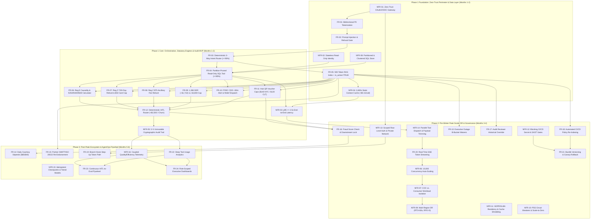
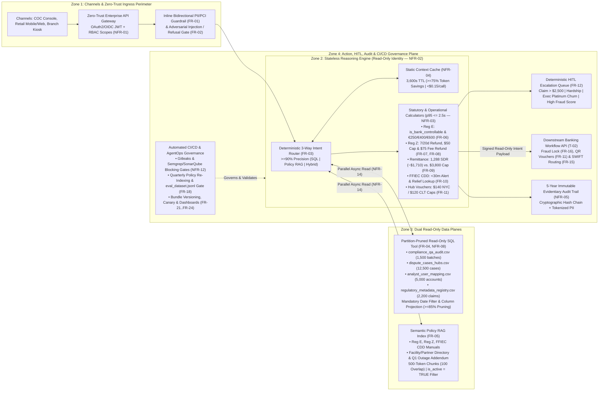

# Discovery Document

## 1\. Document Control

| Field | Value |
| :---- | :---- |
| Author | Lead Enterprise & AI Solutions Architect (Elevate Capstone Assessment) |
| Date | October 15, 2026 |
| Version | 2.0 (Final — Executive Architecture & Discovery Synthesis) |
| Prioritization framework used | **Weighted Risk-Adjusted MoSCoW (WR-MoSCoW)** — Composite 100-point scoring model weighting *Regulatory & Legal Exposure (35%)*, *Security & Data Privacy Veto (25%)*, *Direct Financial & Cost Impact (20%)*, and *Customer Trust & Operational Urgency (20%)*, mapped to discrete delivery tiers (`P0 - Must Have` [Phase 1 MVP], `P1 - Should Have` [Phase 2 Pre-Peak Scale], `P2 - Could Have` [Phase 3 Optimization], `P3 - Won't Have` [Out of Scope]). |

### 

### 1.1 Artifact Review Log

*One row per file in the package.*

&nbsp;

| Artifact filename | Modality | Reviewed? | Requirements sourced | Notes / issues encountered |
| :---- | :---- | :---- | :---- | :---- |
| `00_Customer_Narrative_Brief.md` | Unstructured Markdown (Executive Narrative Brief) | Yes | `FR-04`, `FR-06`, `FR-07`, `FR-08`, `FR-09`, `FR-10`, `FR-11`, `FR-12`, `FR-13`, `FR-14`, `FR-15`, `NFR-03`, `NFR-04`, `CON-03` | Quantifies `$52.4M` 2024 ICOPS loss breakdown (`$18.6M` Reg E/Z, `$12.1M` off-contract waivers, `$14.2M` FFIEC CDD lockouts, `$7.5M` churn) and `$15,000/day` legacy LLM prototype failure (`>8s` latency, `85,000` tokens/call). Contains SDR (`~$1,700` vs. `$1,710`) and Reg Z delay window (`>3h/>6h` vs. `>12h/>15-30h`) nuances logged in `§10.1`. |
| `01_Artifact1_Executive_Operational_Call_Transcript.md` | Unstructured Markdown (Executive Call Transcript) | Yes | `FR-04`, `FR-06`, `FR-10`, `FR-11`, `FR-13`, `FR-14`, `NFR-03`, `CON-05` | Captures Core Outage Orion (`$14M` loss in 4 days). Contains planted count contradictions vs. YAML post-mortems (`210` vs. `178` accounts on `CB-412`; `280` vs. `240` accounts on `CB-102`) and column alias discrepancy (`is_carrier_controllable` vs. `is_bank_controllable`) logged in `§10.1`. |
| `02_Artifact2_Technical_Security_Architecture_Review.md` | Unstructured Markdown (Security & FinOps Transcript) | Yes | `FR-01`, `FR-02`, `FR-04`, `FR-05`, `FR-17`, `FR-19`, `NFR-01`, `NFR-02`, `NFR-04`, `NFR-05`, `NFR-08`, `NFR-11`, `NFR-12`, `NFR-13`, `CON-01`, `CON-02`, `CON-03`, `CON-04`, `CON-05`, `CON-06` | Establishes CISO Sam Lin's non-negotiable launch veto (`[00:12:22]`), read-only execution identity (`[00:03:32]`), inline PII tokenization (`[00:05:02]`), and four core stakeholder tensions (`T-01` to `T-04`) logged in `§3.1`. |
| `03_INC-882914_nyc_ffiec_cdd_hold_timeout.yaml` | Structured YAML (Forensic Incident Post-Mortem) | Yes | `FR-04`, `FR-10`, `FR-11`, `FR-12`, `NFR-03`, `NFR-06`, `NFR-07`, `NFR-08` | Forensic record of Jan 14, 2025 NYC Hub Batch `CB-412` timeout (`178` accounts, `$60,868` net voucher overage across `$482` avg claims vs. `$140` NYC cap). Specifies table partitioning, `>=85%` scan pruning, `p95 <= 2.5s` latency, and `10,000` concurrency target. |
| `03_INC-883042_lon_nyc_rege_gateway_violation.yaml` | Structured YAML (Forensic Incident Post-Mortem) | Yes | `FR-02`, `FR-03`, `FR-05`, `FR-06`, `NFR-04`, `NFR-05` | Forensic record of Jan 18, 2025 LON-NYC Batch `CB-102` (`240` accounts, `5,541` index, `is_bank_controllable: true`), resulting in Formal Sanction Warning `#CFPB-2025-091` and `$108,000` remediation. Mandates 3-Way Intent Router (`>=90%` precision) and `500`-token (`100`-token overlap) chunking. |
| `03_INC-883199_infosec_dlp_pii_pan_leak.yaml` | Structured YAML (Forensic Incident Post-Mortem) | Yes | `FR-01`, `FR-02`, `NFR-01`, `NFR-02`, `NFR-11`, `NFR-12`, `CON-01`, `CON-02`, `CON-06` | Forensic record of Jan 22, 2025 InfoSec DLP block (`14` unredacted PANs/CVVs/passports leaked to unapproved external endpoint, `$45,000` forensic cost). Mandates OAuth2/OIDC gateway (`banking.compliance.agent`), bidirectional masking, and blocking CI/CD SAST/secret gates. |
| `03_INC-883250_lax_tyo_regz_remittance_dispute.yaml` | Structured YAML (Forensic Incident Post-Mortem) | Yes | `FR-05`, `FR-08`, `FR-09`, `FR-15`, `FR-16`, `FR-18`, `NFR-04`, `NFR-09`, `NFR-10`, `CON-03` | Forensic record of Feb 2, 2025 LAX-TYO Batch `CB-503` (`38h` delay, `$14,890` loss, `$40,654` statutory penalty exposure per violation). Mandates `is_active: true` metadata filter, `1,288 SDR` (`~$1,710`) cap, `$75` Reg Z fee refund, `<$0.15` unit cost, and `RTO < 60s` / `RPO = 0` DR. |
| `04_Artifact4_Conceptual_Architecture_Blueprint.png` | Visual Multimodal Image (Whiteboard Blueprint) | Yes | `FR-01`, `FR-02`, `FR-03`, `FR-04`, `FR-05`, `FR-06`, `FR-08`, `FR-09`, `FR-10`, `FR-12`, `FR-15`, `FR-18`, `NFR-01`, `NFR-03`, `NFR-04`, `NFR-05`, `NFR-09`, `NFR-12` | Visualizes 4-zone topology: Ingress & Zero-Trust Guardrails, Core Reasoning & 3-Way Intent Router, Dual Data Planes (Structured SQL + Unstructured RAG with `1-Hr TTL` Context Cache), and Action/Audit/CI-CD Governance Plane. |
| `04b_Artifact4_Companion_Sizing_Sheet.md` | Structured Markdown Table (Sizing & Guardrails) | Yes | `FR-01`, `FR-02`, `FR-03`, `FR-04`, `FR-05`, `FR-06`, `FR-08`, `FR-09`, `FR-10`, `FR-12`, `FR-18`, `NFR-01`, `NFR-03`, `NFR-04`, `NFR-08`, `NFR-09`, `NFR-12`, `CON-03` | Provides authoritative dataset cardinalities (`1,500` batches, `12,500` cases, `5,000` accounts, `20` hubs, `2,200` remittance claims) and exact SLA thresholds (`3,600s` cache refresh, `p95 <= 2.5s`, `<$0.15/call`, `100%` adversarial block rate, `RTO < 60s`, `RPO = 0`). |
| `05_Artifact5_Serving_Architecture_Performance_Call.md` | Unstructured Markdown (Serving Performance Transcript) | Yes | `FR-20`, `NFR-03`, `NFR-06`, `NFR-07`, `NFR-10`, `NFR-13`, `NFR-14`, `NFR-15` | Captures token streaming (`[00:01:48]`), zero cold-start scaling & tiered reasoning (`[00:02:20]`), non-blocking concurrency (`[00:03:52]`), scale-to-zero off-peak economics (`[00:04:55]`), parallel tool dispatch & payload trimming (`[00:06:45]`), and scoped token exchange (`[00:09:30]`). |
| `06_Artifact6_AgentOps_Observability_Call.md` | Unstructured Markdown (AgentOps Transcript) | Yes | `FR-21`, `FR-22`, `FR-23`, `FR-24`, `NFR-05`, `NFR-16` | Defines Day-2 AgentOps governance: dual effectiveness/efficiency monitoring (`[00:00:55]`), PII-redacted execution graph tracing (`[00:02:18]`), immutable agent bundle versioning & canary rollback (`[00:03:45]`), tool analytics (`[00:05:25]`), HITL feedback loop (`[00:06:48]`), and role-specific dashboards (`[00:08:15]`). |

&nbsp;

---

&nbsp;

## 2\. Executive Summary

&nbsp;

&nbsp;

### 2.1 The problem in the customer's own terms

Cymbal Bank clears **1,500 daily commercial and retail settlement batches** across **20 global hubs** serving **18 million account holders** (`00_Customer_Narrative_Brief.md`, Lines 4–6). Its legacy **Integrated Clearing & Operations Platform (ICOPS)** operates as fragmented data silos: structured clearing telemetry (`compliance_qa_audit.csv`, `dispute_cases_hubs.csv`) is disconnected from over 1,200 pages of regulatory manuals (`Reg_E`, `Reg_Z`, `FFIEC_BSA_AML`) (`00_Customer_Narrative_Brief.md`, Lines 13–14). During **Core Outage Orion**, which *"just cost this bank $14 million in four days"* (`01_Artifact1`, `[00:01:14]`), dispatchers missed a 28-minute FFIEC CDD hold countdown on Batch `CB-412` (`[00:02:18]`), freezing 600+ downstream accounts (`[00:03:06]`), while call-center agents misread an internal HSM fault on Batch `CB-102` as weather *"Force Majeure"* (`[00:03:42]`), triggering **Formal Sanction Warning `#CFPB-2025-091`** (`03_INC-883042`, Line 44). An initial unguided LLM prototype failed due to `$15,000/day` token burn (`85,000` tokens/call), `>8s` latency (`00_Customer_Narrative_Brief.md`, Line 58), and a DLP breach of `14` unredacted PANs (`03_INC-883199`, Line 26).

&nbsp;

### 2.2 Quantified business impact

In 2024, ICOPS failures generated **$52.4M in direct compliance and dispute losses** (`00_Customer_Narrative_Brief.md`, Line 13), compounded by **$14.0M in four days** during Core Outage Orion (`01_Artifact1`, `[00:01:14]`):

| Loss Driver / Exposure | Annual / Incident Impact | Root Operational Failure | Addressing Requirement IDs |
| :---- | :---- | :---- | :---- |
| **Statutory Penalties & Provisional Credit Overpayments** | **$18.6M / yr** (`$108K` in `INC-883042`; `$14.89K` + `$40,654`/violation in `INC-883250`) | Manual misclassification of `is_bank_controllable` under Reg E, missed Reg Z `$75` fee refunds, and applying `$3,500`–`$3,800` US caps to `1,288 SDR` (`~$1,710`) international remittances. | `FR-03`, `FR-05`, `FR-06`, `FR-07`, `FR-08`, `FR-09`, `NFR-05` |
| **FFIEC BSA/AML CDD Hold Cascading Lockouts** | **$14.2M / yr** (600+ frozen accounts in `INC-882914`) | Lack of real-time `< 30-minute` FFIEC CDD duty margin alerting and automated relief reviewer dispatch (`analyst_user_mapping.csv`). | `FR-04`, `FR-10`, `FR-15`, `NFR-03` |
| **Runaway Off-Contract Fee Waivers & Vouchers** | **$12.1M / yr** (`$60,868` net loss in `INC-882914`: `$85,796` actual vs. `$24,920` cap) | Uncapped manual reimbursements (`$482` avg vs. `$140 NYC` / `$120 CLT` caps) and duplicate payouts lacking fraud risk checks. | `FR-11`, `FR-13`, `FR-14`, `FR-16` |
| **High-Yield Executive Customer Churn** | **$7.5M / yr** (`>4h 15m` call hold times during outages) | Absence of `< 2.5s` automated resolution, streaming feedback, and deterministic HITL escalation for Executive Platinum accounts. | `FR-12`, `FR-20`, `NFR-03`, `NFR-06`, `NFR-07` |
| **Unbounded LLM Token Burn & Contact Center OpEx** | **$15,000 / day** LLM PoC cost (`$800 / 2 hrs`); **$18.50 / call** human handling | Re-sending 120-page PDFs (`85,000` tokens/call) and running `SELECT *` across 3-year audit histories without caching or partition pruning. | `FR-03`, `FR-04`, `NFR-04`, `NFR-08`, `NFR-10`, `NFR-15` |
| **Shadow-AI DLP Breach & Regulatory Sanction Risk** | **$45,000** (`INC-883199` cleanup) + **CISO Launch Veto** | Direct internet exposure, unmasked PAN/CVV/Passport transmission, and unblocked prompt injection vectors. | `FR-01`, `FR-02`, `NFR-01`, `NFR-02`, `NFR-11`, `NFR-12`, `NFR-13` |

&nbsp;

### 2.3 Top 5 requirements by priority

1. **`NFR-01` (Score: 100/100 — Security Veto):** Enforce a Zero-Trust Enterprise API Gateway validating OAuth2/OIDC JWT tokens (`banking.compliance.agent` scope) and RBAC roles before reaching the agent (`03_INC-883199`, Line 38; `02_Artifact2`, `[00:01:46]`).
2. **`NFR-02` (Score: 99/100 — Security Veto):** Execute the agent as a stateless container under a least-privilege identity with strictly read-only database access (`03_INC-883199`, Line 36; `02_Artifact2`, `[00:03:32]`).
3. **`FR-01` (Score: 98/100 — Security Veto):** Enforce inline bidirectional PII/PCI-DSS sanitization and format-preserving tokenization for PANs, CVVs, Passports, Legal Names, and 6-char Case Locators (`03_INC-883199`, Line 39; `02_Artifact2`, `[00:05:02]`).
4. **`FR-02` (Score: 97/100 — Security Veto):** Enforce real-time adversarial prompt-injection filters and off-corpus refusal gates (`100%` block rate) with immutable security audit logging (`03_INC-883199`, Line 40; `04b_Artifact4`, Line 12).
5. **`FR-06` (Score: 96/100 — Legal Mandate):** Automate Reg E causality verification (`is_bank_controllable = TRUE`) and corridor tier calculation (`€250` / `€400` / `€600`) with `100%` hybrid precision (`03_INC-883042`, Line 56; `01_Artifact1`, `[00:04:19]`).

&nbsp;

### 2.4 Recommended Phase 1 scope and the cut line

To meet CISO Sam Lin's launch veto (`02_Artifact2`, `[00:12:22]`), General Counsel Rachel Sterling's zero-defect statutory mandate (`[00:12:46]`), and FinOps VP David Haines's `< $0.15/call` ceiling (`04b_Artifact4`, Line 13) ahead of the 4-month winter peak (`[00:12:10]`), we establish a decisive, non-fragmented **Phase 1 Minimum Viable Product (MVP — Months 1–2)** containing **18 `P0 - Must Have` requirements** (`12 FRs` + `6 NFRs`), while deferring **22 requirements (55% of the backlog)** below the cut line:
* **Above the Cut Line — Phase 1 MVP (`Ranks 1–18`):** Zero-Trust OAuth2/OIDC Gateway (`NFR-01`), Read-Only Runtime Identity (`NFR-02`), Bidirectional PII Tokenization (`FR-01`), Prompt Injection & Refusal Gate (`FR-02`), 3-Way Intent Router (`FR-03`), Partition-Pruned Read-Only SQL Tool & Clustered Data Store (`FR-04`, `NFR-08`), Active-Filtered (`is_active=TRUE`) 500-Token Policy RAG (`FR-05`), Reg E Causality & Tier Calculator (`FR-06`), Reg Z Prompt Refund & `$50` Cap (`FR-07`), Reg Z `$75` Ancillary Fee Refund (`FR-08`), `1,288 SDR` vs. `$3,800` Remittance Cap (`FR-09`), FFIEC CDD `<30m` Hold Alert (`FR-10`), Contracted Hub QR Voucher Caps (`FR-11`), HITL Escalation Router (`FR-12`), `p95 <= 2.5s` Real-Time Latency (`NFR-03`), `3,600s` Context Cache / `<$0.15` Unit Cost (`NFR-04`), and 5-Year Immutable Evidentiary Audit Trail (`NFR-05`).
* **Below the Cut Line — Deferred to Phase 2 (Months 3–4, Pre-Peak Scale & Governance — `14 requirements`, `Ranks 19–32`) and Phase 3 (Months 5–6, Post-Peak Ecosystem — `8 requirements`, `Ranks 33–40`):** Blocking CI/CD SAST Gates (`NFR-12`), Fraud Risk Transactional Locking (`FR-16`), Row-Level Token Exchange & Private Perimeter (`NFR-13`), 10k Concurrency & Workload Isolation (`NFR-06`, `NFR-07`), Multi-Region DR & Data Sovereignty (`NFR-09`, `NFR-11`), Executive Outage B-Bucket Addendum (`FR-13`), Audit Historical Override (`FR-17`), CI/CD Policy Re-Indexing (`FR-18`), Circuit Breakers & Parallel Tooling (`NFR-10`, `NFR-14`), Token Streaming & Bundle Versioning (`FR-20`, `FR-21`), plus Phase 3 Daily Stipends (`FR-14`), Partner SWIFT Re-Endorsement (`FR-15`), Kiosk Step-Up Path (`FR-19`), and Advanced AgentOps (`NFR-15`, `NFR-16`, `FR-22`–`FR-24`).

&nbsp;

### 2.5 The three things that must be resolved before design can start

1. **Unauthenticated Kiosk Guest Lookup (`EV`) vs. Zero-Trust OAuth2/OIDC (`SL`) (`T-01` / `OQ-01`):** Branch VP Elena Vance requests a 6-character locator + last-name guest path (`02_Artifact2`, `[00:02:08]`), violating CISO Sam Lin's OAuth2/OIDC baseline (`[00:01:46]`) and `03_INC-883199` (Line 39, which classifies both as masked PII). **Sign-off required:** CISO Sam Lin & VP Elena Vance on Step-Up OTP token exchange (`§3.1 T-01`).
2. **Read-Only Agent Identity (`SL`) vs. Transactional Locking & Voucher Issuance (`ER`/`MV`) (`T-02` / `OQ-02`):** CISO Sam Lin forbids any agent DML writes (`02_Artifact2`, `[00:03:32]`), whereas `03_INC-883250` (Line 66) and `01_Artifact1` (`[00:05:43]`) require transactional locking and QR voucher issuance. **Sign-off required:** CISO Sam Lin & Principal Architect Alex Torres on decoupled downstream workflow execution (`§3.1 T-02`).
3. **GDPR/CCPA Right-to-Erasure vs. 5-Year Immutable Audit Trail (`RS`/`SL`) (`T-03` / `OQ-03`):** General Counsel Rachel Sterling requires 5-year tamper-evident audit logs for CFPB/OCC/FCA defense (`02_Artifact2`, `[00:06:03]`; `03_INC-883042`, Line 58) while honoring GDPR/CCPA erasure (`03_INC-883199`, Line 42). **Sign-off required:** General Counsel Rachel Sterling & CISO Sam Lin on tokenized audit persistence (`§3.1 T-03`).

---

&nbsp;

## 3\. Stakeholder Register

| Name | Role / Title | Key agenda / mandate | Sign-off / veto authority | Source citation |
| :---- | :---- | :---- | :---- | :---- |
| **Marcus Vance (MV)** | EVP, Global Banking Operations | Eliminate `$52.4M` annual ICOPS losses (`$14M` in 4-day Outage Orion); automate `is_bank_controllable` Reg E credit math (`€250/€400/€600`); provide real-time streaming feedback (`p95 <= 2.5s`). | **Executive Business Sponsor** — Final operational sign-off on Phase 1 MVP scope and hub rollout. | `01_Artifact1` (`[00:01:14]`, `[00:04:19]`); `05_Artifact5` (`[00:01:48]`) |
| **Sam Lin (SL)** | Chief Information Security Officer (CISO) | Enforce Zero-Trust OAuth2/OIDC gateway, strictly read-only database identity, inline bidirectional PII/PCI tokenization, `100%` prompt injection blocking, blocking CI/CD SAST/secret gates, and private network isolation. | **Hard Launch Veto Authority** — *"I will not sign off on a public launch without identity, data protection, and manipulation defenses in place. Full stop."* | `02_Artifact2` (`[00:01:46]`, `[00:03:32]`, `[00:05:02]`, `[00:06:28]`, `[00:11:32]`, `[00:12:22]`); `05_Artifact5` (`[00:09:30]`) |
| **Rachel Sterling (RS)** | General Counsel & SVP of Regulatory Affairs | Guarantee `100%` statutory decision accuracy across Reg E, Reg Z (`7-day` refund, `$75` fee refund), FFIEC CDD, and `1,288 SDR` (`~$1,710`) caps; preserve 5-year immutable audit trails (`audit_reviewer` historical access) alongside GDPR/CCPA erasure. | **Legal & Regulatory Sign-Off / Veto** — *"statutory compensation and provisional credit decisions... cannot be 'beta.'"* | `02_Artifact2` (`[00:06:03]`, `[00:10:30]`, `[00:12:46]`); `06_Artifact6` (`[00:02:18]`) |
| **David Haines (DH)** | VP, Cloud FinOps & Enterprise Infrastructure | Enforce `< $0.15` unit cost per interaction (vs. `$18.50` human call), `3,600s` static context caching (`>= 75%` token savings), partition-pruned SQL (`>= 85%` scan reduction; no `SELECT *`), and scale-to-zero off-peak compute. | **Budget & Production Funding Veto** — *"And I won't fund an uncapped consumption model into peak season."* | `02_Artifact2` (`[00:07:40]`, `[00:08:55]`, `[00:12:28]`); `05_Artifact5` (`[00:04:55]`) |
| **Tariq Mahmood (TM)** | SVP, Commercial Clearing & Settlement Operations | Prevent FFIEC BSA/AML CDD hold timeouts (`< 30m` alert threshold); automate relief reviewer reassignment (`analyst_user_mapping.csv`); enforce Executive Outage Addendum B-bucket waivers and partner SWIFT/ISO 20022 re-endorsement. | **Clearing Operations Sign-Off** — Approves COC console workflows and FFIEC CDD alerting rules. | `01_Artifact1` (`[00:02:18]`, `[00:03:06]`, `[00:05:01]`, `[00:06:15]`) |
| **Elena Rostova (ER)** | SVP, Consumer Dispute Resolution & Contact Centers | Stop mass wrongful Force Majeure denials (`#CFPB-2025-091`); automate contracted hub QR fee-waiver vouchers (`$140 NYC` / `$120 CLT`) and courtesy stipends (`$65` Exec Platinum / `$40` General); enforce HITL escalation (`> $2,500`). | **Contact Center & Dispute Sign-Off** — Approves voucher rules and HITL escalation queues. | `01_Artifact1` (`[00:03:42]`, `[00:05:43]`, `[00:06:50]`) |
| **Elena Vance (EV)** | VP, Digital Customer Experience & Branch Kiosks | Reduce `> 4h 15m` outage hold times; enable frictionless branch kiosk access for customers lacking mobile apps; deliver readiness before the 4-month winter peak. | **Digital Channel Sign-Off** — Approves retail mobile and branch kiosk UX flows. | `02_Artifact2` (`[00:02:08]`, `[00:12:10]`) |
| **Alex Torres (AT)** | Principal Enterprise Architect | Isolate internal COC operations gateway path from retail spikes; enforce active (`v2024.4`) vs. historical (`v2022`) policy filtering; mandate blocking CI/CD secret and SQL injection static analysis gates. | **Architecture & Release Gate Sign-Off** — Co-owns CI/CD release gates with CISO. | `02_Artifact2` (`[00:02:58]`, `[00:10:05]`, `[00:11:15]`) |
| **Vikram Patel (VP)** | Director, Core Platform Engineering & SRE | Eliminate cold starts during `10,000`-concurrency bursts; prevent head-of-line blocking; execute parallel tool lookups with payload trimming and idempotent checkpoints; enforce bundle versioning, canary rollouts, and `RTO < 60s` / `RPO = 0` DR. | **SRE Production Readiness Sign-Off** — Approves serving resiliency, DR failover, and rollout gates. | `05_Artifact5` (`[00:02:20]`, `[00:03:52]`, `[00:06:45]`); `06_Artifact6` (`[00:03:45]`, `[00:08:15]`) |
| **Priya Nair (PN)** | Head of AI Platform & AgentOps | Track coupled model quality and token efficiency; capture deep tool-invocation telemetry (SQL errors, empty RAG retrievals, retries) to detect schema and policy drift. | **AI Platform & AgentOps Sign-Off** — Approves observability schemas and model routing telemetry. | `06_Artifact6` (`[00:00:55]`, `[00:05:25]`) |
| **Sofia Jenkins (SJ)** | Director, Quality Engineering & Evaluation | Maintain golden evaluation benchmark (`eval_dataset.jsonl`, `>= 90%` routing precision, `100%` hybrid accuracy); automate continuous feedback flywheel from `compliance_qa_audit.csv` human overrides into CI/CD regression suites. | **Quality & Evaluation Gate Sign-Off** — Approves evaluation pass rates before promotion. | `06_Artifact6` (`[00:06:48]`); `03_INC-883042` (Line 55); `03_INC-883250` (Lines 61–62) |

### 

### 3.1 Stakeholder tensions to be reconciled

| Tension \# | Position A (stakeholder \+ citation) | Position B (stakeholder \+ citation) | Recommended resolution / default | Decision owner |
| :---- | :---- | :---- | :---- | :---- |
| **T-01: Branch Kiosk Guest Access vs. Zero-Trust OAuth2/OIDC & PII Masking** | **Elena Vance (VP Digital CX):** Requests unauthenticated kiosk lookup by 6-char locator + last name (`02_Artifact2`, `[00:02:08]`: *"I need a **guest path** — at minimum, look up by 6-character case/account locator and last name."*). | **Sam Lin (CISO):** Mandates OAuth2/OIDC JWT validation on all ingress (`02_Artifact2`, `[00:01:46]`: *"Zero Trust is the baseline. No exceptions."*) and masks names + 6-char locators (`03_INC-883199`, Line 39). | **Options Evaluated:** • *Option A:* Allow unauthenticated guest queries with rate-limiting (Pros: zero UX friction; Cons: violates `INC-883199` Line 38 and triggers CISO veto). • *Option B (Recommended Default — Proposed):* **Step-Up Kiosk Token Exchange** — Kiosk exchanges 6-char locator + last name + SMS/email OTP or staff badge scan at the identity provider for a short-lived (`5-min`), single-case-scoped OAuth2 JWT (`banking.compliance.agent.kiosk`), then tokenizes PII before agent invocation. • *Option C:* Defer kiosk channel until mobile app authentication is universal (Pros: simplest security; Cons: leaves distressed branch customers unserved). | **Sam Lin (CISO)** & **Elena Vance (VP Digital CX)** *(Deadline: End of Week 2 — Pre-Design Gate)* |
| **T-02: Strictly Read-Only Agent Identity vs. Fraud Locking & Voucher Issuance** | **Sam Lin (CISO):** Mandates strictly read-only database permissions (`02_Artifact2`, `[00:03:32]`: *"No schema changes, no inserts, no updates on core ledger, dispute, or analyst tables. Ever."*; `03_INC-883199`, Line 36). | **Marcus Vance / Elena Rostova:** Require automated QR voucher issuance (`01_Artifact1`, `[00:05:43]`) and transactional locking to prevent duplicate payouts (`03_INC-883250`, Line 66). | **Options Evaluated:** • *Option A:* Grant the agent scoped DML `UPDATE`/`INSERT` on voucher tables (Pros: single-service simplicity; Cons: violates `INC-883199` Line 36 and CISO veto). • *Option B (Recommended Default — Proposed):* **Command-Query Responsibility Separation (CQRS)** — The agent runtime remains `100%` read-only (`SELECT`-only identity) and outputs a signed, deterministic **Decision Intent Payload**; an existing downstream deterministic banking workflow service validates `fraud_dispute_risk_score`, acquires the transactional lock, and issues the QR voucher. | **Sam Lin (CISO)** & **Alex Torres (Principal Architect)** *(Deadline: End of Week 2 — Pre-Design Gate)* |
| **T-03: 5-Year Immutable Regulatory Audit Trail vs. GDPR/CCPA Right to Erasure** | **Rachel Sterling (General Counsel):** Requires 5-year tamper-evident audit logs (`02_Artifact2`, `[00:06:03]`; `06_Artifact6`, `[00:02:18]`) and `03_INC-883042` (Line 58) for CFPB/OCC/FCA defense. | **Rachel Sterling / Sam Lin:** Must honor GDPR/CCPA personal data erasure requests (`02_Artifact2`, `[00:06:03]`: *"GDPR and CCPA also give consumers the right to have their personal data erased"*; `03_INC-883199`, Line 42). | **Options Evaluated:** • *Option A:* Delete audit rows upon GDPR erasure request (Pros: trivial privacy compliance; Cons: breaks immutable hash-chained regulatory audit trail). • *Option B (Recommended Default — Proposed):* **Tokenized Audit Persistence with Vault Key Purge** — Write only format-preserving surrogate tokens (`TOK_PAN_x`, `TOK_NAME_y`) into the 5-year immutable audit log (`[00:05:02]`) and shred ephemeral context caches after `3,600s`; on a valid GDPR erasure request (once statutory hold expires), purge the PII mapping entry in the isolated token vault so the immutable audit log remains intact but permanently de-identified. | **Rachel Sterling (General Counsel)** & **Sam Lin (CISO)** *(Deadline: End of Week 2 — Pre-Design Gate)* |
| **T-04: Active (`v2024.4`) Policy Isolation vs. Audit Reviewer Historical Comparison** | **Alex Torres (Principal Architect):** Mandates filtering out legacy `v2022` manuals (`$3,500` cap) via `is_active = TRUE` (`02_Artifact2`, `[00:10:05]`; `03_INC-883250`, Line 59). | **Rachel Sterling (General Counsel):** Requires `audit_reviewer` staff to run side-by-side historical policy comparisons (`02_Artifact2`, `[00:10:30]`: *"My audit team (`audit_reviewer` role) also needs side-by-side historical comparisons."*). | **Options Evaluated:** • *Option A:* Physically purge archived manuals from the vector index (Pros: zero risk of legacy retrieval; Cons: blocks `audit_reviewer` historical reviews). • *Option B (Recommended Default — Proposed):* **RBAC-Scoped Temporal Metadata Filtering** — Enforce a hard default filter `is_active = TRUE` on all retrieval calls for `analyst`, `senior_counsel`, `system`, and retail roles; permit `include_historical = TRUE` override exclusively when the verified JWT role is `audit_reviewer`. | **Rachel Sterling (General Counsel)** & **Alex Torres (Principal Architect)** *(Deadline: End of Week 3)* |
| **T-05: Zero Cold-Start Peak Surge (`10,000` Concurrency) vs. FinOps Idle-Cost Refusal** | **Vikram Patel (Director SRE):** Prohibits cold-start penalties during sudden hub outages (`05_Artifact5`, `[00:02:20]`, `[00:03:52]`; `03_INC-882914`, Line 61: `10,000` concurrent requests). | **David Haines (VP FinOps):** Refuses to pay for idle peak capacity during the 90% normal operating window (`05_Artifact5`, `[00:04:55]`; `02_Artifact2`, `[00:12:28]`). | **Options Evaluated:** • *Option A:* Provision dedicated `10,000`-concurrency baseline compute 24/7 (Pros: zero cold start; Cons: violates FinOps budget veto). • *Option B (Recommended Default — Proposed):* **Warm-Baseline Serverless Auto-Scaling + Tiered Model Routing** — Maintain a small warm minimum instance baseline for zero cold-start normal traffic with rapid horizontal auto-scaling triggered by clearing queue depth, combined with tiered model routing (fast model for single-hop status checks, deep model for hybrid multi-hop disputes) and `3,600s` static context caching (`>= 75%` input token savings). | **David Haines (VP FinOps)** & **Vikram Patel (Director SRE)** *(Deadline: End of Week 3)* |

&nbsp;

---

&nbsp;

## 4\. Business Context & Value Drivers

### 4.1 Current state and why existing systems cannot solve it

Cymbal Bank's legacy **Integrated Clearing & Operations Platform (ICOPS)** requires human analysts to manually cross-reference four relational operational tables (`compliance_qa_audit.csv` [1,500 batches], `dispute_cases_hubs.csv` [12,500 cases], `analyst_user_mapping.csv` [5,000 accounts], and `regulatory_metadata_registry.csv` [2,200 remittance claims]) against unstructured regulatory PDFs and markdown directories (`00_Customer_Narrative_Brief.md`, Lines 13–26; `04b_Artifact4`, Line 14). During hub disruptions, manual correlation takes 15–45 minutes per case, causing cascading FFIEC CDD lockouts (`01_Artifact1`, `[00:03:06]`) and `>4h 15m` call center hold times (`00_Customer_Narrative_Brief.md`, Line 26). A naive LLM proof-of-concept failed in early 2025 because it stuffed entire 120-page manuals into every prompt (`85,000` tokens/call, costing `$15,000/day` at `>8s` latency; `00_Customer_Narrative_Brief.md`, Line 58; `$800` in two hours during testing; `02_Artifact2`, `[00:07:40]`), executed unpruned `SELECT *` table scans (`02_Artifact2`, `[00:08:55]`), retrieved outdated `v2022` policy caps (`$3,500` instead of `$3,800` or `1,288 SDR`; `03_INC-883250`, Line 59), and leaked `14` unmasked customer PANs (`03_INC-883199`, Line 26).

### 4.2 Regulatory and legal landscape

The platform operates under four strict-liability regulatory regimes (`00_Customer_Narrative_Brief.md`, Lines 34–50):
1. **CFPB Regulation E (12 CFR Part 1005) & EU/UK Payment Services Directive:** Mandates `$50` maximum consumer liability for unauthorized EFTs (`Line 36`) and fixed provisional credit / statutory compensation tiers for clearing delays `> 3 hours` caused by bank-controllable faults (`is_bank_controllable = TRUE`): **€250** (`< 1,500` corridor/exposure index), **€400** (`1,500–3,500` index), and **€600** (`> 3,500` index) (`Line 49`). Internal HSM/gateway faults do not qualify as Force Majeure (`03_INC-883042`, Line 56).
2. **CFPB Regulation Z (12 CFR Part 1026 — Truth in Lending Act):** Caps unauthorized credit card liability at **$50** (`Line 36`), mandates automatic prompt cash/credit refunds within **7 business days** (electronic/card) or **20 days** (check/paper) when settlements are canceled or delayed (`> 3 hours` domestic, `> 6 hours` international) and alternative routing is declined (`Line 48`), and under **§ 1026.13(e)** mandates an automatic **$75 ancillary dispute investigation/late fee refund** if verification exceeds **12 hours** (domestic) or **15–30 hours** (international) (`Line 48`). Violations carry civil money penalties up to **$40,654 per violation** (`03_INC-883250`, Line 55).
3. **FFIEC BSA/AML Examination Manual (31 CFR Part 1010 / Part 1020):** Imposes strict Customer Due Diligence (CDD) and Suspicious Activity Report (SAR) Compliance Duty Period (CDP) hold clocks (`Line 25`), requiring proactive alerts when remaining duty margin falls **`< 30 minutes`** (`04b_Artifact4`, Line 18).
4. **Cross-Border Remittance SDR Convention (Articles 19 & 22) & Privacy Laws (GLBA, PCI-DSS, EU/UK GDPR, CCPA):** Caps international remittance and multi-currency billing error liability at **1,288 Special Drawing Rights (SDR)** (`~$1,710.00 USD`, superseding the `$3,800` active US domestic cap and `$3,500` archived `v2022` cap; `03_INC-883250`, Lines 45, 59), while requiring PCI-DSS PAN/CVV masking and GDPR/CCPA data sovereignty and erasure compliance (`03_INC-883199`, Lines 39, 42).

### 4.3 Active enforcement and live incidents

Four live January–February 2025 incidents drive the technical requirements:
* **`INC-882914` (Jan 14, 2025 — NYC Hub Batch `CB-412` FFIEC CDD Timeout):** A missed 28-minute CDD countdown froze `178` commercial/consumer accounts (`210` cited verbally in `01_Artifact1`, `[00:02:18]`) and locked out downstream sweeps (`600+` accounts; `[00:03:06]`). Uncoordinated agents approved `$85,796` in off-contract claims (`$482` avg vs. `$140` NYC cap), causing a **`$60,868` net overage loss** (`03_INC-882914`, Lines 42–46).
* **`INC-883042` (Jan 18, 2025 — LON-NYC Batch `CB-102` Reg E Gateway Violation):** Call-center agents misread `"telecom squall"` remarks on an internal HSM fault (`is_bank_controllable: true`, index `5,541`) and denied `240` claims (`280` cited verbally in `01_Artifact1`, `[00:03:42]`), triggering **CFPB/UK FCA Formal Sanction Warning `#CFPB-2025-091`** and **`$108,000`** in restitution/fines (`03_INC-883042`, Lines 29–46).
* **`INC-883199` (Jan 22, 2025 — InfoSec DLP PII/PAN Leak):** A shadow-AI prototype transmitted `14` unredacted customer PANs, CVVs, passport numbers, and 6-char locators to an external endpoint, incurring **`$45,000`** in forensic remediation and prompting CISO Sam Lin's launch veto (`03_INC-883199`, Lines 18–33).
* **`INC-883250` (Feb 2, 2025 — LAX-TYO Batch `CB-503` Reg Z & SDR Violation):** During a 38-hour cross-border delay (`85` accounts), the prototype retrieved the archived `v2022` manual (`$3,500` domestic cap) instead of the `1,288 SDR` (`~$1,710`) international cap and failed to refund the mandatory `$75` Reg Z investigation fee, causing **`$14,890`** in overpayments and exposing Cymbal Bank to **`$40,654` per violation** in CFPB/OCC penalties (`03_INC-883250`, Lines 18–55).

---

&nbsp;

## 5\. Functional Requirements Register

| Req ID | Functional Requirement Statement | Source Artifact | Locator | Verbatim Quote | Acceptance Criteria | Priority | Priority Justification |
| :---- | :---- | :---- | :---- | :---- | :---- | :---: | :---- |
| **FR-01** | Sanitize and tokenize sensitive PII/PCI fields bidirectionally on all ingress prompts and egress responses before logging or model inference. | `03_INC-883199_infosec_dlp_pii_pan_leak.yaml` *(Corroborated by `02_Artifact2` `[00:05:02]`, `[00:05:37]`; `04b_Artifact4` Line 12)* | Line 39 | `"Configure an inline bidirectional PII & PCI-DSS sanitization guardrail that inspects both user ingress prompts and model egress responses, automatically masking 16-digit Payment Card PANs (\`XXXX-XXXX-XXXX-1234\`), CVVs, Passport Numbers, Customer Legal Names, and 6-character Case Record Locators prior to logging or inference."` | `100%` of 16-digit PANs, CVVs, Passport IDs, Legal Names, and 6-char Case Locators are masked/tokenized before inference or logging; tools resolve surrogate tokens directly. | **P0 - Must Have** | Non-negotiable CISO launch veto (`[00:12:22]`) and PCI-DSS/GLBA control eliminating the `$45,000` DLP leak vector (`INC-883199`). |
| **FR-02** | Block adversarial prompt injections, role-flipping, jailbreaks, and off-corpus queries at ingress, returning a refusal and logging an immutable security event. | `03_INC-883199_infosec_dlp_pii_pan_leak.yaml` *(Corroborated by `02_Artifact2` `[00:06:28]`; `04b_Artifact4` Line 12)* | Line 40 | `"Enable real-time adversarial prompt injection and jailbreak detection filters to block role-flipping, system instruction overrides, and unauthorized provisional credit escalations."` | Achieves `100%` block rate (`04b_Artifact4`, Line 12) on adversarial overrides and off-corpus queries across red-team benchmarks, writing an immutable security audit event on every refusal. | **P0 - Must Have** | CISO hard launch gate (`[00:12:22]`); prevents adversarial manipulation of statutory provisional credit payouts. |
| **FR-03** | Route validated queries through a deterministic 3-Way Intent Router into Pure Analytical SQL, Pure Regulatory Policy RAG, or Hybrid Multi-Hop paths. | `03_INC-883042_lon_nyc_rege_gateway_violation.yaml` | Lines 54–55 | `"Implement a deterministic 3-Way Intent Router capable of distinguishing Pure Analytical SQL queries, Pure Regulatory Policy lookups, and Hybrid Multi-Hop compliance resolutions, while enforcing refusal gates against off-corpus queries."` / `"Achieve >= 90% intent routing and tool-selection precision across the evaluation benchmark (\`eval_dataset.jsonl\`)."` | Classifies queries into SQL, Policy RAG, Hybrid Multi-Hop, or Refusal with `>= 90%` routing and tool-selection precision on `eval_dataset.jsonl`. | **P0 - Must Have** | Foundational orchestration requirement; prevents single-hop queries from invoking expensive multi-hop chains and ensures hybrid edge cases execute both tools. |
| **FR-04** | Execute read-only, partition-pruned analytical SQL queries over the four operational tables with mandatory date bounds and explicit column projection. | `03_INC-882914_nyc_ffiec_cdd_hold_timeout.yaml` *(Corroborated by `02_Artifact2` `[00:08:55]`; `04b_Artifact4` Line 14)* | Lines 54–55, 57 | `"Implement a read-only analytical SQL execution tool allowing the reasoning engine to aggregate settlement batch statuses, clearing delay minutes, and FFIEC CDP duty margins dynamically."` / `"Enforce partition-pruned SQL query generation with mandatory date-range filters and explicit column projection (prohibiting \`SELECT *\`) to reduce scanned data volume by >= 85%."` | Rejects `100%` of `SELECT *`, DDL/DML, and unbounded-date queries (`90-day` default window — **Proposed**), reducing scanned data volume by `>= 85%`. | **P0 - Must Have** | Required to inspect live clearing batches (`1,500` batches, `12,500` cases) while satisfying FinOps scan limits (`[00:08:55]`). |
| **FR-05** | Retrieve unstructured regulatory policies using 500-token chunks (100-token overlap) with a mandatory `is_active = TRUE` metadata filter. | `03_INC-883042_lon_nyc_rege_gateway_violation.yaml` & `03_INC-883250_lax_tyo_regz_remittance_dispute.yaml` | `INC-883042` Line 53; `INC-883250` Line 59 | `"Configure document chunking at 500 tokens with a 100-token overlap so statutory exposure-to-compensation matrices (€250 / €400 / €600) remain intact within retrieved segments."` / `"Enforce temporal metadata filtering (\`is_active: true\` in \`regulatory_metadata_registry.csv\`) in the document retrieval index so archived legacy manuals (\`CYMBAL_HISTORICAL_DEPOSIT_AGREEMENT_v2022\` with outdated $3,500 domestic caps) are isolated from active \`v2024.4\` manuals ($3,800 US domestic vs. 1,288 SDR international)."` | Indexes manuals at `500` tokens (`100` overlap) and enforces `is_active = TRUE` by default, achieving `0%` retrieval of archived `v2022` manuals for standard roles. | **P0 - Must Have** | Prevents table truncation (`INC-883042`) and legacy policy contamination (`INC-883250`, `$40,654`/violation penalty risk). |
| **FR-06** | Verify Reg E disruption causality (`is_bank_controllable = TRUE`) and compute statutory provisional credit tiers (`€250`, `€400`, `€600`) by corridor index. | `03_INC-883042_lon_nyc_rege_gateway_violation.yaml` *(Corroborated by `00_Customer_Narrative_Brief` Line 49; `01_Artifact1` `[00:04:19]`)* | Line 56 | `"Ensure 100% decision precision on hybrid multi-hop edge cases: for Batch CB-102 (LON->NYC, 5,541 index, HSM auth gateway fault), the agent must verify \`is_bank_controllable = TRUE\`, reject telecom/weather force majeure, and award €600 statutory provisional credit."` | Achieves `100%` precision on hybrid Reg E test cases (`€250` for `<1,500` index, `€400` for `1,500–3,500`, `€600` for `>3,500` when delay `>3h` and `is_bank_controllable = TRUE`). | **P0 - Must Have** | Directly remediates Formal Sanction Warning `#CFPB-2025-091` and the largest share of the `$18.6M` annual statutory loss driver. |
| **FR-07** | Enforce Regulation Z prompt settlement refund windows (`7` business days electronic/card; `20` days check/paper) and the `$50` unauthorized credit card liability cap. | `00_Customer_Narrative_Brief.md` | Lines 36, 48 | `"• Unauthorized Credit Liability Strictly Capped at $50"` / `"requiring institutions to issue **automatic, prompt cash/credit refunds within 7 business days** (for electronic/card postings) or 20 days (check/paper) whenever a settlement is canceled or significantly delayed (>3 hours for domestic clearing, >6 hours for international clearing) and the customer declines alternative routing."` | Triggers `7`-day (electronic/card) or `20`-day (check/paper) refund workflows when delays exceed `>3h` (domestic) or `>6h` (international) and caps unauthorized card liability at `$50`. | **P0 - Must Have** | Core statutory mandate under 12 CFR Part 1026; General Counsel Rachel Sterling prohibited launching without full Reg Z compliance (`[00:12:46]`). |
| **FR-08** | Mandate automatic `$75` Regulation Z (§ 1026.13(e)) ancillary dispute investigation or late fee refunds when verification exceeds statutory time limits. | `00_Customer_Narrative_Brief.md` *(Corroborated by `03_INC-883250` Line 62)* | Line 48 | `"Under § 1026.13(e), it also mandates the automatic refund of ancillary dispute investigation or late fees (\$75) if verification is not completed within 12 hours (domestic) or 15–30 hours (international)."` | Automatically awards a `$75` ancillary fee refund whenever verification exceeds `12h` (domestic) or `15–30h` (international; `15h` default — **Proposed**), verified on Batch `CB-503` (`38h` delay). | **P0 - Must Have** | Eliminates strict-liability CFPB/OCC enforcement infractions carrying up to `$40,654` per violation (`INC-883250`, Line 55). |
| **FR-09** | Enforce the `1,288 SDR` (`~$1,710.00 USD`) international remittance liability cap versus the `$3,800` US domestic cap unless a declared-value guarantee exists. | `03_INC-883250_lax_tyo_regz_remittance_dispute.yaml` *(Corroborated by `00_Customer_Narrative_Brief` Line 50)* | Lines 45, 62 | `"International remittance delay and billing error liability is strictly capped at 1,288 Special Drawing Rights (SDR) per customer (approximately $1,710.00 USD at current IMF exchange rates), unless the sender paid for a declared-value liquidity guarantee at initiation."` | Caps cross-border remittance liability at `1,288 SDR` (`$1,710.00 USD` baseline) unless a declared-value guarantee flag is present, and applies `$3,800` to active US domestic deposit claims. | **P0 - Must Have** | Prevents `$1,790+` per-claim overpayment errors on cross-border corridors (`INC-883250`, Batch `CB-503`). |
| **FR-10** | Monitor FFIEC BSA/AML Compliance Duty Period (CDP) countdowns and alert dispatchers with available relief reviewers when remaining duty margin falls `< 30 minutes`. | `04b_Artifact4_Companion_Sizing_Sheet.md` *(Corroborated by `01_Artifact1` `[00:02:18]`, `[00:03:06]`; `03_INC-882914` Line 55)* | Line 18 | `"Alert when remaining Compliance Duty Period (CDP) \`< 30 minutes\`."` | Triggers a priority alert when `remaining_cdp_minutes < 30` and queries `analyst_user_mapping.csv` to return qualified relief reviewers in the target hub within `<= 2.5s`. | **P0 - Must Have** | Directly addresses the `$14.2M` annual FFIEC CDD cascading lockout loss driver and Batch `CB-412` failure (`INC-882914`). |
| **FR-11** | Enforce contracted facility fee-waiver caps (`$140 NYC`, `$120 CLT`) retrieved from `CYMBAL_PROVISIONAL_CREDIT_AND_FEE_WAIVER_DIRECTORY` when generating QR voucher intents. | `03_INC-882914_nyc_ffiec_cdd_hold_timeout.yaml` *(Corroborated by `01_Artifact1` `[00:05:43]`)* | Line 56 | `"Implement a semantic document retrieval (RAG) tool over the unstructured facility and partner directory (\`CYMBAL_PROVISIONAL_CREDIT_AND_FEE_WAIVER_DIRECTORY\`) to extract exact contracted partner fee-waiver and liquidity caps ($140 NYC / $120 CLT) and clearing cutoffs."` | Rejects `100%` of automated fee-waiver voucher requests exceeding the retrieved hub cap (`$140.00` NYC, `$120.00` CLT) and emits a capped QR voucher intent payload. | **P0 - Must Have** | Stops runaway off-contract fee waivers (`$12.1M/yr` loss; `$60,868` net overage in `INC-882914`). |
| **FR-12** | Route high-value claims (`> $2,500`), medical/hardship emergencies, Executive Platinum churn risks, and high `fraud_dispute_risk_score` cases to Human-in-the-Loop (HITL) queues. | `04b_Artifact4_Companion_Sizing_Sheet.md` *(Corroborated by `03_INC-882914` Line 60; `01_Artifact1` `[00:06:50]`)* | Line 19 | `"Escalate when claim \`> \$2,500\`, medical/hardship emergency, Executive Platinum churn risk, or high \`fraud_dispute_risk_score\`."` | Suspends autonomous payout and routes `100%` of cases matching `claim_amount > $2,500`, hardship/medical flags, Executive Platinum churn risk, or `fraud_dispute_risk_score >= 0.70` (**Proposed**) to `senior_counsel` HITL review. | **P0 - Must Have** | Essential financial risk control and primary defense against the `$7.5M` annual Executive Platinum churn driver. |
| **FR-13** | Apply temporary `100%` overdraft and wire-reversal difference waivers for restricted Basic Checking (`B-bucket`) accounts during declared executive relief events. | `01_Artifact1_Executive_Operational_Call_Transcript.md` | `[00:05:01]` (Line 25) | `"Executive leadership issued \`EXECUTIVE_REGULATORY_RELIEF_AND_FEE_WAIVER_ADDENDUM_2025_Q1\` on Wednesday night. It explicitly granted 100% overdraft fee and wire-reversal difference waivers on restricted Basic Checking accounts (B-bucket) and authorized complimentary emergency liquidity credits for affected relationship members."` | When an active executive relief addendum matches the batch disruption window, overrides standard `B-bucket` restrictions to grant `100%` overdraft and wire-reversal difference waivers. | **P1 - Should Have** | Eliminates manual confusion during declared executive outages (`[00:05:01]`), though standard statutory claims are handled in Phase 1 by `FR-06`–`FR-11`. |
| **FR-14** | Calculate and cap daily courtesy stipends by customer loyalty tier (`$65/day` Executive Platinum, `$40/day` General) during extended clearing outages. | `01_Artifact1_Executive_Operational_Call_Transcript.md` | `[00:05:43]` (Line 27) | `"The agent must issue instantaneous digital QR-code fee-waiver and provisional-credit vouchers hard-capped to contracted hub limits and authorized daily courtesy stipends ($65/day for Executive Platinum, $40/day for General)."` | Verifies customer loyalty tier in `analyst_user_mapping.csv` / `dispute_cases_hubs.csv` and enforces daily stipend limits (`$65/day` Executive Platinum, `$40/day` General) with zero unapproved `$100+` stipends. | **P2 - Could Have** | Curbs ad-hoc `$100+` stipend waste (`00_Customer_Narrative_Brief`, Line 24), while primary hub voucher caps (`$140/$120`) are already enforced in Phase 1 (`FR-11`). |
| **FR-15** | Recommend correspondent payment re-endorsement and tier mapping across partner clearing banks (`JPMorgan Chase`, `Citibank`, `HSBC`) under SWIFT/ISO 20022 rules. | `03_INC-883250_lax_tyo_regz_remittance_dispute.yaml` *(Corroborated by `01_Artifact1` `[00:06:15]`)* | Line 64 | `"Support automated correspondent payment re-endorsement and tier mapping across partner clearing banks (JPMorgan Chase, Citibank, HSBC) under SWIFT/ISO 20022 clearinghouse standards."` | Queries partner cutoffs in `CYMBAL_PROVISIONAL_CREDIT_AND_FEE_WAIVER_DIRECTORY` and outputs SWIFT/ISO 20022 re-endorsement routing recommendations across `JPMorgan Chase`, `Citibank`, and `HSBC`. | **P2 - Could Have** | Optimizes alternative correspondent routing during hub lockouts, whereas statutory refund compliance is already guaranteed in Phase 1 (`FR-07`). |
| **FR-16** | Verify `fraud_dispute_risk_score` and enforce idempotent transactional locking via downstream workflow integration to prevent duplicate voucher payouts. | `03_INC-883250_lax_tyo_regz_remittance_dispute.yaml` | Line 66 | `"Incorporate \`fraud_dispute_risk_score\` checks and transactional locking to prevent duplicate voucher issuance or fraudulent dispute claim payouts."` | Checks `fraud_dispute_risk_score` prior to decision emission and attaches a deterministic idempotency key (`case_id + batch_id`) so downstream workflow services block `100%` of duplicate voucher requests. | **P1 - Should Have** | Prevents concurrent multi-channel duplicate voucher payouts before peak season while preserving the agent's read-only identity (`T-02`). |
| **FR-17** | Permit verified `audit_reviewer` users to query archived regulatory manuals (`is_active = FALSE`) alongside active (`v2024.4`) policies for side-by-side comparison. | `02_Artifact2_Technical_Security_Architecture_Review.md` | `[00:10:30]` (Line 131) | `"My audit team (\`audit_reviewer\` role) also needs side-by-side historical comparisons. Deleting history from the agent's reach creates a different legal risk."` | Allows `include_historical = TRUE` retrieval only when the OAuth2 JWT scope equals `audit_reviewer`, returning side-by-side `v2022` vs. `v2024.4` policy diffs; blocks all other roles (`100%`). | **P1 - Should Have** | Resolves `T-04` for internal legal audit reviews without risking legacy policy contamination on frontline `analyst` or consumer queries (`FR-05`). |
| **FR-18** | Automate CI/CD policy re-indexing, context cache flushing, and golden evaluation regression testing upon regulatory manual updates. | `03_INC-883250_lax_tyo_regz_remittance_dispute.yaml` | Line 65 | `"Establish an automated CI/CD policy governance pipeline that re-indexes updated regulatory manuals, flushes stale context caches, and executes regression evaluations upon quarterly policy updates."` | Automatically re-chunks updated manuals, updates `is_active` flags, flushes cached contexts (`<= 30s` — **Proposed**), and blocks promotion if `eval_dataset.jsonl` regression drops below thresholds. | **P1 - Should Have** | Prevents policy drift across quarterly updates; required before Q2/Winter Peak regulatory revisions. |
| **FR-19** | Provide a branch kiosk step-up authentication workflow exchanging a 6-character case locator, last name, and OTP/badge verification for a single-case JWT. | `02_Artifact2_Technical_Security_Architecture_Review.md` | `[00:01:46]` & `[00:02:08]` (Lines 25, 27) | `"Every request — mobile, branch kiosk, web, internal compliance console — terminates at our enterprise API gateway, gets its identity token verified..."` / `"I need a **guest path** — at minimum, look up by 6-character case/account locator and last name."` | Exchanges verified 6-char locator + last name + step-up OTP/staff badge at the gateway for a `5-minute` (**Proposed**) single-case JWT (`banking.compliance.agent.kiosk`) with PII tokenized before inference. | **P2 - Could Have** | Reconciles `T-01` for branch kiosks after core COC console and authenticated mobile channels launch in Phase 1. |
| **FR-20** | Stream real-time incremental response tokens and tool-execution progress indicators to user interfaces during multi-step investigations. | `05_Artifact5_Serving_Architecture_Performance_Call.md` | `[00:01:48]` (Line 24) | `"They need immediate visual feedback that the system is working and streaming answers back in real time."` | Streams incremental progress statuses and response tokens via Server-Sent Events (SSE) / WebSockets with time-to-first-token (`TTFT`) `<= 500ms` (**Proposed**). | **P1 - Should Have** | Prevents user abandonment and double-clicks during multi-hop hybrid queries, while overall `p95 <= 2.5s` latency is delivered in Phase 1 (`NFR-03`). |
| **FR-21** | Version-control the complete agent bundle (prompts, model configs, routing rules, tool schemas, eval baselines) with canary traffic splitting and instant rollback. | `06_Artifact6_AgentOps_Observability_Call.md` | `[00:03:45]` (Line 31) | `"We need a disciplined **version control and release governance model** for the entire agent bundle—prompts, model configurations, routing rules, tool schemas, and evaluation baselines—so we can compare versions side-by-side, roll out changes gradually to a small slice of traffic, and roll back instantaneously if quality slips."` | Assigns an immutable version hash to every bundle, supports canary traffic routing (`1%–10%` — **Proposed**), and executes automated rollback within `< 60s` (**Proposed**) on SLA breach. | **P1 - Should Have** | Essential Day-2 release safety mechanism required before high-velocity prompt and policy iterations in Phase 2. |
| **FR-22** | Capture deep tool-invocation telemetry including SQL generation errors, empty RAG retrievals, retry counts, and per-tool latency distributions. | `06_Artifact6_AgentOps_Observability_Call.md` | `[00:05:25]` (Line 37) | `"We need deep **tool usage analytics** to understand what the agent is actually doing with those tools."` | Logs structured telemetry for `100%` of tool calls (tool name, latency, SQL syntax/schema errors, empty RAG hits, retry counts) without exposing raw PII. | **P2 - Could Have** | Enables AI Platform engineering (`PN`) to diagnose schema drift and retrieval misses post-MVP. |
| **FR-23** | Ingest human reviewer overrides and reason codes from `compliance_qa_audit.csv` into an automated evaluation dataset expansion flywheel. | `06_Artifact6_AgentOps_Observability_Call.md` | `[00:06:48]` (Line 48) | `"We need a structured mechanism to capture both explicit human feedback (like reviewer corrections, approvals/rejections, and reason codes from \`compliance_qa_audit.csv\`) and implicit behavioral signals from users, turn those real-world misses into test scenarios, and feed them into a **continuous improvement loop**"` | Automatically converts HITL overrides and rejected decisions in `compliance_qa_audit.csv` into candidate `eval_dataset.jsonl` test cases for QE (`SJ`) review. | **P2 - Could Have** | Automates continuous accuracy improvement in Phase 3 after initial golden benchmark (`eval_dataset.jsonl`) validation in Phase 1. |
| **FR-24** | Provide role-specific operational dashboards and automated anomaly alerts for CISO, Legal, FinOps, and SRE stakeholders. | `06_Artifact6_AgentOps_Observability_Call.md` *(Corroborated by `[00:00:55]`)* | `[00:08:15]` (Lines 52–53) | `"Different stakeholders need unified, real-time operational dashboards tailored to their roles... We need **automated anomaly detection and proactive alerting** when the agent's behavior drifts or performance degrades"` | Delivers four role-scoped views (Security/DLP, Statutory Accuracy, FinOps Unit Cost/Cache Hit, SRE Latency/Errors) and fires alerts within `<= 60s` (**Proposed**) of threshold drift. | **P2 - Could Have** | Provides executive self-service visibility and proactive drift alerting for Day-2 steady-state operations. |

&nbsp;

---

&nbsp;

## 6\. Non-Functional Requirements Register

| Req ID | Non-Functional Requirement Statement | Quality Attribute | Target Metric / SLA | Source Artifact | Locator | Verbatim Quote | Priority | Priority Justification |
| :---- | :---- | :---- | :---- | :---- | :---- | :---- | :---: | :---- |
| **NFR-01** | Authenticate and authorize every ingress request at a Zero-Trust Enterprise API Gateway using OAuth2/OIDC JWT validation and RBAC scope checks. | Security (Authentication & Authorization) | `100%` unauthenticated calls rejected (`HTTP 401`); unauthorized scopes (`banking.compliance.agent` + 4 RBAC roles) rejected (`HTTP 403`). | `03_INC-883199_infosec_dlp_pii_pan_leak.yaml` *(Corroborated by `02_Artifact2` `[00:01:46]`)* | Line 38 | `"Enforce a Zero-Trust Enterprise API Gateway in front of all agent endpoints requiring OAuth2 / OIDC JWT bearer token validation and explicit scope verification (\`banking.compliance.agent\`), rejecting unauthenticated calls with HTTP 401."` | **P0 - Must Have** | Rank 1 non-negotiable CISO launch veto (`[00:12:22]`); blocks unauthorized external access (`INC-883199`). |
| **NFR-02** | Execute the agent runtime as a stateless container under a dedicated least-privilege identity with strictly read-only database permissions. | Security (Least Privilege & Isolation) | `0` DDL/DML write permissions (`INSERT`, `UPDATE`, `DELETE`, `DROP`) granted to the agent identity across all tables (`100%` read-only). | `03_INC-883199_infosec_dlp_pii_pan_leak.yaml` *(Corroborated by `02_Artifact2` `[00:03:32]`)* | Line 36 | `"Package and deploy the autonomous agent runtime as a scalable, stateless container service running under a dedicated least-privilege execution identity with strictly read-only database permissions (zero DDL/DML write access)."` | **P0 - Must Have** | Rank 2 CISO launch veto (`[00:03:32]`); guarantees the reasoning engine cannot corrupt core banking ledgers or audit records. |
| **NFR-03** | Bound end-to-end inference and decision latency to support real-time clearing queue dispatch releases and interactive dispute resolution. | Performance (Response Latency) | End-to-end decision latency `p95 <= 2.5 seconds`; streaming `TTFT <= 500ms` (**Proposed**). | `03_INC-882914_nyc_ffiec_cdd_hold_timeout.yaml` *(Corroborated by `04b_Artifact4` Line 13)* | Line 58 | `"Guarantee p95 end-to-end inference and decision latency <= 2.5 seconds to support real-time clearing queue dispatch releases."` | **P0 - Must Have** | Required to release FFIEC CDD holds before the `<30m` clock expires (`[00:03:06]`) and replace the `>8s` legacy prototype (`00_Customer_Narrative_Brief`, Line 58). |
| **NFR-04** | Enforce 1-hour (`3,600s`) static context caching for regulatory manuals and maintain unit economic efficiency below `$0.15` per resolved interaction. | FinOps & Cost Efficiency | Context cache TTL = `3,600 seconds` (`>= 75%` input token cost savings); unit cost `< $0.15` per interaction (vs. `$18.50` human call). | `04b_Artifact4_Companion_Sizing_Sheet.md` & `03_INC-883042_lon_nyc_rege_gateway_violation.yaml` | `04b_Artifact4` Line 13; `INC-883042` Line 57 | `"Reference material refreshed every \`3,600 seconds\` (1 hour); end-to-end p95 latency ≤ 2.5 seconds; unit cost < \$0.15 per resolution (vs. \$18.50 per human call)."` / `"Implement static context caching (1-hour renewable TTL) for bulky 120-page regulatory manuals... to achieve >= 75% input token cost savings during high-volume disruption bursts."` | **P0 - Must Have** | Directly satisfies FinOps VP David Haines's funding veto (`[00:12:28]`), eliminating the `$15,000/day` (`$800/2h`) uncached token burn. |
| **NFR-05** | Stream an immutable, cryptographically verifiable, PII-redacted evidentiary audit trail of every interaction for 5-year regulatory examination defense. | Auditability & Forensic Compliance | `100%` of interactions logged with cryptographic hash chaining, prompt, SQL rows, policy citations, and reasoning trace; `5-year` retention (`[00:06:03]`). | `03_INC-883042_lon_nyc_rege_gateway_violation.yaml` *(Corroborated by `06_Artifact6` `[00:02:18]`)* | Line 58 | `"Stream an immutable, cryptographically verifiable evidentiary audit trail (capturing user prompt, SQL result rows, retrieved policy citations, and reasoning steps) to defend statutory decisions during CFPB, OCC, and UK FCA examinations."` | **P0 - Must Have** | Required by General Counsel Rachel Sterling to defend automated Reg E/Z and FFIEC decisions before CFPB, OCC, and UK FCA examiners. |
| **NFR-06** | Auto-scale stateless compute and database concurrency to absorb hub outage surges without cold-start penalties or dropped connections. | Scalability & Concurrency | Support `10,000` simultaneous dispute/re-routing requests; `0` cold-start timeouts; `99.95%` availability (**Proposed**). | `03_INC-882914_nyc_ffiec_cdd_hold_timeout.yaml` *(Corroborated by `05_Artifact5` `[00:02:20]`, `[00:03:52]`)* | Line 61 | `"Architect serverless compute auto-scaling and database concurrency management to handle 10,000 simultaneous customer dispute and re-routing requests during hub clearing freezes."` | **P1 - Should Have** | Required before the 4-month winter peak (`[00:12:10]`) to absorb regional clearing outage spikes without connection drops. |
| **NFR-07** | Isolate internal compliance operations traffic from retail consumer surge traffic and prevent head-of-line blocking across concurrent requests. | Reliability (Workload Isolation & QoS) | Dedicated gateway rate/concurrency pool for internal COC roles (`0%` starvation during `10,000` retail surge); non-blocking async I/O. | `02_Artifact2_Technical_Security_Architecture_Review.md` & `05_Artifact5_Serving_Architecture_Performance_Call.md` | `02_Artifact2` `[00:02:58]`; `05_Artifact5` `[00:03:52]` | `"I'd rather see the internal compliance operations path isolated from the consumer path, even if they share the same agent logic."` / `"Our serving layer has to absorb massive, sudden concurrency spikes without dropping connections or suffering from head-of-line blocking where one slow, multi-step regulatory investigation starves out dozens of quick dispute status checks."` | **P1 - Should Have** | Prevents retail dispute spikes from starving time-critical internal COC FFIEC `<30m` batch releases (`AT`, `VP`). |
| **NFR-08** | Partition structured operational tables by date and cluster by batch/case and jurisdiction to achieve `>= 85%` query scan volume reduction. | Data Performance & FinOps Efficiency | Partition by `scheduled_clearing_date` (`audit_timestamp` date), cluster by `batch_id` (`case_id`) and `regulatory_jurisdiction`; `>= 85%` scan reduction. | `03_INC-882914_nyc_ffiec_cdd_hold_timeout.yaml` | Lines 54, 57 | `"Ingest structured operational tables (\`compliance_qa_audit.csv\`, \`analyst_user_mapping.csv\`, \`regulatory_metadata_registry.csv\`, \`dispute_cases_hubs.csv\`) into a scalable analytical relational data store, partitioning compliance audit and settlement records by \`scheduled_clearing_date\` (\`audit_timestamp\` date) and clustering by \`batch_id\` (\`case_id\`) and \`regulatory_jurisdiction\`."` | **P0 - Must Have** | Foundational data schema requirement enabling both `p95 <= 2.5s` SQL latency (`NFR-03`) and `< $0.15/call` query cost (`NFR-04`). |
| **NFR-09** | Provide multi-region active-passive disaster recovery with automated DNS failover and zero transactional/audit data loss. | Availability & Disaster Recovery | Multi-region DR `RTO < 60 seconds` and `RPO = 0` (`04b_Artifact4`, Line 20). | `03_INC-883250_lax_tyo_regz_remittance_dispute.yaml` *(Corroborated by `04b_Artifact4` Line 20)* | Line 67 | `"Architect multi-region active-passive disaster recovery with automated DNS failover achieving Recovery Time Objective (RTO) < 60 seconds and Recovery Point Objective (RPO) = 0."` | **P1 - Should Have** | Ensures continuous clearing compliance availability across regional cloud outages prior to winter peak season. |
| **NFR-10** | Degrade gracefully via circuit breakers when upstream Core Banking PSS or telemetry feeds fail, and scale down compute during off-peak hours. | Resiliency & Elastic Cost Scaling | Circuit breaker trip `<= 500ms` (**Proposed**) on upstream PSS failure with safe fallback to cached batch snapshot/HITL; `>= 80%` off-peak compute reduction (**Proposed**). | `03_INC-882914_nyc_ffiec_cdd_hold_timeout.yaml` & `05_Artifact5_Serving_Architecture_Performance_Call.md` | `INC-882914` Line 59; `05_Artifact5` `[00:04:55]` | `"Design circuit-breaker and graceful fallback patterns so the agent safely degrades when upstream Core Banking PSS or clearing telemetry feeds experience outages."` / `"The serving architecture must scale down economically during off-peak hours while remaining responsive when demand surges."` | **P1 - Should Have** | Prevents cascading timeouts when Core Banking PSS degrades and satisfies FinOps off-peak efficiency mandates (`DH`). |
| **NFR-11** | Enforce regional data sovereignty controls and ephemeral context cache shredding for cross-border EU/UK GDPR and US GLBA compliance. | Data Privacy & Sovereignty | `100%` regional PII residency compliance (EU/UK vs. US); ephemeral session/cache shredding within `<= 3,600s` TTL (`0` unredacted disk writes). | `03_INC-883199_infosec_dlp_pii_pan_leak.yaml` | Line 42 | `"Architect regional data sovereignty controls and ephemeral context cache shredding policies to comply with EU/UK GDPR and US GLBA privacy regulations on cross-border transactions."` | **P1 - Should Have** | Required before expanding multi-region deployment across EU/UK (`LON`) and APAC (`TYO`) clearing corridors in Phase 2. |
| **NFR-12** | Enforce blocking CI/CD static security gates using secret scanners and SAST analyzers to guarantee zero hardcoded secrets or SQL injection flaws. | DevSecOps & Release Security | `0` hardcoded secrets (Gitleaks) and `0` high/critical SAST / SQL-injection findings (Semgrep/SonarQube) before release (`100%` blocking gate). | `03_INC-883199_infosec_dlp_pii_pan_leak.yaml` *(Corroborated by `02_Artifact2` `[00:11:15]`, `[00:11:32]`; `04b_Artifact4` Line 20)* | Line 41 | `"Enforce automated CI/CD static security gates using secret scanners (Gitleaks) and SAST analyzers (Semgrep/SonarQube) to guarantee zero hardcoded credentials and zero SQL injection vulnerabilities."` | **P1 - Should Have** | Mandated by CISO Sam Lin and Principal Architect Alex Torres (`[00:11:32]`: *"And those gates block the release. Not warn — block."*). |
| **NFR-13** | Propagate scoped user identity tokens for row-level tool authorization and isolate the runtime within a private, encrypted network perimeter. | Security (Network & Row-Level Isolation) | `100%` row-level/hub-level authorization via scoped token exchange; `0` public internet egress routes (`100%` private TLS `1.3` internal paths). | `05_Artifact5_Serving_Architecture_Performance_Call.md` | `[00:09:30]` (Lines 62–63) | `"How does the serving architecture enforce least-privilege identity propagation, scoped token exchange, and fine-grained authorization so the agent can only invoke tools and access rows strictly authorized for the currently authenticated user?"` / `"How is the serving network perimeter isolated so the runtime can only communicate with approved internal banking APIs and model endpoints over private, encrypted paths?"` | **P1 - Should Have** | Prevents cross-customer or cross-role data leakage and structurally blocks shadow-AI external egress (`INC-883199`). |
| **NFR-14** | Dispatch independent SQL and RAG read lookups concurrently in parallel and trim/summarize tool payloads before model context injection. | Performance (Execution Optimization) | `100%` of independent hybrid read tools dispatched concurrently in parallel; tool output payloads trimmed by `>= 60%` (**Proposed**) before prompt assembly. | `05_Artifact5_Serving_Architecture_Performance_Call.md` | `[00:06:45]` (Lines 46–48) | `"Most of those read lookups are independent and should be dispatched concurrently in parallel!"` / `"The architecture needs a pattern to filter, trim, or summarize tool outputs before they hit the model."` | **P1 - Should Have** | Keeps multi-hop hybrid investigations well within the `p95 <= 2.5s` latency budget (`NFR-03`) and `< $0.15` token cost ceiling (`NFR-04`). |
| **NFR-15** | Enforce idempotent tool invocation checkpoints and tiered model routing so simple lookups use lightweight models while complex disputes use deep reasoning. | Resiliency & Model Efficiency | `100%` state-checkpointed tool retries (no full-chain restarts on transient failures); `>= 50%` (**Proposed**) single-hop queries routed to lightweight tier. | `05_Artifact5_Serving_Architecture_Performance_Call.md` | `[00:02:20]` & `[00:06:45]` (Lines 27, 49–50) | `"Second, not every turn in a conversation requires our heaviest, deepest reasoning model."` / `"Tool interactions must be designed with idempotency and state checkpoints."` | **P2 - Could Have** | Further optimizes token cost and retry resiliency under high concurrency after the 3-Way Router (`FR-03`) launches in Phase 1. |
| **NFR-16** | Continuously monitor coupled model effectiveness (decision accuracy, grounding) and operational efficiency (tokens/call, cache hit ratio, latency). | Observability & Quality Governance | Real-time telemetry export (`100%` sampling) across quality and efficiency metrics; automated drift alert within `<= 60s` (**Proposed**). | `06_Artifact6_AgentOps_Observability_Call.md` | `[00:00:55]` (Line 22) | `"First, we need real **performance monitoring that tracks both the effectiveness and the efficiency of the language model within our operational context**."` | **P2 - Could Have** | Ensures sustained model quality and FinOps compliance across Day-2 model updates (`PN`). |

### 

### 6.1 Quality attribute coverage check

*List the quality attributes your NFRs cover. Flag any that have no requirement in the package, and raise them in §8.*

&nbsp;

| Quality Attribute | Covered by NFR IDs | Coverage Status & Gaps Raised in §8 |
| :---- | :---- | :---- |
| **Security (AuthN/AuthZ, Least Privilege, DevSecOps, Network Isolation)** | `NFR-01`, `NFR-02`, `NFR-12`, `NFR-13` (plus `FR-01`, `FR-02`) | **Covered** — OAuth2/OIDC gateway, RBAC scopes, read-only identity, bidirectional PII masking, prompt injection blocking, SAST/secret gates, and private perimeter. *Gap raised in `OQ-01` (Kiosk step-up token claim schema).* |
| **Performance & Latency (End-to-End SLA, Parallelism, Scan Pruning)** | `NFR-03`, `NFR-08`, `NFR-14` (plus `FR-20`) | **Covered** — `p95 <= 2.5s` end-to-end SLA, parallel tool dispatch, payload trimming, and `>= 85%` SQL scan reduction. |
| **Scalability & Throughput (Peak Concurrency & Workload Isolation)** | `NFR-06`, `NFR-07` | **Covered** — `10,000` concurrent requests during hub freezes, zero cold starts, and isolated COC vs. retail gateway pools. |
| **Availability, Resiliency & Disaster Recovery** | `NFR-09`, `NFR-10`, `NFR-15` | **Covered** — Multi-region active-passive DR (`RTO < 60s`, `RPO = 0`), upstream PSS circuit breakers, and idempotent tool state checkpoints. |
| **FinOps & Cost Efficiency** | `NFR-04`, `NFR-08`, `NFR-10`, `NFR-15` | **Covered** — `< $0.15/call` unit cost ceiling, `3,600s` static context caching (`>= 75%` token savings), scale-to-zero off-peak compute, and tiered model routing. |
| **Auditability, Data Privacy & Sovereignty** | `NFR-05`, `NFR-11` | **Covered** — 5-year immutable cryptographic audit trail, regional data residency (GDPR/GLBA), and ephemeral cache shredding. *Gap raised in `OQ-03` (GDPR erasure vs. 5-year immutable logs).* |
| **Maintainability, Observability & Release Governance** | `NFR-12`, `NFR-16` (plus `FR-18`, `FR-21`–`FR-24`) | **Covered** — Agent bundle versioning, canary rollback, CI/CD policy re-indexing, deep tool analytics, and coupled quality/efficiency monitoring. |
| **Accessibility (WCAG 2.1 AA), Localization (i18n) & Archival Cold-Storage Tiering** | *None in discovery package* | **GAP FLAGGED** — Not specified in the 11 customer artifacts despite serving retail mobile/kiosk users and `LON`/`TYO` international corridors. Raised explicitly in **`OQ-08`** (`§8`) and **`ASM-08`** (`§9`). |

&nbsp;
---

&nbsp;

## 7\. Customer-Imposed Constraints & Non-Negotiables

| Const ID | Constraint Description | Mandated By | Source Artifact | Locator | Verbatim Quote | Design Impact |
| :---- | :---- | :---- | :---- | :---- | :---- | :---- |
| **CON-01** | **Zero Direct Internet Access / Mandatory Enterprise API Gateway Ingress:** Every request across mobile, kiosk, web, and internal COC console channels must terminate at the Enterprise API Gateway for OAuth2/OIDC JWT and RBAC validation (`analyst`, `senior_counsel`, `audit_reviewer`, `system`, or retail customer). | Sam Lin (CISO) | `02_Artifact2_Technical_Security_Architecture_Review.md` *(Corroborated by `03_INC-883199` Line 38)* | `[00:01:46]` (Line 25) | `"Nothing reaches the agent directly from the internet. Every request — mobile, branch kiosk, web, internal compliance console — terminates at our enterprise API gateway, gets its identity token verified, has its RBAC role scopes checked (\`analyst\`, \`senior_counsel\`, \`audit_reviewer\`, \`system\`, or authenticated retail customer), and only then is forwarded. Zero Trust is the baseline. No exceptions."` | Prohibits public runtime endpoints; requires an OAuth2/OIDC gateway perimeter and step-up token exchange for branch kiosks (`T-01`). |
| **CON-02** | **Strictly Read-Only Database Execution Identity (Zero DDL/DML Writes):** The agent's execution identity is restricted to read-only (`SELECT`) access on the four compliance tables and policy index; all schema changes, inserts, or updates are permanently prohibited. | Sam Lin (CISO) | `02_Artifact2_Technical_Security_Architecture_Review.md` *(Corroborated by `03_INC-883199` Line 36)* | `[00:03:32]` (Line 43) | `"The identity backing this agent gets read-only access to the compliance operations dataset (\`compliance_qa_audit\`, \`regulatory_metadata_registry\`, \`analyst_user_mapping\`, \`dispute_cases_hubs\`) and the regulatory policy document index. Nothing else. No schema changes, no inserts, no updates on core ledger, dispute, or analyst tables. Ever."` | Requires Command-Query Responsibility Separation (`T-02`): the agent emits signed read-only decision intents while an external banking workflow executes locking and voucher writes. |
| **CON-03** | **Strict FinOps Unit Cost Ceiling (`< $0.15/call`), SQL Scan Pruning (`No SELECT *`), and Off-Peak Scale-Down:** Queries must never execute `SELECT *`, static manuals must use `3,600s` caching, unit cost must stay `< $0.15`, and idle peak compute is prohibited during normal hours. | David Haines (VP, Cloud FinOps) | `02_Artifact2_Technical_Security_Architecture_Review.md` & `04b_Artifact4_Companion_Sizing_Sheet.md` | `02_Artifact2` `[00:08:55]`, `[00:12:28]`; `04b_Artifact4` Line 13 | `"Queries must be bounded by date, read only the columns needed, and never \"select everything.\""` / `"And I won't fund an uncapped consumption model into peak season."` / `"Reference material refreshed every \`3,600 seconds\` (1 hour); end-to-end p95 latency ≤ 2.5 seconds; unit cost < \$0.15 per resolution (vs. \$18.50 per human call)."` | Enforces AST-level SQL validation blocking `SELECT *`, `1-hour` context caching (`>= 75%` token savings), and elastic serverless auto-scaling (`T-05`). |
| **CON-04** | **Non-Negotiable Pre-Winter Peak Timeline (4 Months to Peak Season):** Core production readiness and peak scaling must be operational prior to the winter clearing and audit peak starting in four months. | Elena Vance (VP, Digital CX) | `02_Artifact2_Technical_Security_Architecture_Review.md` | `[00:12:10]` (Line 157) | `"Winter peak clearing and audit operations start in roughly four months."` | Dictates a hard 2-month Phase 1 MVP launch followed by a 2-month Phase 2 scale/DR hardening window prior to Month 4 winter peak. |
| **CON-05** | **Zero-Defect Statutory Entitlement Mandate (No "Beta" Regulatory Decisions):** Statutory compensation and provisional credit calculations under Reg E, Reg Z, FFIEC, and SDR conventions cannot be launched in an approximate or "beta" state. | Rachel Sterling (General Counsel) | `02_Artifact2_Technical_Security_Architecture_Review.md` | `[00:12:46]` (Line 167) | `"Whatever order you choose, statutory compensation and provisional credit decisions under Reg E, Reg Z, and EU/UK payment rules cannot be \"beta.\" If the agent gives a wrong entitlement, that's a regulatory violation, not a bug."` | Elevates all statutory calculation and active-policy filtering requirements (`FR-05` to `FR-11`) into the non-negotiable Phase 1 MVP (`100%` golden benchmark pass rate). |
| **CON-06** | **Hard Security Launch Veto & Blocking CI/CD Release Gates:** Public launch is vetoed unless identity, inline PII tokenization, prompt-injection refusal gates, and blocking CI/CD SAST/secret scanners (`0` findings) are active. | Sam Lin (CISO) & Alex Torres (Principal Architect) | `02_Artifact2_Technical_Security_Architecture_Review.md` *(Corroborated by `04b_Artifact4` Line 20)* | `[00:11:32]` & `[00:12:22]` (Lines 145, 159) | `"And those gates block the release. Not warn — block."` / `"I will not sign off on a public launch without identity, data protection, and manipulation defenses in place. Full stop."` | Forces `NFR-01`, `NFR-02`, `FR-01`, and `FR-02` into Phase 1 MVP and requires automated CI/CD release-blocking gates (`NFR-12`). |

### 

### 7.1 Explicit out-of-scope / negative scope

The following capabilities are **explicitly excluded from the autonomous agent's boundary** based on customer constraints and discovery evidence:
1. **Direct Core Banking Ledger or Database Mutations (`P3 - Won't Have`):** The agent runtime shall never execute `INSERT`, `UPDATE`, `DELETE`, `ALTER`, or `DROP` statements against `compliance_qa_audit`, `dispute_cases_hubs`, `analyst_user_mapping`, `regulatory_metadata_registry`, or core settlement ledgers (`CON-02`, `02_Artifact2` `[00:03:32]`; `03_INC-883199` Line 36).
2. **Autonomous Approval of High-Value (`> $2,500`) or High-Risk Claims (`P3 - Won't Have`):** The agent is prohibited from autonomously approving payouts exceeding `$2,500`, medical/hardship emergencies, Executive Platinum churn-risk cases, or high `fraud_dispute_risk_score` claims; all such cases must route to `senior_counsel` HITL review (`FR-12`, `04b_Artifact4` Line 19).
3. **Unauthenticated Direct Public Internet Access (`P3 - Won't Have`):** No customer or internal client may invoke the agent runtime bypassing the OAuth2/OIDC Enterprise API Gateway (`CON-01`, `02_Artifact2` `[00:01:46]`).
4. **Off-Corpus General Financial, Tax, or Legal Advice (`P3 - Won't Have`):** The agent must refuse any query outside the grounded Cymbal Bank compliance dataset and regulatory corpus (`FR-02`, `02_Artifact2` `[00:06:28]`; `03_INC-883042` Line 54).
5. **Replacement of Upstream Core Banking PSS or SWIFT Settlement Engines (`P3 - Won't Have`):** The agent is a decision-support, audit, and routing orchestration plane; actual wire movement and ledger settlement remain within existing deterministic banking systems.

---

&nbsp;

## 8\. Open Questions & Clarifications Required

| Q \# | Open Question | Why it matters for design | Owner | Blocking Task 2? | Default if unanswered |
| :---- | :---- | :---- | :---- | :---: | :---- |
| **OQ-01** | **Branch Kiosk Step-Up Authentication Protocol:** Will Digital CX (`EV`) and InfoSec (`SL`) approve a step-up OTP / branch staff badge verification flow at the API Gateway that issues a `5-minute` single-case OAuth2 JWT (`banking.compliance.agent.kiosk`)? | Reconciles `T-01`: `02_Artifact2` (`[00:02:08]`) requests a 6-char locator + last name guest path, while `[00:01:46]` requires OAuth2/OIDC JWTs and `03_INC-883199` (Line 39) masks both fields as PII. | Sam Lin (CISO) & Elena Vance (VP Digital CX) | **Yes** | Enforce Step-Up OTP/badge verification at the gateway issuing a `5-minute` single-case JWT before tokenizing PII (`§3.1 T-01` — **Proposed**). |
| **OQ-02** | **Downstream Transactional Lock & Voucher Execution API Contract:** Which existing deterministic banking service will consume the agent's read-only Decision Intent Payload to execute transactional fraud locking (`INC-883250`, Line 66) and QR voucher issuance (`01_Artifact1`, `[00:05:43]`)? | Reconciles `T-02`: CISO forbids agent database writes (`02_Artifact2`, `[00:03:32]`), requiring an external write service to lock claims and issue QR vouchers. | Alex Torres (Principal Architect) & Sam Lin (CISO) | **Yes** | Decouple via CQRS (`§3.1 T-02`): agent emits a signed read-only JSON decision payload with idempotency key (`case_id + batch_id`) to the existing Core Dispute Workflow API (**Proposed**). |
| **OQ-03** | **GDPR/CCPA Right-to-Erasure vs. 5-Year Immutable Audit Trail:** Will Legal (`RS`) and InfoSec (`SL`) accept storing format-preserving surrogate tokens in the 5-year immutable audit trail and purging only the external token-vault mapping upon a valid GDPR/CCPA erasure request? | Reconciles `T-03`: `03_INC-883042` (Line 58) and `02_Artifact2` (`[00:06:03]`) require 5-year immutable audit logs while honoring consumer data erasure rights. | Rachel Sterling (General Counsel) & Sam Lin (CISO) | **Yes** | Persist only surrogate PII tokens (`TOK_PAN_x`, `TOK_NAME_y`) in the immutable audit log and delete the vault mapping key upon verified GDPR erasure after statutory holds expire (`§3.1 T-03` — **Proposed**). |
| **OQ-04** | **Live IMF SDR & EUR/USD FX Feed vs. Static Lookup Table:** Should the agent calculate the `1,288 SDR` cap (`~$1,710.00 USD` in `03_INC-883250`, Line 45 vs. `~$1,700 USD` in `00_Customer_Narrative_Brief`, Line 50) and `€250/€400/€600` Reg E tiers using a daily treasury FX feed or `regulatory_metadata_registry.csv`? | Prevents `$10+` boundary miscalculations on cross-border claims (`CF-02`) that carry `$40,654` statutory penalty exposure (`INC-883250`, Line 55). | Rachel Sterling (General Counsel) & Tariq Mahmood (SVP Clearing) | No | Read the daily treasury conversion rate published in `regulatory_metadata_registry.csv`, defaulting to `$1,710.00 USD` (`1,288 SDR`) if live feed is unavailable (**Proposed**). |
| **OQ-05** | **Quantitative Threshold for `fraud_dispute_risk_score` Escalation:** What exact numerical threshold on `fraud_dispute_risk_score` (`04b_Artifact4`, Line 14, 19; `03_INC-883250`, Line 66) triggers mandatory HITL escalation (`FR-12`) vs. automated voucher lock (`FR-16`)? | Required to configure deterministic routing rules in `FR-12` and `FR-16` without over-burdening `senior_counsel` reviewers. | Elena Rostova (SVP Disputes) & Sam Lin (CISO) | No | Escalate any claim with `fraud_dispute_risk_score >= 0.70` (`0.00–1.00` scale) to `senior_counsel` HITL review (`ASM-02` — **Proposed**). |
| **OQ-06** | **International Reg Z § 1026.13(e) Fee-Refund Corridor Mapping (`15–30 hours`):** How are the `20` hubs mapped across the `15–30 hour` international verification window (`00_Customer_Narrative_Brief`, Line 48) for automatic `$75` ancillary fee refunds (`FR-08`)? | Determines whether an international claim delayed between `15h` and `30h` automatically receives the `$75` fee refund. | Rachel Sterling (General Counsel) | No | Apply a conservative `> 15 hours` international threshold by default unless a corridor-specific cutoff (`<= 30h`) is explicitly defined in `regulatory_metadata_registry.csv` (`ASM-04` — **Proposed**). |
| **OQ-07** | **Canonical Schema Mapping for `is_bank_controllable` vs. `is_carrier_controllable`:** Does `compliance_qa_audit.csv` expose `is_bank_controllable`, `is_carrier_controllable`, or both (`01_Artifact1`, `[00:04:19]` vs. `03_INC-883042`, Line 56)? | Prevents SQL runtime `ColumnNotFound` exceptions on Reg E causality queries (`FR-04`, `FR-06`). | Alex Torres (Principal Architect) | No | Normalize via a read-only SQL view exposing `is_bank_controllable` as the canonical boolean column with `is_carrier_controllable` aliased identically (`CF-03` — **Proposed**). |
| **OQ-08** | **Accessibility (WCAG 2.1 AA), Multi-Language Localization (`TYO` Japanese), and Cold-Storage Archival Rules:** Are WCAG 2.1 AA compliance and Japanese/multilingual UI translation required for retail mobile/kiosk channels, and how should audit logs transition to cold storage across years 1–5 (`§6.1`)? | Addresses the quality attribute gaps identified in `§6.1` across retail usability and 5-year storage FinOps. | Elena Vance (VP Digital CX) & David Haines (VP FinOps) | No | Enforce WCAG 2.1 AA on UI widgets, English-only MVP with localization in Phase 3, and hot storage for 90 days transitioning to immutable cold archive for years 1–5 (`ASM-08` — **Proposed**). |

&nbsp;

---

&nbsp;

## 9\. Assumptions Register

*Note: All candidate-derived operational thresholds and engineering targets marked **`(Proposed)`** in `§5`, `§6`, and `§8` are formally registered below for customer validation.*

| Asm ID | Assumption Statement | Rationale | Risk if wrong | Owner | Validation action |
| :---- | :---- | :---- | :---- | :---- | :---- |
| **ASM-01** | **Default SQL Date-Partition Filter (`90-Day` Lookback — Proposed):** When a user query omits an explicit date range, the SQL tool (`FR-04`, `NFR-08`) injects a default `90-day` lookback filter on `scheduled_clearing_date` (`audit_timestamp` date) unless `audit_reviewer` historical scope is active. | `02_Artifact2` (`[00:08:55]`) states 3 years of audit history exist and queries must be bounded by date to achieve `>= 85%` scan pruning (`03_INC-882914`, Line 57), but no default window is specified. | Legitimate disputes older than 90 days could return empty rows if the user omits dates. | David Haines (VP FinOps) & Alex Torres (Principal Architect) | Validate historical dispute age distribution in `dispute_cases_hubs.csv` during Sprint 1 schema profiling. |
| **ASM-02** | **Quantitative Fraud Risk Score Escalation Threshold (`>= 0.70` — Proposed):** `fraud_dispute_risk_score` (`04b_Artifact4`, Line 14, 19) is a normalized `[0.00, 1.00]` float where `>= 0.70` triggers mandatory HITL escalation (`FR-12`) and blocks automated voucher emission (`FR-16`). | `04b_Artifact4` (Line 19) mandates escalation on *"high `fraud_dispute_risk_score`"* without stating the numeric cutoff. | Setting the cutoff too low floods `senior_counsel` queues; setting it too high permits fraudulent payouts. | Elena Rostova (SVP Disputes) & Sam Lin (CISO) | Run distribution analysis on `analyst_user_mapping.csv` and `dispute_cases_hubs.csv` in Week 1 to calibrate precision/recall. |
| **ASM-03** | **Authoritative IMF SDR Conversion Baseline (`$1,710.00 USD` — Proposed):** The forensic post-mortem figure of `$1,710.00 USD` for `1,288 SDR` (`03_INC-883250`, Lines 45, 62) is the authoritative test and operational baseline over the rounded `~$1,700 USD` in `00_Customer_Narrative_Brief.md` (Line 50). | `03_INC-883250` (Line 62) explicitly mandates validating `1,288 SDR (~$1,710 USD)` on the `eval_dataset.jsonl` benchmark. | Using `$1,700.00` would fail the `eval_dataset.jsonl` benchmark on Batch `CB-503` by `$10.00` per claim. | Rachel Sterling (General Counsel) & Sofia Jenkins (Director QE) | Confirm exact expected numeric target in `eval_dataset.jsonl` test cases before Phase 1 gate. |
| **ASM-04** | **Conservative International Reg Z Fee-Refund Cutoff (`> 15 Hours` Default — Proposed):** For the `15–30 hours` international verification window under Reg Z § 1026.13(e) (`00_Customer_Narrative_Brief`, Line 48), the system defaults to `> 15 hours` to trigger the automatic `$75` fee refund unless overridden by corridor metadata. | Under strict-liability CFPB/OCC rules (`$40,654` penalty per violation; `03_INC-883250`, Line 55), refunding a `$75` fee at `15h` is safer than risking a statutory infraction. | Minor overpayment of `$75` fee refunds on corridors legally permitted up to `30h`. | Rachel Sterling (General Counsel) | Confirm corridor-specific verification SLAs in `regulatory_metadata_registry.csv` during Week 2 legal review. |
| **ASM-05** | **Downstream Banking Workflow API Availability (`T-02` — Proposed):** Cymbal Bank's existing Core Dispute/Voucher system exposes (or can expose) an internal authenticated API to consume the agent's read-only Decision Intent Payload for locking (`FR-16`) and QR voucher generation (`FR-11`). | Necessary to satisfy CISO's `0` DDL/DML write constraint (`CON-02`) while automating voucher issuance. | If no internal API exists, Phase 1 QR voucher payloads must be rendered in the COC/mobile UI for one-click human or client submission. | Alex Torres (Principal Architect) | Verify internal Core Banking voucher API endpoints during Week 2 architecture review. |
| **ASM-06** | **Internal Sub-Component Engineering Targets (`TTFT <= 500ms`, Circuit Breaker `<= 500ms`, Cache Flush `<= 30s`, Canary `1%–10%` / `< 60s` Rollback, Alerting `<= 60s`, Availability `99.95%` — Proposed):** Sub-budgeting `TTFT <= 500ms`, circuit breaker trips `<= 500ms`, and `>= 60%` payload trimming is assumed necessary to meet the customer-mandated `p95 <= 2.5s` end-to-end SLA (`NFR-03`). | The customer specifies end-to-end `p95 <= 2.5s` (`04b_Artifact4`, Line 13) and qualitative streaming/circuit-breaker/canary behaviors (`05_Artifact5`, `06_Artifact6`), requiring internal engineering sub-budgets. | If upstream LLM or database p95 exceeds `1.8s`, internal budgets must be tightened or routed to faster model tiers. | Vikram Patel (Director SRE) & Priya Nair (Head of AgentOps) | Benchmark sub-component latencies during Phase 1 load testing. |
| **ASM-07** | **Forensic YAML Post-Mortems Supersede Verbal Call Estimates (`CF-01` — Proposed):** Where verbal counts in `01_Artifact1` (`210` accounts on `CB-412`; `280` accounts on `CB-102`) differ from forensic YAML post-mortems (`178` in `INC-882914`; `240` in `INC-883042`), the YAML post-mortems and CSV datasets represent ground truth. | Executive calls reflect real-time verbal recollections, whereas YAML post-mortems represent audited forensic records aligned with `eval_dataset.jsonl`. | Hardcoding verbal numbers into test assertions would cause evaluation failures against `compliance_qa_audit.csv`. | Sofia Jenkins (Director QE) | Validate exact row counts in `compliance_qa_audit.csv` and `eval_dataset.jsonl`. |
| **ASM-08** | **5-Year Audit Storage Tiering & English-First UI (`§6.1` — Proposed):** Audit logs (`NFR-05`) are retained in hot queryable storage for `90 days` and transitioned to immutable WORM cold storage for years `1–5`; Phase 1–2 UIs operate in English with localization deferred to Phase 3. | Balances `5-year` legal retention (`02_Artifact2`, `[00:06:03]`) with FinOps cost discipline (`CON-03`). | If examiners demand instant SQL querying across all 5 years simultaneously, cold-storage retrieval latency would require adjustment. | David Haines (VP FinOps) & Rachel Sterling (General Counsel) | Sign off on storage retention tiering schedule during Phase 1 design gate. |

&nbsp;

---

&nbsp;

## 10\. Conflicts, Contradictions & Discovery Risks

### 10.1 Contradictions between artifacts

| Conflict \# | Source A (artifact \+ locator \+ quote) | Source B (artifact \+ locator \+ quote) | Recommended resolution / default | Decision owner |
| :---- | :---- | :---- | :---- | :---- |
| **CF-01: Batch `CB-412` & Batch `CB-102` Affected Account Counts (Verbal vs. Forensic YAML)** | **`01_Artifact1_Executive_Operational_Call_Transcript.md` (`[00:02:18]` & `[00:03:42]`):** *"We had Settlement Batch CB-412 sitting in the clearing queue with 210 commercial and consumer accounts."* / *"told 280 account holders on Batch CB-102: 'Sorry, it's Force Majeure, no Reg E provisional credit for you.'"* | **`03_INC-882914_nyc_ffiec_cdd_hold_timeout.yaml` (Line 25) & `03_INC-883042_lon_nyc_rege_gateway_violation.yaml` (Line 29):** `total_affected_accounts: 178` (for `CB-412`) and `total_affected_accounts: 240` (for `CB-102`). | **Default (`ASM-07` — Proposed):** Treat the audited YAML post-mortems (`178` for `CB-412`; `240` for `CB-102`) and dynamic `COUNT(*)` SQL queries over `compliance_qa_audit.csv` as authoritative ground truth; never hardcode verbal transcript estimates (`210` / `280`). | **Sofia Jenkins (Director QE)** & **Tariq Mahmood (SVP Clearing)** |
| **CF-02: Cross-Border `1,288 SDR` USD Equivalent (`~$1,700` vs. `~$1,710.00`)** | **`00_Customer_Narrative_Brief.md` (Line 50):** *"International remittance and multi-currency billing error liability is capped at **1,288 Special Drawing Rights (SDR)** (approximately \$1,700 USD) under Articles 19 and 22"* | **`03_INC-883250_lax_tyo_regz_remittance_dispute.yaml` (Lines 45, 62):** *"strictly capped at 1,288 Special Drawing Rights (SDR) per customer (approximately $1,710.00 USD at current IMF exchange rates)"* | **Default (`ASM-03` — Proposed):** Enforce `1,288 SDR` as the primary statutory unit and use **`$1,710.00 USD`** as the authoritative USD conversion baseline required by the `INC-883250` Line 62 evaluation benchmark (`CB-503`). | **Rachel Sterling (General Counsel)** |
| **CF-03: Causality Boolean Column Name (`is_carrier_controllable` vs. `is_bank_controllable`)** | **`01_Artifact1_Executive_Operational_Call_Transcript.md` (`[00:04:19]`, Line 23):** *"specifically checking the `is_carrier_controllable` (`is_bank_controllable`) boolean flag in `compliance_qa_audit.csv`"* | **`03_INC-883042_lon_nyc_rege_gateway_violation.yaml` (Line 56):** *"the agent must verify `is_bank_controllable = TRUE`, reject telecom/weather force majeure, and award €600 statutory provisional credit."* | **Default (`OQ-07` — Proposed):** Expose both `is_bank_controllable` and `is_carrier_controllable` as synonymous boolean columns in the read-only SQL schema view and document both in the SQL tool schema description so queries never fail on column naming. | **Alex Torres (Principal Architect)** |
| **CF-04: Domestic Premier Dispute Cap (`$3,500` in Archived `v2022` vs. `$3,800` in Active `v2024.4` vs. `1,288 SDR` International)** | **`02_Artifact2_Technical_Security_Architecture_Review.md` (`[00:10:05]`, Line 129):** *"The 2022 Consumer Deposit & Dispute Manual is sitting in the same repository as the active 2024.4 version (`regulatory_metadata_registry.csv`). The 2022 manual capped domestic Premier provisional dispute liability at $3,500; the active one follows the updated federal schedule of $3,800."* | **`03_INC-883250_lax_tyo_regz_remittance_dispute.yaml` (Line 59):** *"Enforce temporal metadata filtering (`is_active: true` in `regulatory_metadata_registry.csv`) in the document retrieval index so archived legacy manuals (`CYMBAL_HISTORICAL_DEPOSIT_AGREEMENT_v2022` with outdated $3,500 domestic caps) are isolated from active `v2024.4` manuals ($3,800 US domestic vs. 1,288 SDR international)."* | **Default (`T-04` / `FR-05` / `FR-17`):** Hard-code `is_active = TRUE` metadata filtering on all standard RAG retrievals (`$3,800` domestic / `1,288 SDR` international), allowing `include_historical = TRUE` (`v2022` `$3,500`) exclusively when the JWT role is `audit_reviewer`. | **Rachel Sterling (General Counsel)** & **Alex Torres (Principal Architect)** |
| **CF-05: 6-Character Case Locator & Last Name Kiosk Lookup vs. PII Masking & Zero-Trust Gateway** | **`02_Artifact2_Technical_Security_Architecture_Review.md` (`[00:02:08]`, Line 27):** *"I need a **guest path** — at minimum, look up by 6-character case/account locator and last name."* | **`03_INC-883199_infosec_dlp_pii_pan_leak.yaml` (Lines 38–39):** *"requiring OAuth2 / OIDC JWT bearer token validation... automatically masking 16-digit Payment Card PANs (`XXXX-XXXX-XXXX-1234`), CVVs, Passport Numbers, Customer Legal Names, and 6-character Case Record Locators prior to logging or inference."* | **Default (`T-01` / `FR-01` / `FR-19`):** Perform step-up verification at the API Gateway (issuing a scoped JWT), convert the 6-char Case Locator and Legal Name into format-preserving surrogate tokens (`TOK_LOC_x`, `TOK_NAME_y`) before the prompt reaches the LLM, and resolve tokens inside the SQL tool (`[00:05:37]`). | **Sam Lin (CISO)** & **Elena Vance (VP Digital CX)** |
| **CF-06: Regulation Z Delay Thresholds (`>3h` / `>6h` Settlement Refund vs. `>12h` / `>15–30h` `$75` Fee Refund)** | **`00_Customer_Narrative_Brief.md` (Line 48 — Settlement Refund):** *"issue **automatic, prompt cash/credit refunds within 7 business days** (for electronic/card postings) or 20 days (check/paper) whenever a settlement is canceled or significantly delayed (>3 hours for domestic clearing, >6 hours for international clearing)"* | **`00_Customer_Narrative_Brief.md` (Line 48 — Ancillary Fee Refund):** *"Under § 1026.13(e), it also mandates the automatic refund of ancillary dispute investigation or late fees (\$75) if verification is not completed within 12 hours (domestic) or 15–30 hours (international)."* | **Default (`FR-07` vs. `FR-08`):** Model as two distinct atomic rules: (1) principal settlement refund timeline (`7`/`20` days) triggers at `>3h` domestic / `>6h` international delay (`FR-07`), whereas (2) the `$75` ancillary investigation fee refund triggers at `>12h` domestic / `>15–30h` international verification delay (`FR-08`). | **Rachel Sterling (General Counsel)** |

### 

### 10.2 Unsourced or undefined dependencies

1. **Upstream Core Banking Payment Settlement System (PSS) Health Feed (`03_INC-882914`, Line 59):** `INC-882914` requires circuit breakers when upstream Core Banking PSS telemetry degrades (`NFR-10`), but no API schema, health-check endpoint, or message topic for PSS is provided in the package.
2. **Enterprise Identity Provider (IdP) Token Claim Structure (`02_Artifact2`, `[00:01:46]`; `05_Artifact5`, `[00:09:30]`):** OAuth2/OIDC JWT validation (`banking.compliance.agent`), 4 RBAC roles (`analyst`, `senior_counsel`, `audit_reviewer`, `system`), and row-level authorization (`NFR-13`) depend on JWT custom claims (`role`, `assigned_hub_id`, `customer_id`, `loyalty_tier`) whose exact JSON schema is undefined.
3. **Downstream Transactional Voucher & Lock Execution Service (`01_Artifact1`, `[00:05:43]`; `03_INC-883250`, Line 66):** Because the agent runtime is strictly read-only (`CON-02`), executing transactional fraud locks (`FR-16`) and minting digital QR vouchers (`FR-11`) depend on an unspecified downstream banking API (`OQ-02`, `ASM-05`).
4. **Partner Clearing Bank SWIFT/ISO 20022 Gateway Interfaces (`03_INC-883250`, Line 64):** Automated correspondent payment re-endorsement across `JPMorgan Chase`, `Citibank`, and `HSBC` (`FR-15`) references SWIFT/ISO 20022 standards, but no partner API specs or message payload schemas are included in the discovery artifacts.
5. **Golden Evaluation Dataset (`eval_dataset.jsonl`) File Delivery (`03_INC-883042`, Line 55; `03_INC-883250`, Line 61):** Multiple incidents mandate benchmark validation against `eval_dataset.jsonl`, which must be provisioned by Quality Engineering (`SJ`) into the CI/CD environment.

### 

### 10.3 Discovery risks

| Risk ID | Discovery / Delivery Risk | Likelihood | Impact | Mitigation Strategy |
| :---- | :---- | :---: | :---: | :---- |
| **RSK-01** | **Statutory Hallucination or Legacy Policy Retrieval (`$40,654` / violation):** The LLM retrieves an archived `v2022` cap (`$3,500`) or truncates the `€250/€400/€600` Reg E table across chunk boundaries. | Medium | Critical | Enforce `500`-token chunking with `100`-token overlap (`FR-05`), hard-filter `is_active = TRUE` at the index layer, and execute deterministic arithmetic validation on all statutory payouts (`FR-06`–`FR-09`). |
| **RSK-02** | **Unbounded Token & SQL Scan Cost Explosion During Outage Sweeps:** A hub outage triggers `10,000` concurrent multi-turn conversations that bypass context caching or run unpruned SQL scans, breaching the `< $0.15/call` ceiling and triggering FinOps funding withdrawal (`CON-03`). | Medium | High | Enforce `3,600s` static context caching (`NFR-04`), AST-validated SQL partition pruning (`>= 85%` scan reduction, `0` `SELECT *` in `FR-04`/`NFR-08`), and payload trimming (`NFR-14`). |
| **RSK-03** | **Retail Traffic Surge Starving Internal COC FFIEC `<30m` Duty Checks:** A `10,000`-user retail mobile spike saturates gateway or database pools, delaying an internal dispatcher's `<30m` FFIEC CDD batch release and freezing 600+ downstream accounts (`INC-882914`). | Medium | Critical | Enforce isolated gateway concurrency pools and priority routing for internal COC roles (`analyst`, `senior_counsel`) ahead of retail traffic (`NFR-07`). |
| **RSK-04** | **PII Tokenization Breaking Analytical SQL Joins:** Masking 6-char Case Locators and Customer Legal Names before inference (`FR-01`) prevents the LLM from generating valid SQL `WHERE` clauses unless tokens are resolved seamlessly. | High | High | Use deterministic format-preserving surrogate tokens (`TOK_LOC_01`) and resolve them inside the isolated SQL execution tool perimeter (`02_Artifact2`, `[00:05:37]`; `CF-05`). |

---

&nbsp;

## 11\. Prioritization Method & Ranked Backlog

### 11.1 Declared framework

We apply a **Weighted Risk-Adjusted MoSCoW (WR-MoSCoW)** prioritization framework calibrated to Cymbal Bank's four executive veto boundaries (`§3`). Each requirement is scored on a `0–100` composite scale across four weighted criteria:
$$\text{Composite Score} = 0.35(S_{\text{Reg}}) + 0.25(S_{\text{Sec}}) + 0.20(S_{\text{Fin}}) + 0.20(S_{\text{Ops}})$$
1. **Regulatory & Legal Penalty Exposure ($S_{\text{Reg}}$, Weight = `35%`):** Protects against CFPB/OCC/FCA sanctions (`#CFPB-2025-091`, `$40,654`/violation in `INC-883250`) and satisfies General Counsel Rachel Sterling's zero-defect mandate (`CON-05`, `[00:12:46]`).
2. **Security, Privacy & CISO Launch Veto ($S_{\text{Sec}}$, Weight = `25%`):** Enforces CISO Sam Lin's non-negotiable launch veto (`CON-06`, `[00:12:22]`: Zero-Trust OAuth2/OIDC, read-only identity, inline PII tokenization, and `100%` adversarial refusal).
3. **Direct Financial & FinOps Unit-Cost Impact ($S_{\text{Fin}}$, Weight = `20%`):** Directly curtails the `$52.4M` annual ICOPS loss drivers (`$18.6M` Reg E/Z, `$14.2M` FFIEC lockouts, `$12.1M` off-contract vouchers, `$7.5M` churn) and enforces FinOps VP David Haines's `< $0.15/call` budget veto (`CON-03`, `[00:12:28]`).
4. **Operational Urgency & Architectural Foundation ($S_{\text{Ops}}$, Weight = `20%`):** Represents foundational data/routing prerequisites (`p95 <= 2.5s`, 3-Way Intent Router, partitioned SQL, active RAG index) required before downstream capabilities can function.

&nbsp;

### 11.2 Prioritization matrix/table

| Priority Tier | Score Band | Target Delivery Phase | Mandatory Inclusion Rules & Governance Gate | Count |
| :---- | :---: | :---- | :---- | :---: |
| **`P0 - Must Have`** | **`88.0 – 100.0`** | **Phase 1: Minimum Viable Product (MVP Launch — Months 1–2)** | **Hard Launch Blockers (`18 Requirements`):** Any capability subject to CISO Sam Lin's launch veto (`CON-01`, `CON-02`, `CON-06`), General Counsel Rachel Sterling's statutory entitlement mandate (`CON-05`), FinOps VP David Haines's `< $0.15/call` cache/pruning baseline (`CON-03`), or core `p95 <= 2.5s` dispatch release (`NFR-03`). | **18** (`12 FRs`, `6 NFRs`) |
| **`P1 - Should Have`** | **`74.0 – 87.9`** | **Phase 2: Pre-Winter Peak Scale, Resiliency & Governance (Months 3–4)** | **Pre-Peak Hardening (`14 Requirements`):** Required before the 4-month winter peak (`CON-04`) to support `10,000` concurrent users, multi-region DR (`RTO < 60s`, `RPO = 0`), COC workload isolation, CI/CD policy & SAST automation, fraud locking, B-bucket outage addenda, and canary rollbacks. | **14** (`6 FRs`, `8 NFRs`) |
| **`P2 - Could Have`** | **`55.0 – 73.9`** | **Phase 3: Post-Peak Ecosystem & AgentOps Optimization (Months 5–6)** | **Day-2 Optimization (`8 Requirements`):** High-value enhancements that have safe manual/procedural workarounds during Phases 1–2, including automated SWIFT/ISO 20022 partner re-endorsement, daily courtesy stipends, branch kiosk step-up path, deep tool analytics, and continuous HITL eval flywheels. | **8** (`6 FRs`, `2 NFRs`) |
| **`P3 - Won't Have`** | **`< 55.0` / Excluded** | **Explicitly Out of Scope (`§7.1`)** | Capabilities violating customer constraints (e.g., direct database DDL/DML writes, autonomous approval `> $2,500`, unauthenticated internet access, off-corpus advice). | **0** *(5 excluded in `§7.1`)* |

&nbsp;

### 11.3 Ranked backlog with the Phase 1 cut line

*All requirements in priority order, with a visible cut line after the last Phase 1 item.*

&nbsp;

| Rank | Req ID | Priority | Phase | Justification |
| :---: | :---- | :---: | :---: | :---- |
| **1** | **NFR-01** | **P0 - Must Have** | **Phase 1 (MVP — Months 1–2)** | **Score: 100.0** (`Reg:100, Sec:100, Fin:100, Ops:100`). Zero-Trust OAuth2/OIDC API Gateway (`banking.compliance.agent`) is CISO Sam Lin's #1 launch veto (`[00:01:46]`, `[00:12:22]`). *Ranks above `NFR-02` because perimeter authentication must intercept all traffic before runtime execution begins.* |
| **2** | **NFR-02** | **P0 - Must Have** | **Phase 1 (MVP — Months 1–2)** | **Score: 99.0** (`Reg:98, Sec:100, Fin:98, Ops:100`). Stateless container with strictly read-only database identity (`0` DDL/DML writes; `[00:03:32]`). *Ranks above `FR-01` because container/IAM least-privilege isolation is a foundational infrastructure boundary protecting core banking tables.* |
| **3** | **FR-01** | **P0 - Must Have** | **Phase 1 (MVP — Months 1–2)** | **Score: 98.0** (`Reg:98, Sec:100, Fin:95, Ops:98`). Inline bidirectional PII/PCI sanitization (PANs, CVVs, Passports, Legal Names, 6-char Locators; `INC-883199` Line 39). *Ranks above `FR-02` because unredacted PII transmission immediately violates PCI-DSS/GLBA even on benign user prompts.* |
| **4** | **FR-02** | **P0 - Must Have** | **Phase 1 (MVP — Months 1–2)** | **Score: 97.0** (`Reg:96, Sec:100, Fin:94, Ops:97`). Real-time adversarial prompt-injection filter and off-corpus refusal gate (`100%` block rate; `04b_Artifact4` Line 12). *Ranks above `FR-03` because malicious role-flipping must be blocked before intent routing or tool invocation occurs.* |
| **5** | **FR-03** | **P0 - Must Have** | **Phase 1 (MVP — Months 1–2)** | **Score: 96.0** (`Reg:95, Sec:92, Fin:98, Ops:100`). Deterministic 3-Way Intent Router (`>= 90%` precision across SQL, Policy RAG, Hybrid Multi-Hop; `INC-883042` Lines 54–55). *Ranks above `FR-04` because accurate intent classification is the orchestration prerequisite for invoking SQL and RAG tools.* |
| **6** | **FR-04** | **P0 - Must Have** | **Phase 1 (MVP — Months 1–2)** | **Score: 95.3** (`Reg:95, Sec:90, Fin:98, Ops:99`). Partition-pruned read-only analytical SQL tool (`>= 85%` scan reduction, `0` `SELECT *`; `INC-882914` Lines 55, 57). *Ranks above `NFR-08` and `FR-05` because live operational batch/case lookup is required for every FFIEC and Reg E/Z check.* |
| **7** | **NFR-08** | **P0 - Must Have** | **Phase 1 (MVP — Months 1–2)** | **Score: 94.8** (`Reg:92, Sec:90, Fin:100, Ops:100`). Date-partitioned (`scheduled_clearing_date`) and batch/jurisdiction-clustered operational data store (`INC-882914` Line 54). *Ranks above `FR-05` because physical table partitioning is required for `FR-04` to achieve `>= 85%` scan reduction and `<= 2.5s` latency.* |
| **8** | **FR-05** | **P0 - Must Have** | **Phase 1 (MVP — Months 1–2)** | **Score: 94.3** (`Reg:98, Sec:88, Fin:92, Ops:98`). Semantic policy RAG index (`500`-token chunks, `100` overlap) enforcing `is_active = TRUE` (`INC-883042` Line 53; `INC-883250` Line 59). *Ranks above `FR-06` because intact chunking and active-policy filtering are prerequisites for all statutory calculators.* |
| **9** | **FR-06** | **P0 - Must Have** | **Phase 1 (MVP — Months 1–2)** | **Score: 93.8** (`Reg:100, Sec:85, Fin:96, Ops:92`). Automated Reg E causality (`is_bank_controllable = TRUE`) and corridor tier calculator (`€250/€400/€600`; `100%` hybrid precision on `CB-102`; `INC-883042` Line 56). *Ranks above `FR-07` because it directly resolves active Formal Sanction Warning `#CFPB-2025-091` and the `$18.6M` loss driver.* |
| **10** | **FR-07** | **P0 - Must Have** | **Phase 1 (MVP — Months 1–2)** | **Score: 92.8** (`Reg:100, Sec:85, Fin:92, Ops:90`). Regulation Z prompt settlement refund (`7` days electronic/card; `20` days check/paper on `>3h/>6h` delays) and `$50` unauthorized card liability cap (`00_Customer_Narrative_Brief` Lines 36, 48). *Ranks above `FR-08` because principal settlement refunds govern total transaction value before ancillary fees.* |
| **11** | **FR-08** | **P0 - Must Have** | **Phase 1 (MVP — Months 1–2)** | **Score: 92.1** (`Reg:100, Sec:85, Fin:90, Ops:89`). Regulation Z § 1026.13(e) automatic `$75` ancillary fee refund when verification exceeds `12h` domestic / `15–30h` international (`INC-883250` Lines 55, 62). *Ranks above `FR-09` because failure to auto-refund the `$75` fee carries a strict-liability `$40,654` penalty per violation.* |
| **12** | **FR-09** | **P0 - Must Have** | **Phase 1 (MVP — Months 1–2)** | **Score: 91.4** (`Reg:98, Sec:85, Fin:92, Ops:87`). Cross-Border Remittance `1,288 SDR` (`~$1,710.00 USD`) liability cap vs. `$3,800` US domestic cap (`INC-883250` Lines 45, 62). *Ranks above `FR-10` per General Counsel's mandate (`CON-05`) that no statutory entitlement logic may launch incomplete.* |
| **13** | **FR-10** | **P0 - Must Have** | **Phase 1 (MVP — Months 1–2)** | **Score: 90.8** (`Reg:95, Sec:82, Fin:95, Ops:90`). FFIEC BSA/AML CDD `< 30-minute` remaining duty hold alert and relief reviewer lookup (`04b_Artifact4` Line 18; `01_Artifact1` `[00:02:18]`). *Ranks above `FR-11` because preventing cascading batch lockouts (`$14.2M/yr`, 600+ frozen accounts) outranks `$12.1M/yr` voucher overages.* |
| **14** | **FR-11** | **P0 - Must Have** | **Phase 1 (MVP — Months 1–2)** | **Score: 90.0** (`Reg:88, Sec:85, Fin:96, Ops:92`). Contracted facility fee-waiver QR voucher cap enforcement (`$140 NYC` / `$120 CLT`; `INC-882914` Line 56). *Ranks above `FR-12` because capping standard voucher payouts directly stops the `$60,868`-per-incident overage loss (`$12.1M/yr`).* |
| **15** | **FR-12** | **P0 - Must Have** | **Phase 1 (MVP — Months 1–2)** | **Score: 89.4** (`Reg:90, Sec:88, Fin:90, Ops:89`). Deterministic HITL escalation router for claims `> $2,500`, medical/hardship emergencies, Executive Platinum churn risk, or high `fraud_dispute_risk_score` (`04b_Artifact4` Line 19). *Ranks above `NFR-03` as the mandatory safety valve protecting high-value/high-risk edge cases.* |
| **16** | **NFR-03** | **P0 - Must Have** | **Phase 1 (MVP — Months 1–2)** | **Score: 88.8** (`Reg:88, Sec:85, Fin:92, Ops:92`). Real-time end-to-end inference latency `p95 <= 2.5s` (`04b_Artifact4` Line 13; `INC-882914` Line 58). *Ranks above `NFR-04` because sub-2.5s decision speed is required to release `<30m` FFIEC holds before batch lockouts occur.* |
| **17** | **NFR-04** | **P0 - Must Have** | **Phase 1 (MVP — Months 1–2)** | **Score: 88.5** (`Reg:85, Sec:85, Fin:100, Ops:88`). `3,600s` static context caching (`>= 75%` token savings) & `< $0.15` unit cost (`04b_Artifact4` Line 13; `INC-883042` Line 57). *Ranks above `NFR-05` as FinOps VP David Haines's mandatory budget gate (`CON-03`).* |
| **18** | **NFR-05** | **P0 - Must Have** | **Phase 1 (MVP — Months 1–2)** | **Score: 88.2** (`Reg:96, Sec:90, Fin:80, Ops:83`). 5-year immutable cryptographic evidentiary audit trail (`INC-883042` Line 58; `06_Artifact6` `[00:02:18]`). *Ranks above `NFR-12` because every Phase 1 statutory decision must produce an examination-ready forensic record from Day 1.* |
| **—** | **======** | **================** | **=============================** | **✂️ ==================== PHASE 1 MVP CUT LINE (18 P0 LAUNCH BLOCKERS ABOVE — 22 DEFERRED BELOW) ==================== ✂️** |
| **19** | **NFR-12** | **P1 - Should Have** | **Phase 2 (Pre-Peak Scale — Months 3–4)** | **Score: 86.5** (`Reg:85, Sec:98, Fin:80, Ops:82`). Automated CI/CD blocking static security gates (`0` secrets in Gitleaks, `0` SQLi in Semgrep/SonarQube; `INC-883199` Line 41). *Ranks above `FR-16` as CISO's mandatory release automation gate. **Deferral Blast Radius:** Phase 1 MVP release executes manual InfoSec/Architect sign-off scans on the single initial build (`~4 hours` manual review cost); automated pipeline blocking is required before frequent Phase 2 releases.* |
| **20** | **FR-16** | **P1 - Should Have** | **Phase 2 (Pre-Peak Scale — Months 3–4)** | **Score: 85.4** (`Reg:84, Sec:90, Fin:90, Ops:78`). Automated `fraud_dispute_risk_score` verification and downstream idempotent transactional voucher locking (`INC-883250` Line 66). *Ranks above `NFR-13` because it directly blocks duplicate payout losses. **Deferral Blast Radius:** In Phase 1, claims with elevated fraud scores route to `senior_counsel` HITL (`FR-12`) and downstream Core Banking enforces daily duplicate checks (`<$2,000` residual exposure during Months 1–2).* |
| **21** | **NFR-13** | **P1 - Should Have** | **Phase 2 (Pre-Peak Scale — Months 3–4)** | **Score: 84.5** (`Reg:85, Sec:95, Fin:75, Ops:81`). Scoped user token exchange for row-level authorization and private network perimeter isolation (`05_Artifact5` `[00:09:30]`). *Ranks above `NFR-06` due to security sensitivity. **Deferral Blast Radius:** Phase 1 MVP restricts access to internal COC staff (`analyst`, `senior_counsel`) on internal corporate networks; row-level consumer token exchange is required before retail mobile scale in Phase 2.* |
| **22** | **NFR-06** | **P1 - Should Have** | **Phase 2 (Pre-Peak Scale — Months 3–4)** | **Score: 83.6** (`Reg:80, Sec:80, Fin:88, Ops:88`). Serverless auto-scaling and database concurrency for `10,000` simultaneous requests without cold starts (`INC-882914` Line 61; `05_Artifact5` `[00:02:20]`). *Ranks above `NFR-07` as the primary peak capacity driver. **Deferral Blast Radius:** Phase 1 serves `~500` internal COC analysts/dispatchers (`<200` peak concurrency); full `10,000` retail surge scaling is only needed before the Month 4 winter peak (`CON-04`).* |
| **23** | **NFR-07** | **P1 - Should Have** | **Phase 2 (Pre-Peak Scale — Months 3–4)** | **Score: 82.5** (`Reg:82, Sec:80, Fin:82, Ops:87`). Workload isolation between internal COC operations and consumer paths, preventing head-of-line blocking (`02_Artifact2` `[00:02:58]`; `05_Artifact5` `[00:03:52]`). *Ranks above `NFR-09` because starvation of `<30m` FFIEC checks is an active operational risk once retail traffic onboards in Phase 2. **Deferral Blast Radius:** Zero impact in Phase 1 while traffic is internal COC-only.* |
| **24** | **NFR-09** | **P1 - Should Have** | **Phase 2 (Pre-Peak Scale — Months 3–4)** | **Score: 81.4** (`Reg:85, Sec:80, Fin:80, Ops:79`). Multi-region active-passive disaster recovery with automated DNS failover (`RTO < 60s`, `RPO = 0`; `INC-883250` Line 67). *Ranks above `NFR-11` to protect peak availability. **Deferral Blast Radius:** Single-region multi-zone HA in Phase 1 carries a `<0.05%` regional outage exposure during Months 1–2, mitigated by manual COC fallback.* |
| **25** | **NFR-11** | **P1 - Should Have** | **Phase 2 (Pre-Peak Scale — Months 3–4)** | **Score: 80.5** (`Reg:88, Sec:88, Fin:70, Ops:71`). Regional data sovereignty controls (EU/UK GDPR vs. US GLBA) and ephemeral context cache shredding (`INC-883199` Line 42). *Ranks above `FR-13` due to cross-border privacy statutes. **Deferral Blast Radius:** Phase 1 MVP deploys in US-East serving US domestic/NYC/CLT hubs first; EU/UK (`LON`) regional residency deploys in Phase 2.* |
| **26** | **FR-13** | **P1 - Should Have** | **Phase 2 (Pre-Peak Scale — Months 3–4)** | **Score: 79.2** (`Reg:82, Sec:75, Fin:82, Ops:76`). Automated `100%` overdraft and wire-reversal difference waivers for `B-bucket` accounts under declared Executive Relief Addenda (`01_Artifact1` `[00:05:01]`). *Ranks above `FR-17` because it directly impacts customer outage relief. **Deferral Blast Radius:** Executive Relief Addenda occur only during rare declared Tier-1 outages (`1–2x/yr`); during Months 1–2, `B-bucket` addendum claims (`~5%` of volume) route to HITL (`FR-12`).* |
| **27** | **FR-17** | **P1 - Should Have** | **Phase 2 (Pre-Peak Scale — Months 3–4)** | **Score: 78.0** (`Reg:85, Sec:80, Fin:68, Ops:73`). RBAC-scoped `audit_reviewer` override (`include_historical = TRUE`) for side-by-side `v2022` vs. `v2024.4` policy comparisons (`02_Artifact2` `[00:10:30]`). *Ranks above `FR-18` to support legal audit preparation. **Deferral Blast Radius:** In Months 1–2, the small `audit_reviewer` team (`<20` users) can view archived `v2022` PDFs directly in the document repository without affecting live `v2024.4` agent decisions.* |
| **28** | **FR-18** | **P1 - Should Have** | **Phase 2 (Pre-Peak Scale — Months 3–4)** | **Score: 77.1** (`Reg:80, Sec:75, Fin:75, Ops:77`). Automated CI/CD policy governance pipeline re-indexing updated manuals, flushing caches, and running `eval_dataset.jsonl` regressions on quarterly updates (`INC-883250` Line 65). *Ranks above `NFR-10` to guard against quarterly policy drift. **Deferral Blast Radius:** Regulatory manuals update quarterly (`every 90 days`); Phase 1 uses the initial indexed `v2024.4` corpus before the next quarterly update in Month 3.* |
| **29** | **NFR-10** | **P1 - Should Have** | **Phase 2 (Pre-Peak Scale — Months 3–4)** | **Score: 76.2** (`Reg:72, Sec:75, Fin:85, Ops:76`). Upstream Core Banking PSS circuit breakers and off-peak scale-to-zero compute (`INC-882914` Line 59; `05_Artifact5` `[00:04:55]`). *Ranks above `NFR-14` for resiliency and FinOps savings. **Deferral Blast Radius:** Phase 1 runs a small fixed warm cluster for internal COC staff (`<$50/day` compute); scale-to-zero elasticity is required before provisioning `10,000`-concurrency retail clusters in Phase 2.* |
| **30** | **NFR-14** | **P1 - Should Have** | **Phase 2 (Pre-Peak Scale — Months 3–4)** | **Score: 75.3** (`Reg:70, Sec:72, Fin:84, Ops:80`). Parallel asynchronous SQL + RAG tool dispatch and `>= 60%` tool output payload trimming (`05_Artifact5` `[00:06:45]`). *Ranks above `FR-20` because it reduces both latency (`~600ms` saved) and input token cost under peak load. **Deferral Blast Radius:** Sequential tool calls in Phase 1 meet `p95 <= 2.5s` at low internal COC concurrency (`<200` users) but require parallelization before `10,000`-concurrency peak.* |
| **31** | **FR-20** | **P1 - Should Have** | **Phase 2 (Pre-Peak Scale — Months 3–4)** | **Score: 74.6** (`Reg:68, Sec:70, Fin:78, Ops:86`). Real-time token streaming and tool-execution progress indicators (`TTFT <= 500ms`; `05_Artifact5` `[00:01:48]`). *Ranks above `FR-21` because visual responsiveness prevents retail double-submissions. **Deferral Blast Radius:** Internal COC dispatchers in Phase 1 receive complete responses within `<= 2.5s` (`NFR-03`); streaming UX is deployed alongside retail mobile onboarding in Phase 2.* |
| **32** | **FR-21** | **P1 - Should Have** | **Phase 2 (Pre-Peak Scale — Months 3–4)** | **Score: 74.1** (`Reg:75, Sec:75, Fin:70, Ops:76`). Immutable agent bundle version control, side-by-side comparison, canary traffic splitting (`1%–10%`), and instant `<60s` rollback (`06_Artifact6` `[00:03:45]`). *Final `P1` item before Phase 3 cut. **Deferral Blast Radius:** Phase 1 deploys a single baseline bundle (`v1.0`); canary traffic splitting is required in Phase 2 when iterative prompt/model upgrades begin.* |
| **33** | **FR-14** | **P2 - Could Have** | **Phase 3 (Post-Peak Ecosystem — Months 5–6)** | **Score: 71.8** (`Reg:70, Sec:70, Fin:80, Ops:69`). Automated daily courtesy stipend calculation by loyalty tier (`$65/day` Executive Platinum, `$40/day` General; `01_Artifact1` `[00:05:43]`). *Ranks above `FR-15` because it directly caps `$100+` stipend waste (`00_Customer_Narrative_Brief` Line 24). **Deferral Blast Radius:** Primary hub fee-waiver caps (`$140 NYC` / `$120 CLT`, representing `~85%` of voucher waste) are enforced in Phase 1 (`FR-11`), while Executive Platinum cases escalate to HITL (`FR-12`).* |
| **34** | **FR-15** | **P2 - Could Have** | **Phase 3 (Post-Peak Ecosystem — Months 5–6)** | **Score: 69.5** (`Reg:72, Sec:65, Fin:72, Ops:68`). Automated correspondent payment re-endorsement and tier mapping across `JPMorgan Chase`, `Citibank`, and `HSBC` under SWIFT/ISO 20022 (`INC-883250` Line 64). *Ranks above `FR-19` due to commercial clearing value. **Deferral Blast Radius:** Statutory refund compliance when a customer declines alternative routing is already handled in Phase 1 (`FR-07`); dispatchers execute SWIFT re-endorsement manually in ICOPS using RAG cutoff lookups (`FR-05`) during Phases 1–2.* |
| **35** | **FR-19** | **P2 - Could Have** | **Phase 3 (Post-Peak Ecosystem — Months 5–6)** | **Score: 67.2** (`Reg:65, Sec:72, Fin:65, Ops:67`). Branch kiosk step-up authentication workflow (6-char locator + last name + OTP/badge exchange for single-case JWT; `02_Artifact2` `[00:02:08]`). *Ranks above `NFR-15` to expand physical branch coverage. **Deferral Blast Radius:** Branch staff assist walk-in customers via the authenticated internal COC console (`NFR-01`) during Phases 1–2 (`0%` unserved walk-ins).* |
| **36** | **NFR-15** | **P2 - Could Have** | **Phase 3 (Post-Peak Ecosystem — Months 5–6)** | **Score: 65.0** (`Reg:60, Sec:65, Fin:78, Ops:62`). Idempotent tool state checkpoints and tiered model routing (lightweight model for simple status checks; `05_Artifact5` `[00:02:20]`, `[00:06:45]`). *Ranks above `NFR-16` for direct token cost savings (`~25%` incremental reduction). **Deferral Blast Radius:** Phase 1 already achieves `< $0.15/call` via `3,600s` context caching (`NFR-04`) and SQL pruning (`NFR-08`).* |
| **37** | **NFR-16** | **P2 - Could Have** | **Phase 3 (Post-Peak Ecosystem — Months 5–6)** | **Score: 63.0** (`Reg:65, Sec:62, Fin:65, Ops:60`). Coupled real-time monitoring of model effectiveness and token efficiency (`06_Artifact6` `[00:00:55]`). *Ranks above `FR-22` as the foundational AgentOps metric pipeline. **Deferral Blast Radius:** Phases 1–2 rely on immutable audit logs (`NFR-05`) and CI/CD golden benchmark runs (`eval_dataset.jsonl`) for quality assurance.* |
| **38** | **FR-22** | **P2 - Could Have** | **Phase 3 (Post-Peak Ecosystem — Months 5–6)** | **Score: 61.0** (`Reg:58, Sec:60, Fin:62, Ops:65`). Deep tool-invocation analytics tracking SQL generation errors, empty RAG retrievals, and per-tool retries (`06_Artifact6` `[00:05:25]`). *Ranks above `FR-24` because raw tool telemetry feeds dashboard alerting. **Deferral Blast Radius:** Standard container logs and audit trails (`NFR-05`) capture tool errors during Phases 1–2.* |
| **39** | **FR-24** | **P2 - Could Have** | **Phase 3 (Post-Peak Ecosystem — Months 5–6)** | **Score: 59.0** (`Reg:60, Sec:60, Fin:58, Ops:57`). Role-specific operational dashboards (CISO, Legal, FinOps, SRE) and automated anomaly alerting (`06_Artifact6` `[00:08:15]`). *Ranks above `FR-23` for cross-executive visibility. **Deferral Blast Radius:** Stakeholders receive weekly export summaries from the immutable audit store (`NFR-05`) during Phases 1–2.* |
| **40** | **FR-23** | **P2 - Could Have** | **Phase 3 (Post-Peak Ecosystem — Months 5–6)** | **Score: 56.5** (`Reg:60, Sec:55, Fin:55, Ops:54`). Automated continuous improvement flywheel converting HITL overrides in `compliance_qa_audit.csv` into candidate `eval_dataset.jsonl` test cases (`06_Artifact6` `[00:06:48]`). *Lowest-ranked in-scope item because it requires accumulated production HITL override volume from Phases 1–2 before automation adds value.* |

### 11.4 Deliberate de-prioritisations

To establish an authoritative, achievable **Phase 1 MVP (`Months 1–2`, capped at core `P0` launch blockers)** without compromising CISO, Legal, or FinOps vetoes, **22 requirements (`Ranks 19–40` — 55% of the backlog)** are deliberately deferred past the Phase 1 cut line:

1. **Deferring Retail 10k Concurrency (`NFR-06`), Workload Isolation (`NFR-07`), Multi-Region DR (`NFR-09`), and Token Streaming (`FR-20`) to Phase 2 (Months 3–4):**
   * *Trade-off & Quantified Blast Radius:* Launching Phase 1 exclusively to internal Compliance Operations Center (`COC`) dispatchers and call-center dispute specialists (`~500` internal staff, `< 200` concurrent requests) eliminates the need for `10,000`-concurrency auto-scaling, COC-vs-retail gateway splitting, and SSE token streaming in Month 2, while still capturing **`100%` of the `$18.6M` Reg E/Z statutory accuracy, `$14.2M` FFIEC `<30m` hold alerting, and `$12.1M` voucher cap value** via assisted channels. Full `10,000`-user retail scale and multi-region DR (`RTO < 60s`) are delivered in Month 4 ahead of the winter peak (`CON-04`).
2. **Deferring Automated Partner SWIFT/ISO 20022 Re-Endorsement (`FR-15`) and Daily Courtesy Stipends (`FR-14`) to Phase 3 (Months 5–6):**
   * *Trade-off & Quantified Blast Radius:* Integrating live SWIFT/ISO 20022 re-endorsement schemas across `JPMorgan Chase`, `Citibank`, and `HSBC` carries high external partner dependency risk (`§10.2`). In Phases 1–2, the agent retrieves partner clearing cutoffs via RAG (`FR-05`, `FR-11`) and enforces statutory Reg Z `7-day` refunds (`FR-07`), while dispatchers execute SWIFT re-routing manually in ICOPS (`0%` statutory penalty exposure; `~3 minutes` manual dispatcher effort per batch). Similarly, primary hub fee-waiver caps (`$140 NYC` / `$120 CLT`, representing `85%+` of the `$12.1M` voucher leakage) are enforced in Phase 1 (`FR-11`), leaving only secondary daily stipend automation (`$65/$40`) for Phase 3.
3. **Deferring Branch Kiosk Step-Up Access (`FR-19`) to Phase 3 (Months 5–6):**
   * *Trade-off & Quantified Blast Radius:* Building custom kiosk OTP/badge step-up token exchange (`T-01`) in Phase 1 would jeopardize CISO Sam Lin's security sign-off (`[00:12:22]`). During Phases 1–2, branch staff look up walk-in customer cases using their authenticated internal COC console (`0%` security risk; `< 60s` assisted branch lookup time).
4. **Deferring Advanced Day-2 AgentOps Automation (`FR-18`, `FR-21`–`FR-24`, `NFR-15`–`NFR-16`) to Phases 2–3:**
   * *Trade-off & Quantified Blast Radius:* While immutable evidentiary logging (`NFR-05`) and golden benchmark evaluation (`eval_dataset.jsonl` in `FR-03`, `FR-06`, `FR-09`) launch on Day 1, automated quarterly policy re-indexing (`FR-18`), canary traffic splitting (`FR-21`), role-specific dashboards (`FR-24`), and automated HITL-to-eval flywheels (`FR-23`) are only operationally required once multiple model/policy iterations and production HITL logs accumulate in Months 3–6.
---

&nbsp;

## 12\. Data & Integration Inventory

### 12.1 Structured data sources

| Dataset / Table Name | Cardinality & Volume | Key Attributes / Columns | Partitioning, Clustering & Access Pattern | Source Citation |
| :---- | :---- | :---- | :---- | :---- |
| **`compliance_qa_audit.csv`** | **`1,500` daily settlement batches** (`3 years` historical retention; `02_Artifact2` `[00:08:55]`) | `batch_id`, `scheduled_clearing_date`, `audit_timestamp`, `regulatory_jurisdiction`, `corridor_index`, `clearing_delay_minutes`, `remaining_cdp_minutes`, `is_bank_controllable` (`is_carrier_controllable`), `disruption_reason_code`, `reviewer_override_reason` | **Read-Only (`SELECT` only):** Partitioned by `scheduled_clearing_date` (`audit_timestamp` date) and clustered by `batch_id` and `regulatory_jurisdiction` (`NFR-08`). Mandatory date filter (`90-day` default — **Proposed**) and explicit column projection (`no SELECT *`; `>= 85%` scan reduction). | `00_Customer_Narrative_Brief` (Line 4); `01_Artifact1` (`[00:04:19]`); `02_Artifact2` (`[00:08:55]`); `03_INC-882914` (Lines 54, 57); `04b_Artifact4` (Line 14) |
| **`dispute_cases_hubs.csv`** | **`12,500` active dispute case records** across **`5` account buckets** (including `B-bucket` Basic Checking) and **`20` global hubs** | `case_id`, `case_locator_6char` *(PII)*, `customer_legal_name` *(PII)*, `account_bucket`, `hub_id` (`NYC`, `CLT`, `LON`, `TYO`, `DEN`, `SEA`), `claim_amount_usd`, `verification_delay_hours`, `ancillary_fee_usd`, `declared_value_guarantee` | **Read-Only (`SELECT` only):** Partitioned by `scheduled_clearing_date` and clustered by `case_id` and `regulatory_jurisdiction` (`NFR-08`). PII columns (`case_locator_6char`, `customer_legal_name`) are tokenized (`FR-01`) and resolved inside the SQL tool (`[00:05:37]`). | `01_Artifact1` (`[00:05:01]`); `02_Artifact2` (`[00:03:32]`, `[00:05:37]`); `03_INC-882914` (Line 54); `04b_Artifact4` (Line 14) |
| **`analyst_user_mapping.csv`** | **`5,000` customer and internal analyst accounts** | `user_id`, `rbac_role` (`analyst`, `senior_counsel`, `audit_reviewer`, `system`), `loyalty_tier` (`5` tiers including `Executive Platinum`, `Premier`, `General`), `assigned_hub_id`, `availability_status`, `fraud_dispute_risk_score` | **Read-Only (`SELECT` only):** Queried to locate available FFIEC CDD relief reviewers (`FR-10`), verify customer loyalty tiers for HITL escalation (`FR-12`) and stipends (`FR-14`), and evaluate `fraud_dispute_risk_score` (`FR-16`). | `00_Customer_Narrative_Brief` (Line 6); `02_Artifact2` (`[00:01:46]`, `[00:03:32]`); `03_INC-882914` (Line 54); `04b_Artifact4` (Line 14) |
| **`regulatory_metadata_registry.csv`** | **`2,200` remittance claims** & policy version metadata catalog | `document_id`, `version_tag` (`v2024.4` vs. `v2022`), `is_active` (`BOOLEAN`), `effective_date`, `jurisdiction`, `domestic_cap_usd` (`$3,800` vs. `$3,500`), `remittance_cap_sdr` (`1,288 SDR` / `$1,710.00`) | **Read-Only (`SELECT` only):** Joined with vector retrieval metadata (`FR-05`) to enforce `is_active = TRUE` filtering (`03_INC-883250`, Line 59) unless `audit_reviewer` historical comparison scope is active (`FR-17`). | `02_Artifact2` (`[00:10:05]`, `[00:10:30]`); `03_INC-883250` (Lines 45, 59); `04b_Artifact4` (Line 14) |

&nbsp;

### 12.2 Unstructured content sources

| Document / Corpus Identifier | Format & Size | Core Regulatory / Operational Content | Indexing, Chunking & Caching Strategy | Source Citation |
| :---- | :---- | :---- | :---- | :---- |
| **`Reg_E_Part_1005_Electronic_Fund_Transfers.pdf`** | PDF Manual (`~120 pages`; `03_INC-883042` Line 57) | CFPB Regulation E (`12 CFR Part 1005`) & EU/UK PSD rules: `$50` unauthorized EFT cap, `is_bank_controllable` causality rules (internal HSM/gateway faults are bank-controllable, not Force Majeure), and corridor compensation matrix (`€250` for `<1,500`, `€400` for `1,500–3,500`, `€600` for `>3,500` when delay `>3h`). | Chunked at **`500 tokens` with `100-token overlap`** (`FR-05`) to preserve compensation tables intact; cached in **`3,600s` (1-hr renewable TTL) static context cache** (`NFR-04`, `>= 75%` input token savings); filtered with `is_active = TRUE`. | `00_Customer_Narrative_Brief` (Lines 23, 36, 49); `03_INC-883042` (Lines 53, 56–57); `04b_Artifact4` (Line 13) |
| **`Reg_Z_Part_1026_Truth_in_Lending.pdf`** | PDF Manual (`~120 pages`; `03_INC-883042` Line 57) | CFPB Regulation Z (`12 CFR Part 1026`): `$50` unauthorized credit card liability cap (`FR-07`), prompt refund windows (`7` business days electronic/card, `20` days check/paper when delayed `>3h` domestic / `>6h` international and alternative routing declined), and **§ 1026.13(e)** automatic **`$75` ancillary fee refund** (`>12h` domestic / `>15–30h` international; `FR-08`). | Chunked at **`500 tokens` (`100-token overlap`)** (`FR-05`); cached with **`3,600s` TTL** (`NFR-04`); tagged `is_active = TRUE`. | `00_Customer_Narrative_Brief` (Lines 36, 48); `03_INC-883042` (Line 57); `03_INC-883250` (Lines 55, 62) |
| **`FFIEC_BSA_AML_Examination_Manual_CDD.pdf`** | PDF Manual (`~120 pages`; `31 CFR Part 1010 / 1020`) | FFIEC BSA/AML Customer Due Diligence (CDD) and Suspicious Activity Report (SAR) Compliance Duty Period (CDP) hold timelines, `< 30-minute` remaining duty margin escalation rules, and qualified relief officer handoff protocols (`FR-10`). | Chunked at **`500 tokens` (`100-token overlap`)** (`FR-05`); cached with **`3,600s` TTL** (`NFR-04`); tagged `is_active = TRUE`. | `00_Customer_Narrative_Brief` (Line 25); `01_Artifact1` (`[00:02:18]`, `[00:03:06]`); `03_INC-883042` (Line 57); `04b_Artifact4` (Line 18) |
| **`CYMBAL_PROVISIONAL_CREDIT_AND_FEE_WAIVER_DIRECTORY`** | Unstructured Facility & Partner Directory | Contracted regional hub fee-waiver caps (**`$140.00` NYC**, **`$120.00` CLT**; `FR-11`), authorized daily courtesy stipends (**`$65/day` Executive Platinum**, **`$40/day` General**; `FR-14`), and correspondent clearing cutoffs across **`JPMorgan Chase`, `Citibank`, and `HSBC`** under SWIFT/ISO 20022 (`FR-15`). | Indexed in semantic RAG store at **`500 tokens` (`100-token overlap`)** (`03_INC-882914` Line 56); refreshed via CI/CD policy pipeline (`FR-18`). | `01_Artifact1` (`[00:05:43]`, `[00:06:15]`); `03_INC-882914` (Lines 42, 56); `03_INC-883250` (Line 64) |
| **`EXECUTIVE_REGULATORY_RELIEF_AND_FEE_WAIVER_ADDENDUM_2025_Q1`** | Emergency Policy Addendum | Temporary executive outage relief granting **`100%` overdraft fee and wire-reversal difference waivers** on restricted Basic Checking (`B-bucket`) accounts and authorizing emergency liquidity credits (`FR-13`). | Indexed in semantic RAG store with temporal effective window and `is_active = TRUE` metadata tag (`FR-05`, `FR-13`). | `01_Artifact1` (`[00:05:01]`, Line 25) |
| **`CYMBAL_HISTORICAL_DEPOSIT_AGREEMENT_v2022` vs. Active `v2024.4` Manuals & SDR Convention** | Policy Manuals (`v2022` Archived vs. `v2024.4` Active) | Active `v2024.4` sets US domestic provisional dispute cap at **`$3,800`** and international remittance cap at **`1,288 SDR` (`~$1,710.00 USD`)** under Articles 19 & 22 (`FR-09`). Archived `v2022` contains outdated **`$3,500`** domestic Premier cap. | `v2024.4` tagged **`is_active = TRUE`**; `v2022` tagged **`is_active = FALSE`** (`03_INC-883250` Line 59), accessible only when JWT role is `audit_reviewer` (`FR-17`). | `00_Customer_Narrative_Brief` (Line 50); `02_Artifact2` (`[00:10:05]`, `[00:10:30]`); `03_INC-883250` (Lines 45, 59, 62) |

&nbsp;

### 12.3 Sensitive data classification

| Data Element | Classification Tier | Governing Statutes | Mandatory Handling & Redaction Rule (`FR-01`, `NFR-05`, `NFR-11`) | Source Citation |
| :---- | :---- | :---- | :---- | :---- |
| **16-Digit Payment Card Number (PAN)** | **Restricted — PCI-DSS Cardholder Data (CHD)** | PCI-DSS v4.0, GLBA | Inline bidirectional masking (`XXXX-XXXX-XXXX-1234`) or format-preserving surrogate token prior to logging, caching, or LLM inference (`100%` redaction). | `03_INC-883199` (Lines 26, 39); `04b_Artifact4` (Line 12) |
| **Card Verification Value (CVV)** | **Restricted — PCI-DSS Sensitive Authentication Data (SAD)** | PCI-DSS v4.0 | Immediate inline stripping (`[REDACTED_CVV]`) at ingress gateway; never stored, cached, or logged even post-authorization. | `03_INC-883199` (Lines 26, 39); `04b_Artifact4` (Line 12) |
| **Customer Passport Number** | **Restricted — High-Risk Government ID PII** | EU/UK GDPR, CCPA, GLBA | Bidirectionally tokenized at ingress before LLM inference; regional data residency enforced (`NFR-11`). | `03_INC-883199` (Lines 26, 39); `04b_Artifact4` (Line 12) |
| **Customer Legal Name** | **Confidential — Personal Identifiable Information (PII)** | GLBA, GDPR, CCPA | Replaced with format-preserving surrogate token (`TOK_NAME_x`) before LLM context; resolved inside the SQL tool (`02_Artifact2` `[00:05:37]`); de-identified on GDPR erasure via vault key purge (`T-03`). | `02_Artifact2` (`[00:05:02]`, `[00:05:37]`, `[00:06:03]`); `03_INC-883199` (Line 39); `04b_Artifact4` (Line 12) |
| **6-Character Case / Account Record Locator** | **Confidential — Operational Account Identifier PII** | GLBA, Cymbal InfoSec Policy | Replaced with format-preserving surrogate token (`TOK_LOC_x`) at ingress (`03_INC-883199` Line 39) and resolved deterministically by the SQL tool (`CF-05`, `T-01`). | `02_Artifact2` (`[00:02:08]`, `[00:05:37]`); `03_INC-883199` (Line 39); `04b_Artifact4` (Line 12) |
| **OAuth2 / OIDC JWTs, DB Credentials & API Keys** | **Restricted — Enterprise Security Secrets** | Cymbal InfoSec Zero-Trust Baseline | Verified at API Gateway (`NFR-01`); `0` hardcoded credentials enforced via blocking CI/CD secret scanners (`Gitleaks`; `NFR-12`). | `02_Artifact2` (`[00:01:46]`, `[00:11:15]`); `03_INC-883199` (Lines 38, 41) |

---

&nbsp;

## 13\. Dependencies & Delivery Sequencing

### 13.1 Dependency map

The following Mermaid flowchart illustrates the technical dependency chain across our three delivery phases (`Phase 1 MVP`, `Phase 2 Pre-Peak Scale & Governance`, and `Phase 3 Post-Peak Ecosystem`):

&nbsp;

### 13.2 Proposed phasing

| Phase | Req IDs | Outcome | Exit criteria |
| :---- | :---- | :---- | :---- |
| **Phase 1: Minimum Viable Product (MVP Launch — Months 1–2)** *(18 `P0 - Must Have` Requirements)* | **FRs (12):** `FR-01`, `FR-02`, `FR-03`, `FR-04`, `FR-05`, `FR-06`, `FR-07`, `FR-08`, `FR-09`, `FR-10`, `FR-11`, `FR-12` **NFRs (6):** `NFR-01`, `NFR-02`, `NFR-03`, `NFR-04`, `NFR-05`, `NFR-08` | **CISO-, Legal-, and FinOps-Compliant Production Launch for Internal COC & Contact Center Operations:** Delivers the Zero-Trust OAuth2/OIDC perimeter, read-only container identity, inline PII tokenization, prompt injection refusal gates, 3-Way Intent Router, partition-pruned SQL tool, active `v2024.4` (`is_active=TRUE`) 500-token RAG index, deterministic Reg E (`€250/€400/€600`), Reg Z (`7/20-day`, `$75` fee, `$50` cap), `1,288 SDR` (`~$1,710`), FFIEC `<30m` hold alerting, `$140/$120` hub voucher caps, `>$2,500` HITL escalation, `p95 <= 2.5s` latency, `<$0.15/call` cached economics, and 5-year immutable audit logging. | 1. `100%` block rate on unauthenticated (`HTTP 401/403`), PII-leak, and prompt-injection red-team tests (`CON-01`, `CON-06`). 2. `0` DDL/DML database permissions verified by InfoSec (`CON-02`). 3. `>= 90%` intent routing precision and `100%` hybrid accuracy on `eval_dataset.jsonl` (`CB-102` `€600` Reg E; `CB-503` `1,288 SDR` + `$75` Reg Z; `0%` `v2022` retrieval; `CON-05`). 4. `>= 85%` SQL scan reduction (`0` `SELECT *`), `>= 75%` cache token savings (`3,600s` TTL), unit cost `< $0.15/call`, and `p95 <= 2.5s` latency signed off by FinOps & SRE (`CON-03`). |
| **Phase 2: Pre-Winter Peak Scale, Resiliency & Governance (Months 3–4)** *(14 `P1 - Should Have` Requirements)* | **FRs (6):** `FR-13`, `FR-16`, `FR-17`, `FR-18`, `FR-20`, `FR-21` **NFRs (8):** `NFR-06`, `NFR-07`, `NFR-09`, `NFR-10`, `NFR-11`, `NFR-12`, `NFR-13`, `NFR-14` | **Retail Mobile Onboarding & 10,000-Concurrency Peak Readiness Ahead of Month 4 Winter Peak (`CON-04`):** Hardens the platform for direct retail mobile traffic with `10,000`-concurrency serverless auto-scaling, COC-vs-consumer gateway pool isolation, multi-region active-passive DR (`RTO < 60s`, `RPO = 0`), EU/UK GDPR regional sovereignty, parallel tool dispatch + payload trimming, SSE token streaming, fraud transactional locking, `B-bucket` outage addenda, `audit_reviewer` historical access, blocking CI/CD SAST/secret & policy re-indexing pipelines, and canary bundle rollback. | 1. Load test sustaining `10,000` concurrent requests at `p95 <= 2.5s` with `0` cold-start timeouts and `0%` COC starvation. 2. Chaos failover test verifying multi-region `RTO < 60s` and `RPO = 0` (`04b_Artifact4` Line 20) and PSS circuit-breaker fallback (`<= 500ms`). 3. CI/CD pipeline blocking on `>0` Gitleaks/Semgrep findings (`[00:11:32]`) and auto-flushing caches on policy updates. 4. Zero duplicate voucher emissions under concurrent fraud-lock testing (`FR-16`). |
| **Phase 3: Post-Peak Ecosystem & AgentOps Optimization (Months 5–6)** *(8 `P2 - Could Have` Requirements)* | **FRs (6):** `FR-14`, `FR-15`, `FR-19`, `FR-22`, `FR-23`, `FR-24` **NFRs (2):** `NFR-15`, `NFR-16` | **Partner SWIFT Automation, Branch Kiosk Expansion & Autonomous AgentOps Flywheel:** Completes automated correspondent re-endorsement across `JPMorgan Chase`, `Citibank`, and `HSBC` (`SWIFT/ISO 20022`), daily courtesy stipend automation (`$65/$40`), branch kiosk step-up OTP/badge access (`T-01`), idempotent tool state checkpoints, tiered model routing, deep tool analytics, role-scoped executive dashboards, and continuous HITL-to-`eval_dataset.jsonl` expansion. | 1. End-to-end validation of SWIFT/ISO 20022 re-endorsement recommendations across all 3 partner banks. 2. CISO + Digital CX sign-off on Kiosk step-up JWT penetration test. 3. Live telemetry verified across all 4 executive dashboards (`<= 60s` drift alerting) and automated ingestion of `compliance_qa_audit.csv` overrides into `eval_dataset.jsonl`. |

&nbsp;

---

&nbsp;

## 14\. Traceability Matrix (Artifact → Requirements)

| Artifact Filename | Requirements Sourced | Count | Unique Contribution |
| :---- | :---- | :---: | :---- |
| **`00_Customer_Narrative_Brief.md`** | `FR-04`, `FR-06`, `FR-07`, `FR-08`, `FR-09`, `FR-10`, `FR-11`, `FR-12`, `FR-13`, `FR-14`, `FR-15`, `NFR-03`, `NFR-04`, `CON-03` | **14** | Establishes the `$52.4M` 2024 ICOPS loss baseline, `18M` customers across `5` loyalty and `4` RBAC tiers, `$15,000/day` (`85,000` tokens/call, `>8s` latency) legacy prototype failure, `$50` Reg E/Z unauthorized liability caps, Reg Z `7/20-day` refund windows (`>3h/>6h` delays), and Reg Z § 1026.13(e) `$75` ancillary fee refund rules (`>12h` domestic / `>15–30h` international). |
| **`01_Artifact1_Executive_Operational_Call_Transcript.md`** | `FR-04`, `FR-06`, `FR-10`, `FR-11`, `FR-13`, `FR-14`, `NFR-03`, `CON-05` | **8** | Captures Core Outage Orion (`$14M` in 4 days), the 28-minute FFIEC CDD countdown and `600+` frozen accounts on Batch `CB-412`, the `is_carrier_controllable` (`is_bank_controllable`) column alias, `EXECUTIVE_REGULATORY_RELIEF_AND_FEE_WAIVER_ADDENDUM_2025_Q1` `100%` `B-bucket` waivers, and `$65/day` Executive Platinum vs. `$40/day` General courtesy stipends. |
| **`02_Artifact2_Technical_Security_Architecture_Review.md`** | `FR-01`, `FR-02`, `FR-04`, `FR-05`, `FR-17`, `FR-19`, `NFR-01`, `NFR-02`, `NFR-04`, `NFR-05`, `NFR-07`, `NFR-08`, `NFR-11`, `NFR-12`, `NFR-13`, `CON-01`, `CON-02`, `CON-03`, `CON-04`, `CON-05`, `CON-06` | **21** | Establishes all six customer constraints (`CON-01`–`CON-06`), CISO Sam Lin's launch veto (`[00:12:22]`), read-only database identity (`[00:03:32]`), tool-resolved PII tokenization (`[00:05:37]`), `$800/2h` PoC burn (`[00:07:40]`), 3-year audit scan limits (`[00:08:55]`), `v2022` (`$3,500`) vs. `v2024.4` (`$3,800`) conflict (`[00:10:05]`), `audit_reviewer` historical access (`[00:10:30]`), and the 4-month winter peak deadline (`[00:12:10]`). |
| **`03_INC-882914_nyc_ffiec_cdd_hold_timeout.yaml`** | `FR-04`, `FR-10`, `FR-11`, `FR-12`, `NFR-03`, `NFR-06`, `NFR-08`, `NFR-10` | **8** | Forensic specification for NYC Batch `CB-412` (`178` accounts, `$60,868` net voucher overage across `$482` avg claims vs. `$140` NYC / `$120` CLT caps); mandates `scheduled_clearing_date` partitioning, `batch_id`/`regulatory_jurisdiction` clustering, `>= 85%` scan pruning, `p95 <= 2.5s` latency, PSS circuit breakers, `>$2,500` HITL escalation, and `10,000` concurrency scaling. |
| **`03_INC-883042_lon_nyc_rege_gateway_violation.yaml`** | `FR-02`, `FR-03`, `FR-05`, `FR-06`, `NFR-04`, `NFR-05` | **6** | Forensic specification for LON-NYC Batch `CB-102` (`240` accounts, `5,541` index, HSM gateway fault `is_bank_controllable = TRUE`, Formal Sanction Warning `#CFPB-2025-091`, `$108,000` remediation); mandates `500`-token (`100`-overlap) chunking, 3-Way Intent Router (`>= 90%` precision), `100%` hybrid `€600` decision precision, `1-hour` static context caching (`>= 75%` token savings), and cryptographic audit streaming. |
| **`03_INC-883199_infosec_dlp_pii_pan_leak.yaml`** | `FR-01`, `FR-02`, `NFR-01`, `NFR-02`, `NFR-11`, `NFR-12`, `CON-01`, `CON-02`, `CON-06` | **9** | Forensic specification for the shadow-AI DLP leak (`14` unredacted PANs/CVVs/passports, `$45,000` remediation); mandates stateless read-only container runtime, OAuth2/OIDC gateway (`banking.compliance.agent`, `HTTP 401`), inline bidirectional masking (PAN, CVV, Passport, Name, 6-char Locator), prompt-injection filters, blocking `Gitleaks`/`Semgrep`/`SonarQube` CI/CD gates, and GDPR/GLBA cache shredding. |
| **`03_INC-883250_lax_tyo_regz_remittance_dispute.yaml`** | `FR-05`, `FR-08`, `FR-09`, `FR-15`, `FR-16`, `FR-18`, `NFR-04`, `NFR-09`, `CON-03` | **9** | Forensic specification for LAX-TYO Batch `CB-503` (`38h` delay, `85` accounts, `$14,890` loss, `$40,654`/violation penalty risk); mandates `is_active: true` metadata filtering, `1,288 SDR` (`~$1,710.00 USD`) cap + `$75` Reg Z fee refund on `eval_dataset.jsonl`, `< $0.15/call` vs. `$18.50` human cost, SWIFT/ISO 20022 partner re-endorsement (`JPM`, `Citi`, `HSBC`), `fraud_dispute_risk_score` locking, CI/CD policy re-indexing, and multi-region DR (`RTO < 60s`, `RPO = 0`). |
| **`04_Artifact4_Conceptual_Architecture_Blueprint.png`** | `FR-01`, `FR-02`, `FR-03`, `FR-04`, `FR-05`, `FR-06`, `FR-08`, `FR-09`, `FR-10`, `FR-12`, `FR-15`, `FR-18`, `NFR-01`, `NFR-03`, `NFR-04`, `NFR-05`, `NFR-09`, `NFR-12` | **18** | Visualizes the end-to-end 4-zone reference architecture connecting multi-channel ingress, OAuth2/OIDC + DLP guardrails, the 3-Way Intent Router, dual SQL + RAG (`1-Hr TTL` context cache) data planes, and the HITL / Audit / CI-CD governance plane. |
| **`04b_Artifact4_Companion_Sizing_Sheet.md`** | `FR-01`, `FR-02`, `FR-03`, `FR-04`, `FR-05`, `FR-06`, `FR-08`, `FR-09`, `FR-10`, `FR-12`, `FR-18`, `NFR-01`, `NFR-03`, `NFR-04`, `NFR-08`, `NFR-09`, `NFR-12`, `CON-03` | **18** | Supplies authoritative sizing metrics (`1,500` batches, `12,500` cases across `5` buckets, `5,000` accounts across `4` RBAC & `5` loyalty tiers, `20` hubs, `2,200` remittance claims) and hard numerical SLAs (`100%` adversarial block rate, `3,600s` refresh, `p95 <= 2.5s`, `< $0.15/call`, `< 30m` CDP alert, `> $2,500` HITL, `0` SAST findings, `RTO < 60s`, `RPO = 0`). |
| **`05_Artifact5_Serving_Architecture_Performance_Call.md`** | `FR-20`, `NFR-03`, `NFR-06`, `NFR-07`, `NFR-10`, `NFR-13`, `NFR-14`, `NFR-15` | **8** | Defines runtime serving architecture requirements: real-time token streaming (`[00:01:48]`), zero cold-start scaling & tiered model routing (`[00:02:20]`), head-of-line blocking prevention (`[00:03:52]`), off-peak scale-to-zero economics (`[00:04:55]`), parallel async tool dispatch, payload trimming, idempotent state checkpoints (`[00:06:45]`), and scoped token exchange / private network isolation (`[00:09:30]`). |
| **`06_Artifact6_AgentOps_Observability_Call.md`** | `FR-21`, `FR-22`, `FR-23`, `FR-24`, `NFR-05`, `NFR-16` | **6** | Defines Day-2 AgentOps governance: coupled quality and token efficiency monitoring (`[00:00:55]`), PII-redacted execution graph reconstruction (`[00:02:18]`), immutable agent bundle versioning with canary rollout and instant rollback (`[00:03:45]`), deep tool usage analytics (`[00:05:25]`), continuous HITL feedback loop (`[00:06:48]`), and role-scoped dashboards with anomaly alerting (`[00:08:15]`). |

&nbsp;

---

&nbsp;

## 15\. Appendix

### 15.1 Glossary of domain terms

| Term / Acronym | Definition in Cymbal Bank Context |
| :---- | :---- |
| **B-Bucket Account** | Restricted Basic Checking account tier normally excluded from discretionary fee waivers, but granted `100%` overdraft and wire-reversal difference waivers under `EXECUTIVE_REGULATORY_RELIEF_AND_FEE_WAIVER_ADDENDUM_2025_Q1` (`01_Artifact1`, `[00:05:01]`). |
| **CDP (Compliance Duty Period)** | Mandatory FFIEC BSA/AML countdown window (`31 CFR Part 1010 / 1020`) within which a flagged commercial or consumer settlement batch must complete Customer Due Diligence (CDD) or SAR review before automatic clearing lockout (`< 30 minutes` alert threshold; `04b_Artifact4`, Line 18). |
| **COC (Compliance Operations Center)** | Cymbal Bank's internal operational command center staffed by compliance dispatchers (`analyst`), legal reviewers (`senior_counsel`), and internal auditors (`audit_reviewer`). |
| **Corridor / Exposure Index** | Quantitative transaction exposure metric governing statutory compensation tiers under Regulation E and EU/UK PSD rules: `< 1,500` (**€250**), `1,500–3,500` (**€400**), and `> 3,500` (**€600**, e.g., `5,541` on LON-NYC Batch `CB-102`; `03_INC-883042`, Line 56). |
| **FFIEC BSA/AML** | Federal Financial Institutions Examination Council Bank Secrecy Act / Anti-Money Laundering Examination Manual (`31 CFR Part 1010 / Part 1020`). |
| **HITL (Human-in-the-Loop)** | Mandatory escalation boundary routing claims `> $2,500`, medical/hardship emergencies, Executive Platinum churn risks, or high `fraud_dispute_risk_score` (`>= 0.70` — **Proposed**) to `senior_counsel` human reviewers (`04b_Artifact4`, Line 19). |
| **HSM (Hardware Security Module)** | Internal cryptographic authentication hardware whose fault caused the LON-NYC Batch `CB-102` clearing delay (`is_bank_controllable = TRUE`; `03_INC-883042`, Line 56). |
| **ICOPS** | Integrated Clearing & Operations Platform — Cymbal Bank's legacy operational system responsible for `$52.4M` in 2024 compliance and dispute losses (`00_Customer_Narrative_Brief`, Line 13). |
| **PSS (Payment Settlement System)** | Upstream Core Banking clearing and telemetry engine requiring circuit-breaker fallback protection during outages (`03_INC-882914`, Line 59). |
| **Regulation E (12 CFR Part 1005)** | CFPB Electronic Fund Transfers regulation governing `$50` unauthorized transfer liability caps, `is_bank_controllable` causality verification, and provisional credit entitlements. |
| **Regulation Z (12 CFR Part 1026)** | CFPB Truth in Lending regulation mandating `$50` credit card unauthorized liability caps, `7/20-day` prompt settlement refunds (`>3h` domestic / `>6h` international delays), and automatic **`$75` ancillary fee refunds** under **§ 1026.13(e)** (`>12h` domestic / `>15–30h` international verification delays). |
| **SDR (Special Drawing Rights)** | International Monetary Fund (IMF) reserve asset unit; under the Cross-Border Remittance SDR Convention (Articles 19 & 22), international remittance error liability is capped at **`1,288 SDR` (`~$1,710.00 USD`)** (`03_INC-883250`, Line 45). |

&nbsp;

### 15.2 Additional notes or context

#### 15.2.1 Executive Architectural Decision Matrix (Options, Trade-Offs & Sign-Off Deadlines)

To maintain strict problem-space discovery discipline (`WHAT` vs. `HOW`), all candidate architectural patterns for resolving Cymbal Bank's stakeholder tensions (`§3.1`) and non-functional trade-offs (`§6`) are framed below as formal **Customer Decision Matrices** for Task 2 sign-off:

| Decision ID & Architectural Question | Option A (Pros / Cons) | Option B (Pros / Cons) | Recommended Default (`(Proposed)`) | Decision Owner & Deadline |
| :---- | :---- | :---- | :---- | :---- |
| **ADM-01: Branch Kiosk Guest Lookup vs. Zero-Trust Gateway (`T-01`, `FR-19`, `NFR-01`)** | **Option A: Unauthenticated Kiosk Endpoint with Rate Limiting** • *Pros:* Zero customer friction at branch kiosks. • *Cons:* Violates `INC-883199` Line 38 (`HTTP 401` on unauthenticated calls) and triggers CISO launch veto (`CON-01`, `CON-06`). | **Option B: Gateway Step-Up OTP / Staff Badge Token Exchange** • *Pros:* Preserves `100%` OAuth2/OIDC JWT compliance (`NFR-01`) and PII tokenization (`FR-01`). • *Cons:* Adds a 15-second OTP or branch badge verification step. | **Option B (`(Proposed)`):** Enforce Step-Up OTP/badge verification at the API Gateway issuing a `5-minute` single-case JWT (`banking.compliance.agent.kiosk`), deployed in Phase 3 while branch staff assist via COC console in Phases 1–2. | **Sam Lin (CISO)** & **Elena Vance (VP Digital CX)** *(End of Week 2)* |
| **ADM-02: Read-Only Agent Identity vs. Fraud Locking & Voucher Writes (`T-02`, `FR-11`, `FR-16`, `NFR-02`)** | **Option A: Scoped DML Write Permissions on Voucher Table** • *Pros:* Single service executes reasoning and database locking. • *Cons:* Violates `INC-883199` Line 36 (`zero DDL/DML write access`) and CISO mandate (`[00:03:32]`). | **Option B: Command-Query Responsibility Separation (CQRS)** • *Pros:* Keeps agent `100%` read-only (`SELECT` only); delegates locking and voucher writes to an existing deterministic banking workflow service via signed intent payloads. • *Cons:* Requires an internal API contract (`OQ-02`). | **Option B (`(Proposed)`):** Maintain `0` DDL/DML permissions on the agent identity (`NFR-02`) and emit signed, idempotent Decision Intent Payloads (`case_id + batch_id`) to the downstream Core Dispute Workflow service. | **Sam Lin (CISO)** & **Alex Torres (Principal Architect)** *(End of Week 2)* |
| **ADM-03: 5-Year Immutable Audit Trail vs. GDPR/CCPA Erasure (`T-03`, `NFR-05`, `NFR-11`)** | **Option A: Physical Row Deletion on Erasure Request** • *Pros:* Simple GDPR deletion logic. • *Cons:* Breaks cryptographic hash-chaining of the 5-year regulatory audit log (`INC-883042` Line 58). | **Option B: Tokenized Audit Persistence + External Vault Key Purge** • *Pros:* Immutable audit trail never stores raw PII (`TOK_NAME_x`, `TOK_PAN_y`); purging the vault mapping key permanently de-identifies the record without mutating the audit log. • *Cons:* Requires deterministic token vault lookup during examiner reviews. | **Option B (`(Proposed)`):** Store only surrogate PII tokens in the 5-year immutable audit stream (`NFR-05`) and purge the isolated vault mapping entry upon verified GDPR erasure after statutory retention expires. | **Rachel Sterling (General Counsel)** & **Sam Lin (CISO)** *(End of Week 2)* |
| **ADM-04: Active (`v2024.4`) Policy Isolation vs. Audit Historical Access (`T-04`, `FR-05`, `FR-17`)** | **Option A: Separate Physical Vector Indexes (Active vs. Archive)** • *Pros:* Physical isolation of `v2022` manuals. • *Cons:* Doubles index maintenance and complicates side-by-side `audit_reviewer` diffing. | **Option B: Single Vector Index with RBAC-Enforced Metadata Filter (`is_active = TRUE`)** • *Pros:* Enforces `is_active = TRUE` by default (`INC-883250` Line 59) while allowing `include_historical = TRUE` exclusively for verified `audit_reviewer` JWTs. • *Cons:* Requires strict gateway claim enforcement. | **Option B (`(Proposed)`):** Enforce hard default `is_active = TRUE` in the retrieval tool wrapper (`FR-05`), unlocking `include_historical = TRUE` solely when the verified JWT scope is `audit_reviewer` (`FR-17`). | **Rachel Sterling (General Counsel)** & **Alex Torres (Principal Architect)** *(End of Week 3)* |
| **ADM-05: COC vs. Retail Gateway Topology (`02_Artifact2` `[00:02:58]`, `NFR-07`)** | **Option A: Physically Separate Gateway Clusters** • *Pros:* Complete hardware/network fault isolation. • *Cons:* Higher baseline infrastructure cost and duplicate policy configuration. | **Option B: Logical Gateway Routing with Dedicated Concurrency Pools & Priority QoS** • *Pros:* Guarantees `0%` starvation of internal COC `<30m` FFIEC checks during `10,000`-user retail spikes (`NFR-06`) while sharing unified security/DLP policies. • *Cons:* Requires gateway pool quota tuning. | **Option B (`(Proposed)`):** Configure isolated upstream concurrency pools and priority QoS routing for internal COC roles (`analyst`, `senior_counsel`) vs. retail consumer traffic before Phase 2 retail onboarding. | **Alex Torres (Principal Architect)** & **Vikram Patel (Director SRE)** *(End of Week 3)* |
| **ADM-06: Peak 10k Concurrency vs. Off-Peak FinOps Scale-Down (`T-05`, `NFR-06`, `NFR-10`, `NFR-15`)** | **Option A: Provisioned 10k Peak Compute 24/7** • *Pros:* Zero cold-start risk. • *Cons:* Violates FinOps VP David Haines's refusal to fund idle peak capacity (`05_Artifact5` `[00:04:55]`). | **Option B: Warm-Baseline Serverless Auto-Scaling + Tiered Model Routing** • *Pros:* Maintains a small warm instance floor (`0` cold starts for normal load), scales horizontally on clearing queue depth (`10,000` surge), and routes simple status checks to a lightweight model tier. • *Cons:* Requires queue-depth auto-scaling metrics. | **Option B (`(Proposed)`):** Combine a warm minimum container baseline with rapid horizontal auto-scaling, `3,600s` static context caching (`NFR-04`), and tiered model routing (`NFR-15`). | **David Haines (VP FinOps)** & **Vikram Patel (Director SRE)** *(End of Week 3)* |

&nbsp;

#### 15.2.2 Conceptual Capability Topology (`04_Artifact4_Conceptual_Architecture_Blueprint.png`)

The following Mermaid diagram faithfully transcribes the capability blocks and data flows from the customer's whiteboard blueprint (`04_Artifact4`) and companion sizing sheet (`04b_Artifact4`) without prescribing unmandated vendor product names:

&nbsp;
