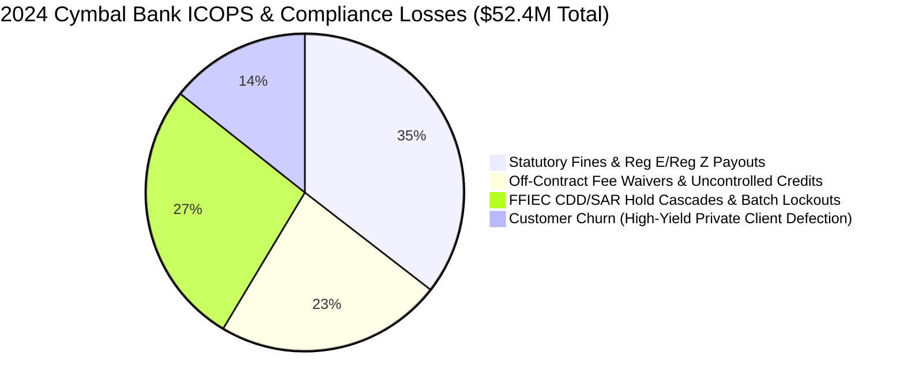
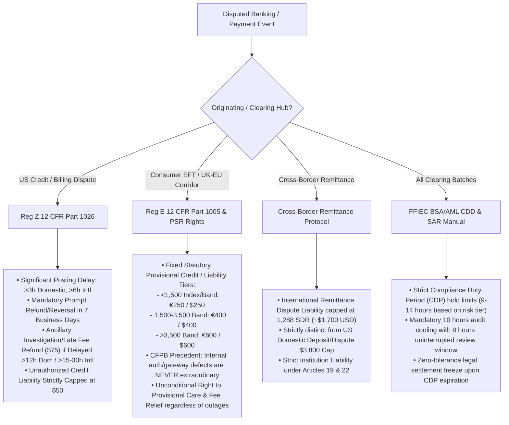

# Cymbal Bank Group — Customer Narrative Brief

### 1.1 Enterprise Profile & Operational Scale
**Cymbal Bank Group** is a premier Tier-1 global retail and commercial banking institution headquartered in New York, New York. Cymbal Bank operates an extensive hub-and-corridor financial network spanning **1,500 daily domestic and international commercial settlement batches** across **20 worldwide operations and compliance hubs**—including primary domestic fortresses (New York [NYC], Charlotte [CLT], Chicago [CHI], Los Angeles [LAX], Atlanta [ATL], Miami [MIA], Denver [DEN], San Francisco [SFO]) and major international clearing stations (London [LON], Paris [PAR], Frankfurt [FRA], Tokyo [TYO], Singapore [SIN], Sydney [SYD], São Paulo [GRU]).

Cymbal Bank generates **\$14.2 billion in annual consumer and commercial banking revenue**, operating an active footprint of 620 retail branches and commercial treasury centers. The bank maintains an active customer relationship database of over 18 million account holders structured across five status tiers (alongside four internal RBAC compliance role tiers—`analyst`, `senior_counsel`, `audit_reviewer`, and `system`):
- **Executive Platinum (Top 1%):** High-yield private banking and corporate treasury clients, responsible for 34% of net interest and fee revenue.
- **Platinum Pro (Top 4%):** Frequent commercial and affluent banking clients.
- **Gold & Silver (15%):** Regular relationship and regional business account holders.
- **General Members (80%):** Everyday retail checking and credit card holders.

### 1.2 The Bleed: Irregular Compliance Operations (ICOPS) & Financial Hemorrhage
Cymbal Bank’s operational Achilles' heel is its acute vulnerability to **Irregular Compliance Operations (ICOPS)** triggered by severe core-banking ledger outages, payment-rail storms, and regulatory audit sweeps (e.g., Northeast grid/telecom blackouts, ACH/Fedwire settlement freezes in Charlotte, and cross-border correspondent liquidity shocks in Europe). In 2024 alone, Cymbal Bank suffered **\$52.4 million in direct ICOPS-related compliance and dispute losses**, driven by four compounding operational failures:

1. **Preventable Statutory Penalties & Provisional Credit Overpayments (\$18.6M):** Frontline compliance and dispute agents misclassify Electronic Fund Transfer (EFT) and billing dispute causality under `Reg_E_Part_1005_Electronic_Fund_Transfers.pdf`. Under legal pressure from consumer rights claims agencies, Cymbal Bank paid out millions in statutory Reg E provisional credit claims on legitimate customer-authorized transfers, while conversely unlawfully rejecting valid unauthorized-transfer claims on accounts that experienced internal authentication gateway token faults prior to external telecom outages.
2. **Runaway Off-Contract Fee Waivers & Liquidity Voucher Waste (\$12.1M):** During core-banking hub outages, desperate branch and contact-center agents issue emergency fee-waiver and bridge-liquidity credits by approving arbitrary third-party wire and external overdraft reimbursements. While Cymbal Bank maintains contracted regional fee-waiver and emergency liquidity caps (\$120–\$140 per incident at NYC and CLT with automated ACH fee-reversal rails), uncoordinated agents approved ad-hoc external bank reimbursement claims at \$450–\$600 per incident, plus uncontrolled \$100+ courtesy stipends.
3. **FFIEC BSA/AML CDD Hold Cascading Lockouts (\$14.2M):** Compliance dispatchers lack real-time predictive visibility into analyst and batch Customer Due Diligence (CDD) and Suspicious Activity Report (SAR) review windows under **`FFIEC_BSA_AML_Examination_Manual_CDD.pdf` (31 CFR Part 1010 / Part 1020)**. High-value settlement batches frequently enter the clearing queue only for the mandatory CDD compliance clock to time out prior to Fedwire cutoff, forcing batch rollbacks, account freezes, and unscheduled settlement lockouts that cascade across the network.
4. **High-Yield Customer Churn (\$7.5M):** During ICOPS outage events, dispute resolution call centers experience average hold times exceeding **4 hours and 15 minutes**. High-yield Executive Platinum clients, stranded without automated provisional credit or correspondent wire re-routing, defect to competing correspondent institutions (JPMorgan Chase, Citibank, HSBC).

### 1.3 The Multi-Jurisdictional Regulatory Maze
Cymbal Bank operates across an extraordinarily complex, multi-jurisdictional legal environment where a single disputed transaction leg may be governed by conflicting statutory regimes:

- **Regulation Z — 12 CFR Part 1026 (`Reg_Z_Part_1026_Truth_in_Lending.pdf`, 2024 Mandate):** Codifies federal Truth in Lending and Fair Credit Billing regulations requiring institutions to issue **automatic, prompt cash/credit refunds within 7 business days** (for electronic/card postings) or 20 days (check/paper) whenever a settlement is canceled or significantly delayed (>3 hours for domestic clearing, >6 hours for international clearing) and the customer declines alternative routing. Under § 1026.13(e), it also mandates the automatic refund of ancillary dispute investigation or late fees (\$75) if verification is not completed within 12 hours (domestic) or 15–30 hours (international).
- **Regulation E — 12 CFR Part 1005 (`Reg_E_Part_1005_Electronic_Fund_Transfers.pdf`) & UK/EU PSR Statutory Compensation:** For all electronic fund transfers and cross-border payment corridors, clearing delays >3 hours or unauthorized transfer claims trigger mandatory fixed provisional credit / statutory compensation tiers: **€250** (<1,500 corridor/exposure index), **€400** (1,500–3,500 index), or **€600** (>3,500 index). Critically, under binding CFPB Official Interpretations and European/UK payment precedent (*CFPB Circular 2024-05* and *Wallentin-Hermann / PSR strict-liability doctrine*), unexpected internal authentication token faults, gateway hardware breakdowns, and compliance staffing shortages are **strictly bank-controllable** and do not constitute "extraordinary circumstances." Furthermore, the **Right to Care** (emergency fee waivers, provisional liquidity vouchers, and correspondent routing) is absolute and unconditional—even during severe regional grid or telecom blackouts.
- **Cross-Border Remittance Convention (Reg E Subpart B / Montreal-Equivalent SDR Protocol):** International remittance and multi-currency billing error liability is capped at **1,288 Special Drawing Rights (SDR)** (approximately \$1,700 USD) under Articles 19 and 22, superseding domestic US consumer deposit rules where provisional dispute liability is capped at \$3,800. Frontline analysts constantly confuse domestic vs. international conventions, causing massive claim overpayments.
- **FFIEC BSA/AML Examination Manual (`FFIEC_BSA_AML_Examination_Manual_CDD.pdf` — 31 CFR Part 1010 / 1020):** Federal anti-money laundering regulations enforcing maximum Compliance Duty Periods (CDP) and pre-clearing hold clocks for compliance analysts and high-risk wire batches. Once a batch's CDP review window expires, the settlement batch cannot move an inch under federal law.

### 1.4 The As-Is Architecture Bottleneck
Why can’t Cymbal Bank solve this with their existing software?
- **Siloed Relational Data:** Transaction and compliance audit statuses live in a legacy Core Banking PSS (`compliance_qa_audit.csv`); customer loyalty tiers, RBAC role mappings (`analyst`, `senior_counsel`, `audit_reviewer`, `system`), and lifetime value reside in an internal CRM (`analyst_user_mapping.csv`); cross-border remittance claims are in a legacy mainframe system (`regulatory_metadata_registry.csv`); and contracted regional partner fee-waiver and liquidity caps are buried in flat files and shared spreadsheets.
- **Unstructured, Dynamic Policies:** Master regulatory and operating manuals (`Reg_E_Part_1005_Electronic_Fund_Transfers.pdf`, `Reg_Z_Part_1026_Truth_in_Lending.pdf`, `FFIEC_BSA_AML_Examination_Manual_CDD.pdf`, `CYMBAL_CONSUMER_DEPOSIT_AND_DISPUTE_MANUAL_v2024_4`, and executive outage directives like `EXECUTIVE_REGULATORY_RELIEF_AND_FEE_WAIVER_ADDENDUM_2025_Q1`) are distributed as 100+ page PDF/Word documents. During core-banking outages, frontline compliance dispatchers and call center agents cannot manually cross-reference an Executive Regulatory Relief Waiver against Basic Checking (`B-bucket`) restrictions or Reg E exposure thresholds, nor can they consistently enforce refusal gates against off-corpus queries (such as retail stock-trading or tax-shelter advice).
- **Security & Data Privacy Leaks:** Customer support agents routinely paste unmasked Case/Account Record Locators (PNR/CNRs), full 16-digit credit/debit card numbers, and passport/government ID details into shared Slack channels and unencrypted ticketing notes to process manual fee waivers and third-party wire reimbursements, causing critical compliance violations under GLBA, GDPR, CCPA, and PCI-DSS.
- **Skyrocketing LLM Operating Costs (Tokenomics):** Initial internal experiments with naive commercial LLMs attempted to dump entire 120-page Consumer Deposit Agreement and Reg E/Z PDFs into the prompt context for every customer inquiry. At 85,000 tokens per call and 60,000 daily queries during major outage sweeps, API costs exploded to over \$15,000/day, while generation latency exceeded 8 seconds per interaction.

### 1.5 Target Vision: Autonomous Regulatory Compliance & Dispute Resolution Agent
Cymbal Bank is engaging Google Cloud to architect, develop, and deploy an **Autonomous Regulatory Compliance Q&A & Dispute Resolution Agent** built on an agent orchestration framework, an analytical compliance operations data store, an enterprise regulatory policy search and retrieval index, and an authenticated enterprise workspace for compliance dispatchers and dispute specialists.

The system must:
1. Orchestrate structured analytical data (compliance audit logs, customer/analyst role profiles, dispute cases, regional hub directories) with unstructured regulatory policies (`Reg_E_Part_1005_Electronic_Fund_Transfers.pdf`, `Reg_Z_Part_1026_Truth_in_Lending.pdf`, `FFIEC_BSA_AML_Examination_Manual_CDD.pdf`).
2. Intelligently route queries between pure SQL analytics, regulatory policy RAG, and complex hybrid multi-hop reasoning, while using intent filters and refusal gates to strictly reject off-corpus queries.
3. Automatically calculate statutory cash/provisional compensation, issue QR-coded fee-waiver and emergency liquidity vouchers within contracted hub caps, and re-endorse cross-border settlements onto correspondent partner banks (JPMorgan Chase, Citibank, HSBC) under SWIFT/ISO 20022 clearinghouse rules.
4. Enforce strict enterprise security via **inline AI guardrails** (PII/PCI masking and prompt injection defense) and an **authenticated enterprise API gateway** with RBAC enforcement.
5. Optimize token economics by **reusing static context** from regulatory manuals instead of re-sending it on every call, and by **date-partitioned, targeted queries** over compliance operations data.
